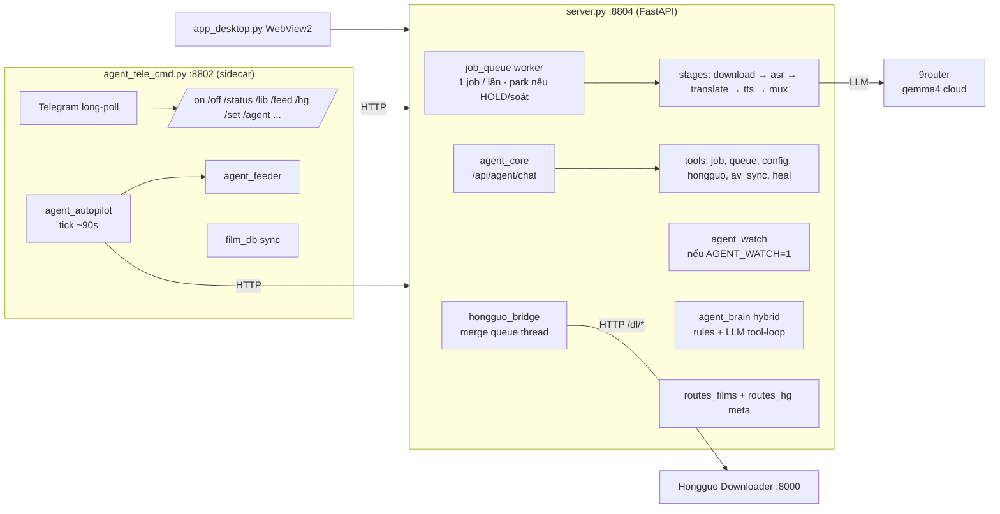

# Kiến trúc PinelineV4

_Cập nhật: 2026-11-10 — queue park HOLD/waiting_review (không nhảy job kế)_

Pipeline lồng tiếng phim Trung → Việt, local Windows. Port từ V2; ops cổng **8804** / sidecar **8802**.

## Tiến trình

| Tiến trình | File chính | Vai trò |
|---|---|---|
| Server :8804 | `server.py` (~5,8k dòng) + `routes_*.py` | Jobs, queue, stage thread, UI, HG, agent hooks, films/meta (một phần trùng sidecar) |
| Sidecar :8802 | `agent_tele_cmd.py`, `agent_autopilot.py`, `agent_feeder.py`, `film_db.py` | Telegram, Auto-pilot, feeder, `/films/*` + `/meta/*` |
| Desktop | `app_desktop.py` | WebView2 bọc server (không dùng Tauri — đã archive) |
| Hongguo :8000 | app ngoài | Tải tập / catalog |
| YT uploader | `Z:\yt_uploader` | Độc lập; đọc films.db |

## Bản đồ module (root `*.py`)

| Nhóm | Module |
|---|---|
| Server / routes | `server`, `config`, `hongguo_bridge`, `routes_ui`, `routes_hg`, `routes_agent`, `routes_films`, `routes_uploader_settings` |
| Pipeline | `download` → `asr*` / `fun_asr_nano` / `nano_fa_asr` / … → `translate` / `llm` / `series_glossary` → `clone_tts` → `assemble` → `render` / `render_fx` / `sfx_lib` / `mux` / `subs` / `media_ts` / `split_parts` / `job_queue` / `batch_config` |
| Agent (server + shared) | `agent_core` (tool-loop + `force_first_tool`), `agent_hongguo`, `agent_heal`, `agent_watch`, `agent_brain` + `agent_brain_context` (Second Brain hybrid), `agent_quality`, `agent_qa_gate`, `agent_name_pass`, `agent_av_sync`, `agent_error_class`, `agent_stage_io` |
| Sidecar / publish | `agent_tele_cmd`, `agent_autopilot`, `agent_feeder`, `film_db`, `auto_publisher`, `meta_studio`, `canva_client`, `preset_switcher` |
| Ops | `restart_server`, `migrate_work`, `lib_check`, `app_desktop` |

## Pipeline 1 job (Studio SOP)

**1 ghế queue / lần:** ASR OK → NMT dịch → REVIEW (Aurora∥ `REVIEW_PARALLEL`, fail → local) → TTS → mux → **Done** → job kế. HOLD/QA → park ghế (không nhảy job). Không CLI review ngoài queue khi studio đang chạy.

| Stage | Module | Output trong `work/<job_id>/` |
|---|---|---|
| download | `download`, `hongguo_bridge` | `source.mp4` hoặc `download.video_path` (direct) |
| asr | `asr`, `fun_asr_nano`, `nano_fa_asr`, … | `asr.json`, `sub.zh.srt` (+ `AUDIO_TS_FIX`) |
| translate + review | `translate` NMT + `run_review` (Aurora∥/local) | `script.json` (`rv`) |
| tts | `clone_tts`, `rvc_bridge` | `tts.json`, `seg_*.wav` |
| assemble | `assemble` | `dub_fit.wav`, `tts_fit.json` |
| mux | `render`, `sfx_lib`, `subs`, … | `output.mp4` |
| split (tuỳ chọn) | `split_parts` | job con `_p01…` → merge `output.mp4` trên cha |

`server` hot-reload `render` (kéo assemble/media_ts/subs) mỗi lần vào bước render. Agent/HG trong process → cần restart :8804.

## Dữ liệu

| Dữ liệu | Vị trí điển hình |
|---|---|
| Job work | `D:\PinelineV4_work\<id>\` (hoặc junction — xem `STATE.md`) |
| Queue / batch | `work/logs/queue.json`, `batch_config.json` |
| films.db | `data/films.db` dưới cây V4 |
| Thư viện nguồn | `D:\Lib\…` |
| Temp | `D:\PinelineV4_tmp` |
| Secret | `pineline.config.json`, OAuth/Canva token (không commit) |

## Config

`config.py` / `cfg(key)`:

1. Key LLM: **`pineline.config.json` thắng env**.
2. Key khác: env (`run_v4.bat`) → file → default code.
3. Job: snapshot `queue_opts` lúc xếp hàng.

## Cấu trúc — nhận xét ngắn

- **Ổn / giữ:** tách `routes_*`, pipeline stage rõ, sidecar Telegram tách process, `scripts/archive` làm attic.
- **Nặng nhưng có chủ đích:** nhiều backend ASR (`fun_asr_nano`, `nano_fa`, `hybrid`, …) — chọn qua config, không xoá khi chưa chốt 1 engine.
- **Còn chồng chéo có chủ đích:** `/films` + `/meta` trên cả :8804 và :8802 (UI desktop vs Telegram).
- **Nợ kỹ thuật:** `server.py` vẫn monolithic (~5,8k dòng) — routes đã tách một phần; không cần flatten thêm trừ khi sửa lớn.
- **Đã bỏ thừa:** launcher V1/V2, PineLine/, Tauri/npm, `index.html` cũ, scratch one-shot → `scripts/archive/`.
