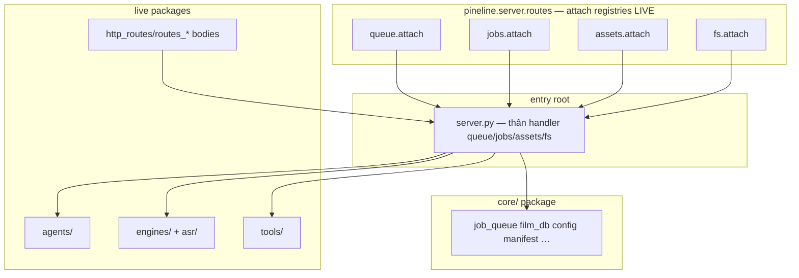

# Kiến trúc PinelineV5

_Cập nhật: 2026-11-06 (eng-swarm skills pointer)_

V5 = workspace refactor từ V4. Production ops có thể vẫn V4 (:8804) tới khi user chuyển hẳn; V5 mặc định **:8805**.

## Tiến trình

| Process | Cổng | Entry |
|---|---|---|
| Server FastAPI | **8805** | `run_v5.bat` (stub → `apps/run_v5.bat`) → `server.py` |
| Desktop WebView2 | **8805** | `app_desktop.py` / `build_desktop.bat` |
| Desktop Tauri | **8805** | `run_tauri.bat` → `src-tauri/` (`devUrl` UI server) |
| Sidecar Telegram | 8802 | `run_tele_cmd.bat` → `apps/` (`PORT=8805` → BASE) |
| Hongguo | 8000 | app ngoài |

## UI HTML

Dashboard / Hongguo / Films / Workflow sống ở **`static/ui/`** (`index3.html`, `hongguo.html`, `films_ui.html`, `workflow.html`). `routes_ui.find_index` và `routes_films` ưu tiên path đó, fallback root/cwd.

## Packages live (Phase B–F)

| Package | Nội dung | Import |
|---|---|---|
| `agents/` | `agent_*.py`, `hongguo_bridge`, `auto_publisher`, `meta_studio`, `canva_client` | `import agents.agent_core as agent_core` |
| `http_routes/` | `routes_ui.py`, `routes_hg.py`, `routes_agent.py`, `routes_films.py`, `routes_uploader_settings.py` | `import http_routes.routes_ui as routes_ui` |
| `engines/asr/` | `asr.py`, `asr_*.py`, `*_asr.py`, `fun_asr_nano`, `paraformer_zh`, … | `import engines.asr.asr as asr` |
| `engines/` (flat) | `download`, `translate`, `llm`, `clone_tts`, `assemble`, `mux`, `render`, `render_fx`, `subs`, `sfx_lib`, `media_ts`, `separate`, `ocr`, `split_parts`, `vram`, `playlist`, `title_mt`, `pronoun_consistency`, `series_glossary`, `translate_alts`, `check_block`, `script_lint` | `import engines.render as render` |
| `tools/` | `lib_check`, `test_channel`, `preset_switcher`, `pick_dirs_dialog`, `migrate_work`, `context_studio/` | `import tools.lib_check as lib_check` |
| `core/` | `config`, `batch_config`, `job_queue`, `job_meta`, `film_db`, `manifest`, `fileio` | `import core.config as config` / `from core.manifest import Manifest` |
| `pineline.server.routes` | Attach registries only: `queue`, `jobs`, `assets`, `fs` | `attach(server_mod)` + `include_router` |

**Entry (root, 3 `.py`):** `server.py`, `app_desktop.py`, `restart_server.py`. **App kernel:** package `core/` (không shim root).

Phase E: rewrite flat import → package; xoá root shim. Phase F: `tools/` + `scripts/install/` + `config/`. Unity: xoá TARGET shells. 2026-11-05: kernel → `core/`; import `core.*`.

## HTTP — nguồn sự thật

### Glossary — bodies vs registry

| Lớp | Vai trò |
|---|---|
| **Attach registry** (`pineline.server.routes.queue/jobs/assets/fs`) | Bảng path → tên hàm; `attach` + `include_router`. Không chứa thân UI/hg/agent/films. |
| **`server.py`** | Thân handler queue/jobs/assets/fs + helper job (xen helper). |
| **`http_routes/`** | Router bodies UI / Hongguo / agent / films / uploader — `include_router` từ `server.py`. |
| **`core/job_queue.py`** | Hàng chờ, `get_job_info` DB-first, `http_queue_state`. |
| **`core/film_db.py` / `core/job_meta.py`** | Chỉ mục metadata UI |
| **`agents/`** | Sidecar / agent / publisher (package live, không nằm trong `pineline/`) |
| **`engines/` (+ `engines/asr/`)** | Pipeline stages |
| **`tools/`** | Ops helpers + context_studio |

Chi tiết field: [`MANIFEST_CONTRACT.md`](MANIFEST_CONTRACT.md).

## Pipeline 1 job

Không đổi so với V4: download → asr → translate → tts → assemble → mux; optional `split_parts` / auto_split. Stages sống ở `engines/` (+ `agents/` cho sidecar).

## Engineering swarm (agent skills)

Song song audit/review V5 dùng roster dưới `.cursor/skills/v5-eng-swarm` (orchestrator) cùng các skill con `v5-vuln-hunter`, `v5-critical-bug-hunter`, `v5-invariants-monitor`, `v5-part-atomizer`, `v5-test-coverage`, `v5-pr-reviewer`, `v5-autofix-safe`, `v5-docs-generator`. Báo cáo first-run: [`reviews/2026-11-06-v5-eng-swarm.md`](reviews/2026-11-06-v5-eng-swarm.md); part map: [`reviews/2026-11-06-v5-part-atoms.md`](reviews/2026-11-06-v5-part-atoms.md). Index: [`reviews/README.md`](reviews/README.md).

## Dữ liệu V5

| Mục | Path |
|---|---|
| Code | `Z:\PinelineV5` |
| Temp | `D:\PinelineV5_tmp` |
| Work | `D:\PinelineV5_work` (hoặc junction `work/`) |
| Config/secret | `pineline.config.json` root (không commit); mẫu trong `config/` |
| Films index | `data/films.db` |
