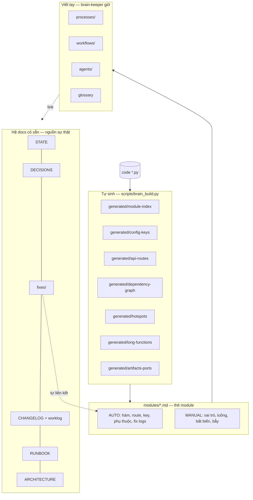

# 🧠 Second Brain — PinelineV5

_Cập nhật: 2026-11-11 — khởi tạo hệ thống (brain_build + 7 subagent dev)._

Bộ nhớ dài hạn về **code / quy trình / workflow** của Pineline, dùng chung cho người và AI agent (Claude Code subagents, Cursor). Mục tiêu: trả lời "cái này ở đâu, chạy thế nào, từng hỏng chưa, ai quyết" **trong 30 giây, có nguồn**, không phải đọc lại `server.py` 6,6k dòng.

> Không nhầm với **`agent_brain`** (daemon runtime "Second Brain" tự heal job — xem [agents/runtime-agents.md](./agents/runtime-agents.md)). Thư mục này là tri thức cho **người phát triển**.

## Bản đồ



| Muốn biết | Mở |
|---|---|
| Module X làm gì, ai gọi, bẫy gì | `modules/X.md` · danh sách: [generated/module-index.md](./generated/module-index.md) |
| Config key đọc ở đâu | [generated/config-keys.md](./generated/config-keys.md) |
| API route nào ở file nào (và route trùng ⚠️) | [generated/api-routes.md](./generated/api-routes.md) |
| File `manifest.json`/`script.json`… module nào đụng; cổng nào | [generated/artifacts-ports.md](./generated/artifacts-ports.md) |
| Ai phụ thuộc ai, code chết | [generated/dependency-graph.md](./generated/dependency-graph.md) |
| Nên soi bug/refactor ở đâu trước | [generated/hotspots.md](./generated/hotspots.md), [generated/long-functions.md](./generated/long-functions.md) |
| 1 job chạy từ đầu tới cuối thế nào | [processes/job-pipeline.md](./processes/job-pipeline.md) |
| Queue, ghế 1 job, HOLD/park | [processes/queue-studio-sop.md](./processes/queue-studio-sop.md) |
| Dịch → NMT → REVIEW → QA | [processes/translate-review.md](./processes/translate-review.md) |
| Quy trình sửa code/fix bug/review | [workflows/](./workflows/) |
| Agent runtime (brain, heal, watch, autopilot…) | [agents/runtime-agents.md](./agents/runtime-agents.md) |
| Đội subagent dev (bug-hunter, reviewer…) | [agents/dev-team.md](./agents/dev-team.md) |
| Thuật ngữ (rv, HOLD, park, Aurora∥, Pass1…) | [glossary.md](./glossary.md) |
| Hiện trạng · quyết định · lịch sử | [../STATE.md](../STATE.md) · [../DECISIONS.md](../DECISIONS.md) · [../CHANGELOG.md](../CHANGELOG.md) · [../fixes/](../fixes/) |

## Nguyên tắc

1. **Một nguồn sự thật cho mỗi loại tri thức.** Brain *trỏ link* tới STATE/DECISIONS/fixes, không chép lại.
2. **Code thắng docs.** Brain lệch code → chạy sync, không sửa code cho khớp docs.
3. **Tự động cái máy làm được** (`generated/`, khối AUTO), **viết tay cái cần hiểu** (vai trò, bất biến, bẫy, quy trình).
4. **Mọi khẳng định có `file.py` + `hàm()`.** Chưa chắc → ghi `(chưa xác minh)`.
5. **Không secret.** Chỉ tên key/tên file.

## Cập nhật brain

```bat
python scripts\brain_build.py            :: làm mới phần tự động (giữ MANUAL) ~2 giây
python scripts\brain_build.py --check    :: module đổi / mới / xoá / chưa có MANUAL
python scripts\brain_build.py --module translate   :: in nhanh 1 thẻ cho agent
```

Trong Claude Code: `/brain-sync` (sau khi sửa code) · `/brain-sync enrich 8` (viết thêm thẻ) · `/ask-brain <câu hỏi>`.

Bắt buộc: sau mỗi lần sửa code, bước cuối của rule `docs-on-change` là sync brain cho module đã đổi.

## Nhật ký brain

- 2026-11-11 — Khởi tạo: `scripts/brain_build.py`, thẻ module tự sinh, processes/workflows/agents/glossary, 7 subagent `.claude/agents/`, 7 slash command `.claude/commands/`.
