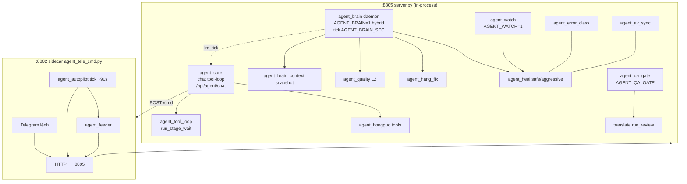

# Agent runtime của Pineline (chạy trong production)

_Cập nhật: 2026-11-11. Nguồn: docstring module, `docs/design/2026-11-09-second-brain-agent.md`, `README_V2.md`, STATE. Chi tiết từng module: thẻ trong `../modules/`._

| Agent | Kích hoạt | Được làm gì (mutate) | Log / dấu vết | Thẻ |
|---|---|---|---|---|
| `agent_core` | Chat UI/Telegram `/agent` | job/queue/config/hongguo/heal/av_sync tools; confirm trừ khi lệnh rõ | manifest.agent, chat history | [agent_core](../modules/agent_core.md) |
| `agent_tool_loop` | Tool của core/brain | chạy stage và **chờ** kết quả (poll manifest) | log stage | [agent_tool_loop](../modules/agent_tool_loop.md) |
| `agent_brain` | Daemon `AGENT_BRAIN=1`, `MODE=hybrid` | L0 infra → L1 heal → L2 quality heal → HOLD → L3 (restart llama/preset/re-review) theo cooldown; **silent** (`require_confirm=False`) | `work/logs/agent_brain.log`, `agent_brain_state.json`, `work/<job>/qa_brain.json`, Telegram minimal | [agent_brain](../modules/agent_brain.md) |
| `agent_quality` | Gọi bởi brain | scan VI deterministic + safe heals | `qa_brain.json` | [agent_quality](../modules/agent_quality.md) |
| `agent_hang_fix` | Cuối `run_review` + brain | LLM trace/plan cho câu hang, ghi VI, `hang_ack` | `qa_hang_trace.json` | [agent_hang_fix](../modules/agent_hang_fix.md) |
| `agent_heal` | brain / watch / autopilot / tool | safe: stale running, dịch trống, TTS thiếu clip, mux lại; aggressive: ASR/TTS force | manifest | [agent_heal](../modules/agent_heal.md) |
| `agent_watch` | `AGENT_WATCH=1`, `AGENT_WATCH_SEC` | scan → heal safe khi GPU rảnh, cooldown fingerprint | `agent_watch.log` | [agent_watch](../modules/agent_watch.md) |
| `agent_qa_gate` | Sau translate (`AGENT_QA_GATE`, mặc định 1) | review → diff → pass mới TTS; fail → `qa_blocked` | manifest.agent | [agent_qa_gate](../modules/agent_qa_gate.md) |
| `agent_name_pass` / `agent_pronoun_pass` | `manifest.agent.review_request` | sửa tên riêng / xưng hô theo glossary | `script.pre_agent_review.json` | thẻ tương ứng |
| `agent_av_sync` | tool / heal | chẩn đoán lệch sub/audio, audio cụt | — | [agent_av_sync](../modules/agent_av_sync.md) |
| `agent_autopilot` | Sidecar, `/on` `/off` | queue need_queue + heal safe qua HTTP | log sidecar | [agent_autopilot](../modules/agent_autopilot.md) |
| `agent_feeder` | Autopilot khi hàng trống | thêm job mới (lib_merged, auto_merge, hongguo…) | log sidecar | [agent_feeder](../modules/agent_feeder.md) |
| `agent_tele_cmd` | Process :8802 | lệnh Telegram, `/films`, `/meta`, film_db sync | `data/tele_chat_history.json` | [agent_tele_cmd](../modules/agent_tele_cmd.md) |

## Chồng chéo cần để ý (đầu vào cho `agent-architect`)

- **Ba nguồn heal tự động**: `agent_brain` (L1), `agent_watch`, `agent_autopilot` — cùng gọi `agent_heal`. Debug "ai đã heal job này?" → đọc cả 3 log.
- **Hai đường vào queue tự động**: brain (L3) và autopilot/feeder (sidecar).
- **REVIEW có thể được kích từ**: `_auto_gpu` (ghế), `agent_qa_gate`, `_run_requested_review`, brain L3 force re-review.
