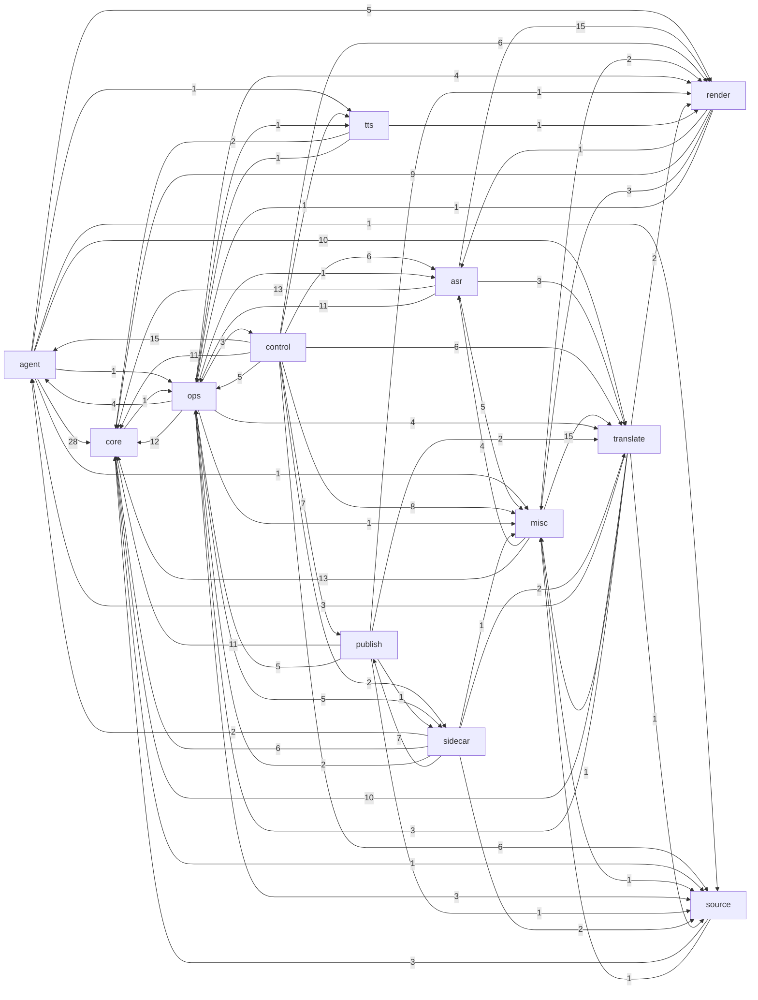

# Phụ thuộc giữa các lớp

_Sinh tự động bởi `scripts/brain_build.py` lúc 2026-11-17 19:05. Đừng sửa tay — chạy lại script._

Cạnh A → B = module lớp A import module lớp B (số = số cặp module).

## Ngược chiều đáng chú ý

Lớp pipeline/media (`source/asr/translate/tts/render`) import ngược `control`/`agent` là dấu hiệu coupling cần xem.

- [engines.pronoun_consistency](../modules/engines.pronoun_consistency.md) → [agents.agent_pronoun_pass](../modules/agents.agent_pronoun_pass.md)
- [engines.script_lint](../modules/engines.script_lint.md) → [agents.agent_name_pass](../modules/agents.agent_name_pass.md)
- [engines.translate](../modules/engines.translate.md) → [agents.agent_hang_fix](../modules/agents.agent_hang_fix.md)

## Fan-in / fan-out

| Module | Fan-in (được import) | Fan-out (import) | Hot-reload |
|---|---:|---:|---|
| [server](../modules/server.md) | 5 | 37 |  |
| [engines.translate](../modules/engines.translate.md) | 14 | 15 |  |
| [core.manifest](../modules/core.manifest.md) | 34 | 1 |  |
| [core.config](../modules/core.config.md) | 36 | 0 |  |
| [engines.llm](../modules/engines.llm.md) | 21 | 2 |  |
| [engines.translate_simple.pipeline](../modules/engines.translate_simple.pipeline.md) | 0 | 21 |  |
| [core.film_db](../modules/core.film_db.md) | 16 | 2 |  |
| [agents.agent_brain](../modules/agents.agent_brain.md) | 2 | 14 |  |
| [agents.agent_tele_cmd](../modules/agents.agent_tele_cmd.md) | 3 | 18 |  |
| [engines.subs](../modules/engines.subs.md) | 20 | 1 |  |
| [engines.render](../modules/engines.render.md) | 4 | 10 |  |
| [agents.agent_core](../modules/agents.agent_core.md) | 4 | 11 |  |
| [agents.hongguo_bridge](../modules/agents.hongguo_bridge.md) | 12 | 5 |  |
| [engines.translate_simple.stage_draft](../modules/engines.translate_simple.stage_draft.md) | 2 | 11 |  |
| [engines.asr.asr](../modules/engines.asr.asr.md) | 6 | 7 |  |
| [engines.translate_simple.cfg](../modules/engines.translate_simple.cfg.md) | 9 | 3 |  |
| [engines.translate_simple.stage_review](../modules/engines.translate_simple.stage_review.md) | 4 | 6 |  |
| [engines.vram](../modules/engines.vram.md) | 16 | 0 |  |
| [core.fileio](../modules/core.fileio.md) | 15 | 0 |  |
| [core.job_queue](../modules/core.job_queue.md) | 9 | 0 |  |
| [agents.agent_hang_fix](../modules/agents.agent_hang_fix.md) | 5 | 6 |  |
| [engines.series_glossary](../modules/engines.series_glossary.md) | 5 | 3 |  |
| [engines.source_preflight](../modules/engines.source_preflight.md) | 11 | 3 |  |
| [engines.translate_simple.script_store](../modules/engines.translate_simple.script_store.md) | 7 | 2 |  |
| [engines.asr.fun_asr_nano](../modules/engines.asr.fun_asr_nano.md) | 7 | 7 |  |
| [engines.cloud_retry](../modules/engines.cloud_retry.md) | 4 | 2 |  |
| [engines.translate_simple.plan_view](../modules/engines.translate_simple.plan_view.md) | 7 | 0 |  |
| [agents.agent_heal](../modules/agents.agent_heal.md) | 5 | 3 |  |
| [agents.agent_hold](../modules/agents.agent_hold.md) | 6 | 4 |  |
| [agents.agent_watch](../modules/agents.agent_watch.md) | 9 | 3 |  |
| [agents.auto_publisher](../modules/agents.auto_publisher.md) | 4 | 6 |  |
| [engines.media_ts](../modules/engines.media_ts.md) | 8 | 2 |  |
| [engines.separate](../modules/engines.separate.md) | 3 | 5 |  |
| [http_routes.routes_agent](../modules/http_routes.routes_agent.md) | 1 | 11 |  |
| [agents.agent_qa_ask](../modules/agents.agent_qa_ask.md) | 3 | 8 |  |
| [agents.agent_quality](../modules/agents.agent_quality.md) | 6 | 3 |  |
| [engines.pronoun_consistency](../modules/engines.pronoun_consistency.md) | 2 | 5 |  |
| [agents.meta_studio](../modules/agents.meta_studio.md) | 4 | 5 |  |
| [engines.asr.firered_asr](../modules/engines.asr.firered_asr.md) | 0 | 9 |  |
| [engines.split_parts](../modules/engines.split_parts.md) | 3 | 4 |  |

## Không ai import và không ai nhắc tên file (ứng viên code chết — kiểm .bat/UI trước khi xoá)

[agents.__init__](../modules/agents.__init__.md), [app_desktop](../modules/app_desktop.md), [core.__init__](../modules/core.__init__.md), [engines.__init__](../modules/engines.__init__.md), [engines.asr.__init__](../modules/engines.asr.__init__.md), [engines.translate_simple.__init__](../modules/engines.translate_simple.__init__.md), [http_routes.__init__](../modules/http_routes.__init__.md), [pineline.__init__](../modules/pineline.__init__.md), [pineline.server.__init__](../modules/pineline.server.__init__.md), [pineline.server.routes.__init__](../modules/pineline.server.routes.__init__.md), [pineline.server.routes.assets](../modules/pineline.server.routes.assets.md), [pineline.server.routes.fs](../modules/pineline.server.routes.fs.md), [tools.__init__](../modules/tools.__init__.md), [tools.asr_boundary_scan](../modules/tools.asr_boundary_scan.md), [tools.collect_manual_edits](../modules/tools.collect_manual_edits.md), [tools.context_studio.__init__](../modules/tools.context_studio.__init__.md), [tools.context_studio.app_streamlit](../modules/tools.context_studio.app_streamlit.md), [tools.simple_stats](../modules/tools.simple_stats.md)
