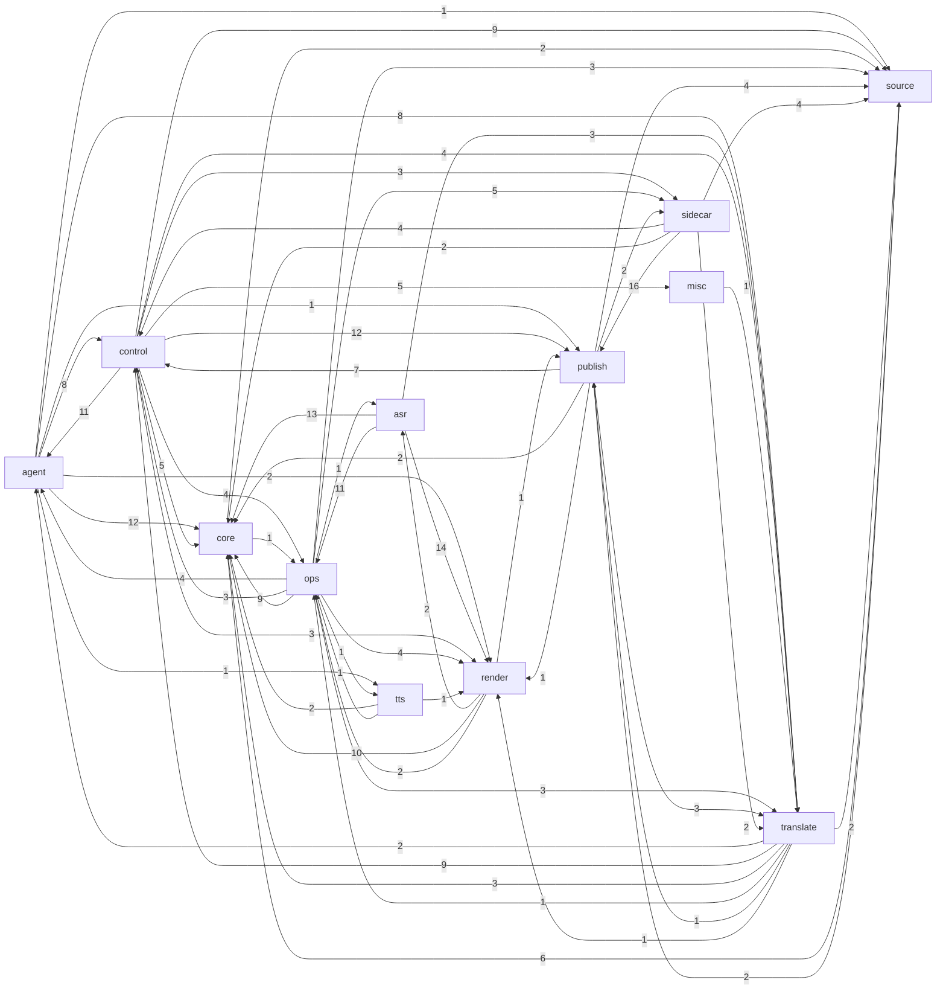

# Phụ thuộc giữa các lớp

_Sinh tự động bởi `scripts/brain_build.py` lúc 2026-11-11 02:38. Đừng sửa tay — chạy lại script._

Cạnh A → B = module lớp A import module lớp B (số = số cặp module).

## Ngược chiều đáng chú ý

Lớp pipeline/media (`source/asr/translate/tts/render`) import ngược `control`/`agent` là dấu hiệu coupling cần xem.

- [translate](../modules/translate.md) → [agent_hang_fix](../modules/agent_hang_fix.md)
- [translate](../modules/translate.md) → [batch_config](../modules/batch_config.md)
- [engines.script_lint](../modules/engines.script_lint.md) → [agents.agent_name_pass](../modules/agents.agent_name_pass.md)

## Fan-in / fan-out

| Module | Fan-in (được import) | Fan-out (import) | Hot-reload |
|---|---:|---:|---|
| [server](../modules/server.md) | 7 | 17 |  |
| [core.manifest](../modules/core.manifest.md) | 23 | 1 |  |
| [film_db](../modules/film_db.md) | 19 | 2 |  |
| [core.config](../modules/core.config.md) | 19 | 0 |  |
| [hongguo_bridge](../modules/hongguo_bridge.md) | 11 | 8 |  |
| [agents.hongguo_bridge](../modules/agents.hongguo_bridge.md) | 8 | 8 |  |
| [core.film_db](../modules/core.film_db.md) | 9 | 4 |  |
| [agents.agent_core](../modules/agents.agent_core.md) | 3 | 10 |  |
| [engines.subs](../modules/engines.subs.md) | 15 | 1 |  |
| [config](../modules/config.md) | 15 | 0 |  |
| [engines.render](../modules/engines.render.md) | 3 | 9 |  |
| [engines.translate](../modules/engines.translate.md) | 6 | 6 |  |
| [engines.vram](../modules/engines.vram.md) | 15 | 0 |  |
| [engines.asr.fun_asr_nano](../modules/engines.asr.fun_asr_nano.md) | 7 | 7 |  |
| [translate](../modules/translate.md) | 3 | 8 |  |
| [engines.asr.asr](../modules/engines.asr.asr.md) | 6 | 6 |  |
| [agent_tele_cmd](../modules/agent_tele_cmd.md) | 2 | 10 | meta_studio, test_channel |
| [render](../modules/render.md) | 2 | 9 |  |
| [agents.agent_tele_cmd](../modules/agents.agent_tele_cmd.md) | 2 | 10 | hongguo_bridge, meta_studio, test_channel |
| [engines.llm](../modules/engines.llm.md) | 8 | 2 |  |
| [meta_studio](../modules/meta_studio.md) | 6 | 5 |  |
| [auto_publisher](../modules/auto_publisher.md) | 5 | 5 |  |
| [llm](../modules/llm.md) | 9 | 1 |  |
| [engines.asr.paraformer_zh](../modules/engines.asr.paraformer_zh.md) | 1 | 9 |  |
| [http_routes.routes_agent](../modules/http_routes.routes_agent.md) | 0 | 9 |  |
| [core.job_queue](../modules/core.job_queue.md) | 5 | 0 |  |
| [scripts.check_batch4](../modules/scripts.check_batch4.md) | 0 | 9 |  |
| [agents.auto_publisher](../modules/agents.auto_publisher.md) | 1 | 5 |  |
| [engines.assemble](../modules/engines.assemble.md) | 8 | 0 |  |
| [engines.media_ts](../modules/engines.media_ts.md) | 8 | 1 |  |
| [http_routes.routes_uploader_settings](../modules/http_routes.routes_uploader_settings.md) | 0 | 9 |  |
| [agent_hang_fix](../modules/agent_hang_fix.md) | 4 | 4 |  |
| [batch_config](../modules/batch_config.md) | 6 | 1 |  |
| [job_queue](../modules/job_queue.md) | 6 | 0 |  |
| [engines.asr.asr_spam](../modules/engines.asr.asr_spam.md) | 6 | 2 |  |
| [engines.asr.hybrid_asr](../modules/engines.asr.hybrid_asr.md) | 0 | 8 |  |
| [agent_brain](../modules/agent_brain.md) | 1 | 6 |  |
| [agent_core](../modules/agent_core.md) | 2 | 5 |  |
| [agent_feeder](../modules/agent_feeder.md) | 3 | 4 |  |
| [agent_quality](../modules/agent_quality.md) | 4 | 2 |  |

## Không ai import và không ai nhắc tên file (ứng viên code chết — kiểm .bat/UI trước khi xoá)

[agents.__init__](../modules/agents.__init__.md), [agents.agent_pronoun_pass](../modules/agents.agent_pronoun_pass.md), [agents.hongguo_license_ensure](../modules/agents.hongguo_license_ensure.md), [agents.test_channel](../modules/agents.test_channel.md), [app_desktop](../modules/app_desktop.md), [core.__init__](../modules/core.__init__.md), [engines.__init__](../modules/engines.__init__.md), [engines.asr.__init__](../modules/engines.asr.__init__.md), [engines.asr.asr_fix_align](../modules/engines.asr.asr_fix_align.md), [engines.asr.hardsub_asr](../modules/engines.asr.hardsub_asr.md), [engines.hv_auditor](../modules/engines.hv_auditor.md), [engines.mt_zh_vi](../modules/engines.mt_zh_vi.md), [engines.playlist](../modules/engines.playlist.md), [engines.script_lint](../modules/engines.script_lint.md), [engines.series_glossary](../modules/engines.series_glossary.md), [http_routes.__init__](../modules/http_routes.__init__.md), [pineline.__init__](../modules/pineline.__init__.md), [pineline.server.__init__](../modules/pineline.server.__init__.md), [pineline.server.routes.__init__](../modules/pineline.server.routes.__init__.md), [pineline.server.routes.assets](../modules/pineline.server.routes.assets.md), [pineline.server.routes.fs](../modules/pineline.server.routes.fs.md), [tools.__init__](../modules/tools.__init__.md), [tools.context_studio.__init__](../modules/tools.context_studio.__init__.md), [tools.context_studio.app_streamlit](../modules/tools.context_studio.app_streamlit.md)
