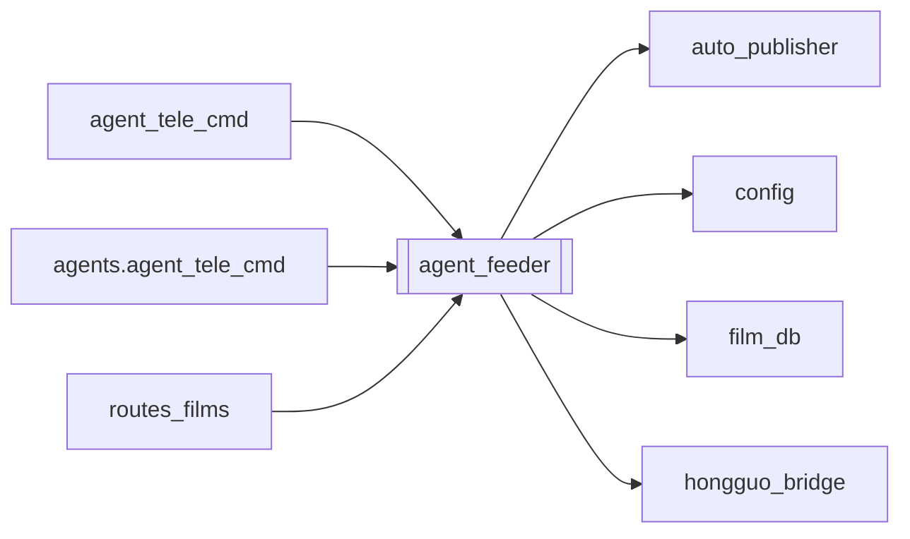

# `agent_feeder`

[← Index](../generated/module-index.md) · [Brain home](../README.md)

<!-- AUTO:START — sinh bởi scripts/brain_build.py 2026-11-11 02:38. Đừng sửa tay khối này. -->
**File:** `agent_feeder.py` · **Lớp:** `sidecar` · **2065 dòng** (1821 code) · **68 hàm**, **0 class** · sha1 `08a3b066a9`

> Feeder + Run-watch cho Auto-pilot (chạy trong sidecar :8802, chỉ gọi API :8801). Feeder — khi hàng chờ trống, không job nào chạy/chờ → thêm job mới theo "yêu cầu" (spec): lib_merged : file (merged) trong thư viện Hongguo

### Phụ thuộc

- **Gọi tới (import nội bộ):** [auto_publisher](./auto_publisher.md), [config](./config.md), [film_db](./film_db.md), [hongguo_bridge](./hongguo_bridge.md)
- **Được dùng bởi:** [agent_tele_cmd](./agent_tele_cmd.md), [agents.agent_tele_cmd](./agents.agent_tele_cmd.md), [routes_films](./routes_films.md)
- **Test:** ❌ chưa có test import trực tiếp
- **Thư viện ngoài:** `agent_autopilot`, `psutil`, `requests`

### Hàm & class top-level

| Tên | Dòng | Dài | Tham số | Docstring |
|---|---:|---:|---|---|
| `_now_s` | 54 | 2 | `` |  |
| `_today` | 58 | 2 | `` |  |
| `load_state` | 64 | 17 | `` |  |
| `save_state` | 83 | 4 | `st` |  |
| `normalize_spec` | 89 | 29 | `d` |  |
| `describe_spec` | 120 | 21 | `s` |  |
| `_get` | 145 | 4 | `base, path, timeout, **params` |  |
| `_post` | 151 | 2 | `base, path, body, timeout` |  |
| `_hg` | 157 | 3 | `` |  |
| `_job_manifests` | 162 | 13 | `` |  |
| `_norm` | 177 | 2 | `p` |  |
| `imported_paths` | 181 | 8 | `` | Nguồn đã làm: job hiện có + database (kể cả job đã xoá thư mục). |
| `lib_root` | 191 | 13 | `spec` |  |
| `_match` | 206 | 5 | `spec, *texts` |  |
| `library` | 213 | 31 | `base` |  |
| `candidates` | 246 | 59 | `base, st, items, manual` | Phim (merged) chưa làm job, đã lọc + sắp: gom theo bộ, trong bộ theo thứ tự mùa. |
| `_db_series_info` | 309 | 15 | `` | series → {done, uploaded, max_season} từ database phim. |
| `group_score` | 326 | 35 | `core, seasons, st, info` | Điểm gợi ý 1 bộ: nối mạch bộ đang làm > mùa kế tiếp > đủ mùa sẵn > mới tải. |
| `_season_no` | 363 | 3 | `s` |  |
| `_probe_dur` | 368 | 19 | `path, st` |  |
| `process_ratio` | 389 | 21 | `` | Thời gian xử lý / thời lượng phim — trung vị từ lịch sử các job xong liên tiếp. |
| `_translate` | 412 | 12 | `base, titles, st` |  |
| `library_view` | 426 | 116 | `base` | Tab «Thư viện chưa làm»: bộ có mùa ghép sẵn chưa làm job hoặc còn tập lẻ chờ ghép, kèm điểm gợi ý. |
| `library_action` | 544 | 145 ⚠️ | `base, action, names, cores` |  |
| `_probe_stream_meta` | 693 | 30 | `path` | Lấy width, height, vcodec, duration của 1 file video. |
| `_concat_videos_smart` | 725 | 173 ⚠️ | `inputs, out_mp4` | Nối danh sách file MP4 thành 1 file out_mp4 duy nhất. |
| `_sanitize_folder_name` | 900 | 3 | `name` |  |
| `combine_library_seasons` | 905 | 151 ⚠️ | `base, names, cores, move_to_trash, add_to_queue` | Gộp nhiều mùa (SS1 + SS2 + SS3...) trong thư viện D:\Lib thành 1 thư mục phim duy nhất |
| `_fmt_srt_ts` | 1058 | 7 | `sec` |  |
| `_combine_parse_cn_int` | 1073 | 18 | `s` |  |
| `_combine_part_num` | 1093 | 35 | `*texts` | Bóc số phần từ title_vi / title_zh / name / job_id. |
| `_part_sort_key` | 1130 | 15 | `jid, manifest` | (part, created_at, job_id). Thiếu số phần → 0. |
| `combine_rendered_jobs` | 1147 | 200 ⚠️ | `base, job_ids, custom_title_vi, auto_publish, preserve_order, allow…` | Nối các Job ĐÃ RENDER xong (work/<jid>/output.mp4) thành 1 Job video dài hoàn chỉnh |
| `pick` | 1349 | 9 | `spec, cands` |  |
| `_have` | 1360 | 2 | `spec, cands` |  |
| `_existing_group` | 1366 | 6 | `core` |  |
| `add_jobs` | 1374 | 37 | `base, chosen` | Tạo job local cho từng file, gom nhóm theo bộ, rồi xếp hàng theo config batch. |
| `_merge_busy` | 1415 | 6 | `base` |  |
| `_hg_status` | 1423 | 5 | `base` |  |
| `_downloading_sids` | 1430 | 10 | `hg_st` | series_id đang tải dở. /dl/status trả khoá «sid» (không phải series_id) và giữ cả bộ đã xong. |
| `mergeable` | 1442 | 15 | `spec, items, hg_st` |  |
| `hongguo_pick` | 1459 | 30 | `base, spec, items, k` |  |
| `prefetch` | 1491 | 36 | `base, st, items, n_cands` |  |
| `pipeline_idle` | 1531 | 5 | `brief` |  |
| `feed_tick` | 1538 | 33 | `base, force` | 1 vòng: prefetch (ghép/tải) + nếu pipeline rảnh thì thêm job. force=True: thêm ngay kể cả đang chạy. |
| `preview` | 1573 | 16 | `base` |  |
| `_llm_cfg` | 1612 | 5 | `` | Cùng nguồn với agent chat (config.agent_llm): sidecar không còn cần key trong .bat. |
| `_extract_json` | 1619 | 4 | `text` |  |
| `parse_request_llm` | 1625 | 22 | `text, cur` |  |
| `parse_request_rules` | 1649 | 29 | `text` |  |
| `set_request` | 1680 | 15 | `text` |  |
| `_server_tree_cpu` | 1699 | 25 | `lib` | Tổng CPU-seconds của server :8801 + tiến trình con (bỏ ffmpeg ghép thư viện Hongguo). |
| `_job_activity` | 1726 | 13 | `job_id` |  |
| `_running_stage` | 1741 | 9 | `job_id` |  |
| `_running_jobs` | 1752 | 12 | `base` |  |
| `_fmt_dur` | 1766 | 4 | `sec` |  |
| `_requeue_front` | 1772 | 14 | `base, job_id, m` |  |
| `runwatch_tick` | 1788 | 75 | `base, heal, notify` | Kiểm job đang chạy. notify(text) để báo. heal=True: tự stop + xếp lại khi treo. |
| `running_text` | 1865 | 32 | `base` |  |
| `lib_verb` | 1913 | 4 | `word` | Động từ /lib làm thay đổi trạng thái (add/priority/…) hoặc None. |
| `_fold` | 1919 | 4 | `s` |  |
| `lib_key` | 1925 | 3 | `core` |  |
| `_lib_find` | 1930 | 17 | `groups, token` | token = số thứ tự (theo /lib gần nhất) · key nút bấm · tên gốc / tên Việt (không dấu cũng được). |
| `_lib_line` | 1949 | 6 | `i, g` |  |
| `_lib_buttons` | 1957 | 12 | `g, i` |  |
| `_lib_detail` | 1971 | 14 | `g` |  |
| `lib_command` | 1987 | 68 | `base, arg` | /lib [all / <số/tên> / add/star/unstar/skip/unskip/merge <số/tên> ...] → (text, nút inline). |
| `lib_callback` | 2057 | 9 | `base, data` | Nút inline «lib:<action>:<key>». |

**Hàm dài ≥120 dòng:** `combine_rendered_jobs` (200, L1147), `_concat_videos_smart` (173, L725), `combine_library_seasons` (151, L905), `library_action` (145, L544)

### Config / env keys (2)

`RUNWATCH_MAX_HEAL`, `RUNWATCH_STUCK_MIN`

**Cổng nhắc tới:** 8802

**File/artifact nhắc tới:** `.partial.mp4`, `.series.json`, `_sample90s.mp4`, `feeder_state.json`, `list_mp4.txt`, `list_ts.txt`, `manifest.json`, `output.mp4`, `script.json`, `sub.vi.srt`

**Tín hiệu rủi ro (đếm tĩnh):** broad_except=40 · file_writes=5 · global_stmt=1 · sleep=1 · subprocess=8 · swallow_except=20

### Lịch sử (từ docs/)

- **Fix logs (7):**
  - [Films UI thiếu nút gộp job đã làm (combine)](../../fixes/2026-11-07-films-combine-ui.md)
  - [Gộp job encode lại cả loạt dù chỉ 1 phần lệch resolution](../../fixes/2026-11-07-concat-partial-norm.md)
  - [Gộp job đã làm nối sai thứ tự Phần](../../fixes/2026-11-07-combine-part-order.md)
  - [`/library/action` crash — gọi API film_db không tồn tại](../../fixes/2026-11-02-library-action-missing-api.md)
  - [2026-10-06 — Đợt 5 review: agent an toàn hơn](../../fixes/2026-10-06-batch5-agent-safety.md)
  - [2026-10-06 — Đợt 2 review: bảo mật + config một nguồn + LLM sập không để trống câu](../../fixes/2026-10-06-batch2-security.md)
  - [Đợt 1 — chặn mất dữ liệu (review 6/10)](../../fixes/2026-10-06-batch1-data-loss.md)
- **Reviews:** [_atoms_http_agents](../../reviews/_atoms_http_agents.md), [2026-11-06-v5-part-atoms](../../reviews/2026-11-06-v5-part-atoms.md), [2026-11-06-v5-func-catalog](../../reviews/2026-11-06-v5-func-catalog.md), [2026-11-02-v4-structure-sync](../../reviews/2026-11-02-v4-structure-sync.md), [2026-11-02-v4-structure-and-v2-port](../../reviews/2026-11-02-v4-structure-and-v2-port.md), [2026-10-06-code-review](../../reviews/2026-10-06-code-review.md)
- Nhắc trong CHANGELOG: **7** lần · DECISIONS: **0** lần

<!-- AUTO:END -->

<!-- MANUAL:START -->
## Vai trò (viết tay)

_Chưa viết. 2–4 câu: module này chịu trách nhiệm gì trong pipeline, ai gọi nó, nó KHÔNG làm gì._

## Luồng chính

_Các hàm vào (entry) → bước chính → output/side effect. Ghi tên hàm thật._

## Bất biến & hợp đồng

_Điều luôn phải đúng (vd: chỉ ghi manifest qua `Manifest.update`; 1 job / ghế). Vi phạm = bug._

## Bẫy đã biết

_Lỗi từng gặp + link `docs/fixes/...`. Những chỗ dễ sửa sai._

## Ghi chú vận hành

_Config key quan trọng, cần restart gì khi sửa (:8801 / :8802 / hot-reload), cách test._
<!-- MANUAL:END -->
