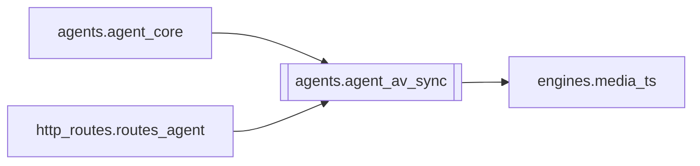

# `agents.agent_av_sync`

[← Index](../generated/module-index.md) · [Brain home](../README.md)

<!-- AUTO:START — sinh bởi scripts/brain_build.py 2026-11-11 02:38. Đừng sửa tay khối này. -->
**File:** `agents/agent_av_sync.py` · **Lớp:** `agent` · **567 dòng** (518 code) · **11 hàm**, **0 class** · sha1 `7dc879ae29`

> AV sync diagnose + heal — phát hiện lệch sub/audio / audio cụt sau mux. Các class chính: audio_truncated  — tiếng chết giữa phim (duck_bgm -shortest cũ)

### Phụ thuộc

- **Gọi tới (import nội bộ):** [engines.media_ts](./engines.media_ts.md)
- **Được dùng bởi:** [agents.agent_core](./agents.agent_core.md), [http_routes.routes_agent](./http_routes.routes_agent.md)
- **Test:** ❌ chưa có test import trực tiếp

### Hàm & class top-level

| Tên | Dòng | Dài | Tham số | Docstring |
|---|---:|---:|---|---|
| `_ffprobe_dur` | 22 | 16 | `path, stream` |  |
| `_rms_at` | 40 | 28 | `video, t, dur` |  |
| `_tts_fit_stats` | 70 | 29 | `work` |  |
| `_mux_meta` | 101 | 13 | `work` |  |
| `diagnose_av_sync` | 116 | 210 ⚠️ | `work_root, job_id` |  |
| `_hint` | 328 | 12 | `` |  |
| `_invalidate_mixed` | 342 | 12 | `work` |  |
| `_quick_gap` | 356 | 27 | `work` |  |
| `scan_av_sync` | 385 | 69 | `work_root, job_ids, group_id, deep` | Quét nhiều job — mặc định nhanh (/v-a/). deep=True = diagnose đầy đủ (RMS). |
| `heal_av_sync` | 456 | 67 | `work_root, job_id, apply, hooks` |  |
| `heal_av_sync_batch` | 525 | 43 | `work_root, job_ids, group_id, apply, hooks, deep` | Scan rồi heal job broken đầu tiên (GPU 1 job). Gọi lại sau khi mux xong. |

**Hàm dài ≥120 dòng:** `diagnose_av_sync` (210, L116)

**File/artifact nhắc tới:** `dub_fit.wav`, `manifest.json`, `mixed_audio.partial.wav`, `mixed_audio.wav`, `output.mp4`, `output.partial.mp4`, `source.mp4`, `sub.vi.burn.srt`, `sub.vi.srt`, `tts_fit.json`

**Tín hiệu rủi ro (đếm tĩnh):** broad_except=9 · subprocess=2 · swallow_except=1

### Lịch sử (từ docs/)

- **Fix logs (3):**
  - [Phim dài ~12h lệch khung sub — nguyên nhân + split_parts](../../fixes/2026-11-02-longfilm-sub-drift-split.md)
  - [Video nguồn bị chép thành 2 bản (thư viện + job)](../../fixes/2026-10-07-source-duplicate-copy.md)
  - [2026-09-26 — Port duck/duck_bgm two-pass sang PinelineV2](../../fixes/2026-09-26-duck-bgm-twopass-port.md)
- **Reviews:** [_atoms_http_agents](../../reviews/_atoms_http_agents.md), [2026-11-06-v5-part-atoms](../../reviews/2026-11-06-v5-part-atoms.md), [2026-11-06-v5-func-catalog](../../reviews/2026-11-06-v5-func-catalog.md)
- Nhắc trong CHANGELOG: **3** lần · DECISIONS: **0** lần

<!-- AUTO:END -->

<!-- MANUAL:START -->
## Vai trò (viết tay)

_Chưa viết. 2–4 câu: module này chịu trách nhiệm gì trong pipeline, ai gọi nó, nó KHÔNG làm gì._

## Luồng chính

_Các hàm vào (entry) → bước chính → output/side effect. Ghi tên hàm thật._

## Bất biến & hợp đồng

_Điều luôn phải đúng (vd: chỉ ghi manifest qua `Manifest.update`; 1 job / ghế). Vi phạm = bug._

## Bẫy đã biết

_Lỗi từng gặp + link `docs/fixes/...`. Những chỗ dễ sửa sai._

## Ghi chú vận hành

_Config key quan trọng, cần restart gì khi sửa (:8801 / :8802 / hot-reload), cách test._
<!-- MANUAL:END -->
