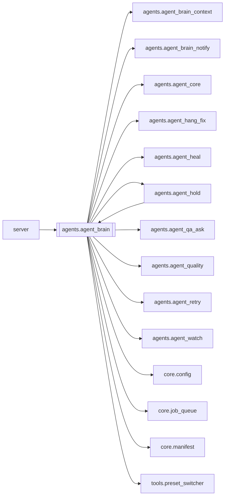

# `agents.agent_brain`

[← Index](../generated/module-index.md) · [Brain home](../README.md)

<!-- AUTO:START — sinh bởi scripts/brain_build.py 2026-11-17 19:05. Đừng sửa tay khối này. -->
**File:** `agents/agent_brain.py` · **Lớp:** `agent` · **2201 dòng** (1916 code) · **82 hàm**, **0 class** · sha1 `bd5233140a`

> Second Brain — daemon nền full-silent. Sensors → incidents → policy → actuators. Bật: AGENT_BRAIN=1 (hoặc pineline.config.json).

### Phụ thuộc

- **Gọi tới (import nội bộ):** [agents.agent_brain_context](./agents.agent_brain_context.md), [agents.agent_brain_notify](./agents.agent_brain_notify.md), [agents.agent_core](./agents.agent_core.md), [agents.agent_hang_fix](./agents.agent_hang_fix.md), [agents.agent_heal](./agents.agent_heal.md), [agents.agent_hold](./agents.agent_hold.md), [agents.agent_qa_ask](./agents.agent_qa_ask.md), [agents.agent_quality](./agents.agent_quality.md), [agents.agent_retry](./agents.agent_retry.md), [agents.agent_watch](./agents.agent_watch.md), [core.config](./core.config.md), [core.job_queue](./core.job_queue.md), [core.manifest](./core.manifest.md), [tools.preset_switcher](./tools.preset_switcher.md)
- **Được dùng bởi:** [agents.agent_hold](./agents.agent_hold.md), [server](./server.md)
- **Test:** `tests/test_agent_brain_events.py`, `tests/test_agent_brain_notify.py`, `tests/test_brain_finished_hold.py`, `tests/test_brain_qa_ask.py`, `tests/test_brain_qa_hold_timeout.py`, `tests/test_deepseek_empty_and_brain_idle.py`

### Hàm & class top-level

| Tên | Dòng | Dài | Tham số | Docstring |
|---|---:|---:|---|---|
| `_self_base` | 34 | 7 | `` | URL server Pineline đang chạy brain (fix 2026-11-11: trước cứng :8801 → V4/V5 điều khiển nhầm V2). |
| `_cfg` | 50 | 9 | `key, default` |  |
| `_truthy` | 61 | 2 | `v` |  |
| `brain_enabled` | 65 | 6 | `` |  |
| `_interval_sec` | 73 | 5 | `` |  |
| `_tg_mode` | 80 | 2 | `` |  |
| `_tg_allowed` | 94 | 11 | `mode, level` |  |
| `_tg_begin_tick` | 107 | 7 | `work_root` | Bắt đầu gom tin của 1 tick (thread-local) → _tg_flush_tick gửi 1 tin duy nhất. |
| `_tz` | 116 | 3 | `` |  |
| `_render_job_block` | 121 | 11 | `jid, events, root` |  |
| `_tg_flush_tick` | 134 | 20 | `` |  |
| `_emit` | 156 | 16 | `jid, kind, level, data, **kw` | Sự kiện của 1 job → khối tin dựng bằng mẫu (agent_brain_notify). Ngoài tick: gửi ngay. |
| `_ev_eq` | 174 | 4 | `a, b` |  |
| `_tg_send` | 180 | 6 | `msg, key` |  |
| `_remind_sec` | 188 | 6 | `` | Cùng lỗi / cùng kết quả hành động của 1 job: nhắc lại tối đa mỗi N giây (mặc định 2 giờ). |
| `_once` | 196 | 9 | `state, key, sec` | True nếu key chưa báo trong `sec` giây (mặc định _remind_sec) — và đánh dấu đã báo. |
| `_log_dir` | 207 | 4 | `root` |  |
| `log_line` | 213 | 9 | `root, msg` |  |
| `_state_path` | 224 | 2 | `root` |  |
| `_load_state` | 228 | 8 | `root` |  |
| `_save_state` | 238 | 7 | `root, state` |  |
| `_cooldown_ok` | 247 | 4 | `state, fp, sec` |  |
| `_mark_fp` | 253 | 3 | `state, fp, note` |  |
| `_telegram` | 258 | 10 | `msg, level` |  |
| `_ping` | 270 | 12 | `url, timeout` |  |
| `sense_infra` | 284 | 21 | `` |  |
| `sense_jobs` | 307 | 51 | `work_root, max_jobs` | Quét job có script / failed / stale cho quality + ops hints. |
| `_ts_any` | 369 | 11 | `v` |  |
| `_ghost_running` | 382 | 20 | `work_dir, name, st, now` | running nhưng KHÔNG có dấu hiệu sống trong GHOST_RUN_MIN phút (updated_at/started_at, file tạm). |
| `_reset_ghost_running` | 404 | 31 | `work_root, wd, jid, names` | Job đang HOLD + stage running giả → pending (Manifest.update), để gỡ HOLD/chạy lại được. |
| `_qa_pipeline_phase` | 437 | 88 | `work_dir` | Perceive: job đang ở đâu — mid_review / pre_tts / post_tts / idle. |
| `_norm_status` | 535 | 3 | `v` |  |
| `_job_dirs` | 540 | 16 | `work_root, max_jobs` |  |
| `_read_mf` | 558 | 6 | `d` |  |
| `_has_output` | 566 | 6 | `d` |  |
| `_job_title` | 574 | 6 | `data, jid` |  |
| `job_finished` | 582 | 5 | `d, data` | Job đã xong — MỘT định nghĩa dùng chung: agent_hold.job_finished (fix 2026-11-13 agentN: |
| `_is_held` | 589 | 3 | `ag` |  |
| `_scan_job_states` | 594 | 38 | `work_root, max_jobs` |  |
| `_remind_max` | 634 | 5 | `` |  |
| `detect_stage_events` | 641 | 75 | `work_root, state, max_jobs` | So trạng thái stage hiện tại với lần trước (state['job_stages']) → list sự kiện (dict). |
| `_hold_event` | 718 | 25 | `jid, info, p` | fix 2026-11-13 agentN — tin tạm dừng ĐÚNG loại, mỗi lần chuyển 1 tin: |
| `_review_retry_max` | 745 | 3 | `` |  |
| `emit_events` | 750 | 8 | `evs` | Đẩy sự kiện vào buffer tick (level theo loại). |
| `clear_stale_holds` | 760 | 67 | `work_root, state, max_jobs` | Gỡ HOLD cũ TẤT ĐỊNH (không cần LLM): job đã xong (mux done + output, hoặc mọi stage done) |
| `_drop_pending` | 829 | 13 | `work_root, jid` |  |
| `_gpu_or_queue_busy` | 844 | 12 | `work_root` |  |
| `decide` | 858 | 39 | `incidents, state` | Policy full-silent → list actions. |
| `apply_actions` | 899 | 218 ⚠️ | `work_root, actions, state, hooks` |  |
| `_llm_enabled` | 1119 | 7 | `` |  |
| `_llm_interval_sec` | 1128 | 5 | `` |  |
| `_http_json` | 1135 | 12 | `method, url, body, timeout` |  |
| `_ensure_brain_runtime` | 1149 | 187 ⚠️ | `work_root` | Bind agent_core Runtime nếu chưa có — FS + HTTP proxy (không cần restart :8801). |
| `_run_agent_llm` | 1338 | 18 | `message, work_root, max_steps, force_first_tool, force_first_args` | Gọi agent_core tool-loop in-process (bind FS/HTTP nếu cần) hoặc fallback HTTP chat. |
| `_run_agent_llm_inner` | 1358 | 70 | `message, work_root, max_steps, force_first_tool, force_first_args` |  |
| `_mutating_steps` | 1440 | 25 | `steps` | Step thật sự đổi trạng thái (theo agent_core.tool_tier; fallback danh sách read). |
| `_deep_focus` | 1467 | 42 | `snap, work_root` | Job cần LLM deep tick: failed / held / high_open (chưa qua TTS) / pending / pre_tts có high. |
| `_deep_sig` | 1511 | 10 | `meta` |  |
| `_deep_cooldown_sec` | 1523 | 5 | `` |  |
| `_decision_dedupe_sec` | 1530 | 5 | `` |  |
| `_job_evidence` | 1537 | 29 | `jid, work_root` | Chạy sẵn tool đọc (pineline_job + diagnose + heal plan) → nhét vào prompt. |
| `_log_tool_issues` | 1568 | 7 | `work_root, jid, steps` |  |
| `_report_llm_actions` | 1577 | 22 | `state, jid, steps` | Tool MUTATE thật của LLM → tin mẫu «Brain: <việc> → <kết quả>» (fix 2026-11-12 agentH). |
| `_maybe_decision_tg` | 1601 | 4 | `state, jid, meta, steps, reply` | DECISION của LLM: CHỈ log (không gửi văn LLM lên Telegram). Có tool mutate → tin mẫu kết quả. |
| `llm_tick` | 1607 | 142 ⚠️ | `work_root, state` | LLM Second Brain: đọc snapshot toàn hệ → tool-loop quyết định. |
| `_tg_report_sec` | 1752 | 6 | `` | Chu kỳ digest — tối thiểu 600 s (fix 2026-11-12 agentG: trước 120 s = spam). |
| `_digest_sig` | 1760 | 10 | `msg` | Chữ ký nội dung digest bỏ % / số / cur_text đổi liên tục → chỉ đổi khi tập job/stage đổi. |
| `_progress_digest` | 1772 | 72 | `work_root` | Tóm tắt ngắn running/queue cho Telegram. |
| `_maybe_tg_progress` | 1846 | 16 | `work_root, state` |  |
| `tick` | 1864 | 16 | `work_root, hooks, list_jobs` |  |
| `_tick_inner` | 1882 | 106 | `work_root, state, hooks, list_jobs` |  |
| `_start_grace_left` | 1993 | 10 | `now` | Số giây còn phải hoãn heal/LLM sau khi brain loop khởi động (0 = hết hoãn / brain_once). |
| `_loop` | 2005 | 17 | `work_root, hooks, list_jobs, interval` |  |
| `start_brain` | 2024 | 22 | `work_root, hooks, list_jobs` |  |
| `stop_brain` | 2048 | 2 | `` |  |
| `brain_once` | 2052 | 8 | `work_root, hooks, list_jobs` | API/ops: chạy 1 tick thủ công. |
| `_qa_resume` | 2070 | 9 | `hooks, work_root, jid, why` |  |
| `_qa_ask` | 2081 | 3 | `` |  |
| `_qa_ask_close` | 2086 | 11 | `wd, why` | Job hết HOLD (người/brain gỡ) → đóng câu hỏi đang mở để lần HOLD sau hỏi lại từ đầu. |
| `_qa_ask_active` | 2099 | 6 | `wd` |  |
| `_qa_defer` | 2107 | 11 | `hooks, work_root, jid` |  |
| `_qa_hold_timeout` | 2120 | 82 | `state, hooks, work_root, wd, jid, r` | 2026-11-17 qaask: HOLD QA → hỏi người qua Telegram (chi tiết + đề xuất + nút); quá QA_HOLD_MAX_MIN |

**Hàm dài ≥120 dòng:** `apply_actions` (218, L899), `_ensure_brain_runtime` (187, L1149), `llm_tick` (142, L1607)

### Config / env keys (19)

`AGENT_BRAIN`, `AGENT_BRAIN_DECISION_DEDUP_SEC`, `AGENT_BRAIN_DEEP_SEC`, `AGENT_BRAIN_LLM`, `AGENT_BRAIN_LLM_SEC`, `AGENT_BRAIN_LLM_STEPS`, `AGENT_BRAIN_MODE`, `AGENT_BRAIN_REMIND_MAX`, `AGENT_BRAIN_REMIND_SEC`, `AGENT_BRAIN_SEC`, `AGENT_BRAIN_TELEGRAM`, `AGENT_BRAIN_TG_SEC`, `AGENT_BRAIN_TZ`, `GHOST_RUN_MIN`, `PINELINE_BASE`, `PINELINE_PORT`, `QA_HOLD_MAX_MIN`, `REVIEW_PRESET`, `TRANSLATE_PRESET`

**Cổng nhắc tới:** 3377, 8083, 8802

**File/artifact nhắc tới:** `_filter_complex.txt`, `agent_brain.log`, `agent_brain_last_snapshot.json`, `agent_brain_state.json`, `brain_pending_decisions.json`, `dub_fit.wav`, `dub_tts.wav`, `manifest.json`, `mixed_audio.partial.wav`, `mixed_audio.wav`, `output.mp4`, `output.partial.mp4`, `script.json`, `tts.json`

**Tín hiệu rủi ro (đếm tĩnh):** broad_except=65 · file_writes=5 · global_stmt=2 · swallow_except=13 · threads=1

### Lịch sử (từ docs/)

- **Fix logs (5):**
  - [Port V2→V5: Brain — job đã xong không heal + park tự động ≠ HOLD cần người](../../fixes/2026-11-13-port-brain-finished-hold.md)
  - [Port V2→V5: Second Brain (Telegram events + gỡ HOLD khi chạy tay) + đóng dấu luồng dịch theo job](../../fixes/2026-11-12-port-brain-hold-pipeline.md)
  - [V5 không khởi động được → chuyển về bố cục package bằng sync_from_v2](../../fixes/2026-11-11-v5-package-sync.md)
  - [REVIEW lỗi bị coi là đã soát · park treo hàng đợi · Brain V4 điều khiển nhầm V2](../../fixes/2026-11-11-review-fail-park-port.md)
  - [Brain LLM tick trả tools=[] (không gọi tool)](../../fixes/2026-11-09-brain-llm-tool-loop.md)
- **Reviews:** [2026-11-11-v4-v5-port-review](../../reviews/2026-11-11-v4-v5-port-review.md)
- Nhắc trong CHANGELOG: **4** lần · DECISIONS: **1** lần

<!-- AUTO:END -->

<!-- MANUAL:START -->
## Vai trò (viết tay)

_Chưa viết. 2–4 câu: module này chịu trách nhiệm gì trong pipeline, ai gọi nó, nó KHÔNG làm gì._

## Luồng chính

_Các hàm vào (entry) → bước chính → output/side effect. Ghi tên hàm thật._

## Bất biến & hợp đồng

_Điều luôn phải đúng (vd: chỉ ghi manifest qua `Manifest.update`; 1 job / ghế). Vi phạm = bug._

## Bẫy đã biết

_Lỗi từng gặp + link `docs/fixes/...`. Những chỗ dễ sửa sai._

## Ghi chú vận hành

_Config key quan trọng, cần restart gì khi sửa (:8801 / :8802 / hot-reload), cách test._
<!-- MANUAL:END -->
