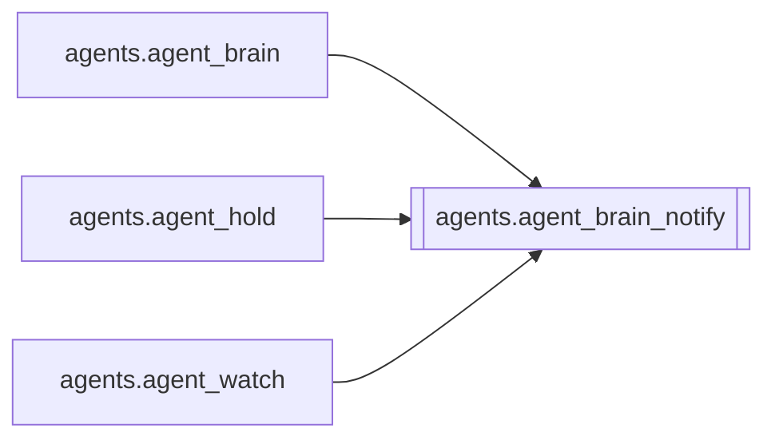

# `agents.agent_brain_notify`

[← Index](../generated/module-index.md) · [Brain home](../README.md)

<!-- AUTO:START — sinh bởi scripts/brain_build.py 2026-11-17 19:05. Đừng sửa tay khối này. -->
**File:** `agents/agent_brain_notify.py` · **Lớp:** `agent` · **485 dòng** (413 code) · **17 hàm**, **0 class** · sha1 `9e9a212438`

> Mẫu tin Telegram của Second Brain — do CODE dựng, không dùng văn tự do của LLM (fix 2026-11-12 agentH). Nguyên tắc: * Plain text (agent_watch.telegram_send KHÔNG dùng parse_mode) → không markdown, không thẻ HTML,

### Phụ thuộc

- **Gọi tới (import nội bộ):** —
- **Được dùng bởi:** [agents.agent_brain](./agents.agent_brain.md), [agents.agent_hold](./agents.agent_hold.md), [agents.agent_watch](./agents.agent_watch.md)
- **Được nhắc tên file `.py` (subprocess/script) bởi:** [agents.agent_brain](./agents.agent_brain.md)
- **Test:** `tests/test_agent_brain_notify.py`, `tests/test_brain_finished_hold.py`

### Hàm & class top-level

| Tên | Dòng | Dài | Tham số | Docstring |
|---|---:|---:|---|---|
| `clean` | 112 | 17 | `s, maxlen` | Plain text an toàn cho Telegram: bỏ thẻ <...>, markdown, «/», gộp khoảng trắng, cắt theo từ. |
| `stage_vi` | 131 | 2 | `stage` |  |
| `split_part` | 143 | 5 | `jid` |  |
| `short_id` | 150 | 4 | `jid` |  |
| `_raw_title` | 156 | 13 | `data` | (title, is_vi). Ưu tiên title_vi / meta.title_vi / series; fallback title gốc. |
| `short_title` | 171 | 23 | `title, maxlen` | «Lớp học huyền thoại bị lộ, các đại ca … - Phần 3» → («Lớp học huyền thoại bị lộ», 3). |
| `job_label` | 196 | 20 | `jid, data, parent` | Tên phim tiếng Việt + P<n> + (id rút gọn). Part con (_pNN) không có title_vi → lấy của job cha. |
| `hhmm` | 221 | 16 | `at, tz` | ISO/epoch → HH:MM giờ địa phương (tz=None: giờ máy). |
| `tz_from_cfg` | 239 | 10 | `v` | '+7' / '7' / '+07:00' → timezone; rỗng → None (giờ máy). |
| `short_error` | 251 | 8 | `stage, err` | «firered_asr.py lỗi (mã 1)» → «firered mã 1»; còn lại: chữ sạch ≤ 70 ký tự. |
| `heal_summary` | 264 | 37 | `r` | Kết quả agent_heal.heal_job (có thể {"safe":…, "aggressive":…}) → {outcome, actions, reason}. |
| `tool_outcome` | 303 | 14 | `tool, preview` | Kết quả 1 tool mutate của LLM (result_preview JSON có thể bị cắt) → (outcome, chi tiết ngắn). |
| `_join_stages` | 322 | 2 | `stages` |  |
| `_heal_line` | 326 | 19 | `ev` | → (dòng «Brain: …», need hoặc None). |
| `park_text` | 347 | 21 | `ev, tz` | Câu «tạm dừng … tự thử lại …» cho park tự động (không HOLD, không «Cần bạn»). |
| `render_job` | 370 | 107 | `jid, data, events, parent, tz` | 1 khối/job: tiêu đề + ≤ 3 dòng. |
| `render_tick` | 479 | 7 | `blocks, extra, maxlen` | Nhiều khối job (+ dòng hệ thống) → 1 tin; cách nhau 1 dòng trống. |

**Tín hiệu rủi ro (đếm tĩnh):** broad_except=1

### Lịch sử (từ docs/)

- **Fix logs (2):**
  - [Port V2→V5: Brain — job đã xong không heal + park tự động ≠ HOLD cần người](../../fixes/2026-11-13-port-brain-finished-hold.md)
  - [Port V2→V5: Second Brain (Telegram events + gỡ HOLD khi chạy tay) + đóng dấu luồng dịch theo job](../../fixes/2026-11-12-port-brain-hold-pipeline.md)
- Nhắc trong CHANGELOG: **2** lần · DECISIONS: **0** lần

<!-- AUTO:END -->

<!-- MANUAL:START -->
## Vai trò (viết tay)

_Chưa viết. 2–4 câu: module này chịu trách nhiệm gì trong pipeline, ai gọi nó, nó KHÔNG làm gì._

## Luồng chính

_Các hàm vào (entry) → bước chính → output/side effect. Ghi tên hàm thật._

## Bất biến & hợp đồng

_Điều luôn phải đúng (vd: chỉ ghi manifest qua `Manifest.update`; 1 job / ghế). Vi phạm = bug._

## Bẫy đã biết

_Lỗi từng gặp + link `docs/fixes/...`. Những chỗ dễ sửa sai._

## Ghi chú vận hành

_Config key quan trọng, cần restart gì khi sửa (:8801 / :8802 / hot-reload), cách test._
<!-- MANUAL:END -->
