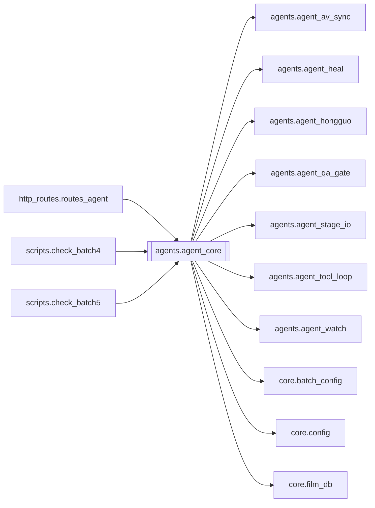

# `agents.agent_core`

[← Index](../generated/module-index.md) · [Brain home](../README.md)

<!-- AUTO:START — sinh bởi scripts/brain_build.py 2026-11-11 02:38. Đừng sửa tay khối này. -->
**File:** `agents/agent_core.py` · **Lớp:** `agent` · **2038 dòng** (1930 code) · **30 hàm**, **2 class** · sha1 `92ee735021`

> agent_core.py — AI Agent nhúng trong Pineline V4. Không gọi HTTP self. Tools gọi runtime đã bind từ server.py (list jobs, queue, manifest, draft YT).

### Phụ thuộc

- **Gọi tới (import nội bộ):** [agents.agent_av_sync](./agents.agent_av_sync.md), [agents.agent_heal](./agents.agent_heal.md), [agents.agent_hongguo](./agents.agent_hongguo.md), [agents.agent_qa_gate](./agents.agent_qa_gate.md), [agents.agent_stage_io](./agents.agent_stage_io.md), [agents.agent_tool_loop](./agents.agent_tool_loop.md), [agents.agent_watch](./agents.agent_watch.md), [core.batch_config](./core.batch_config.md), [core.config](./core.config.md), [core.film_db](./core.film_db.md)
- **Được dùng bởi:** [http_routes.routes_agent](./http_routes.routes_agent.md), [scripts.check_batch4](./scripts.check_batch4.md), [scripts.check_batch5](./scripts.check_batch5.md)
- **Được nhắc tên file `.py` (subprocess/script) bởi:** [agent_core](./agent_core.md), [restart_server](./restart_server.md)
- **Test:** `tests/test_agent_core_smoke.py`, `tests/test_agent_parser.py`, `tests/test_layout_paths.py`
- **Thư viện ngoài:** `requests`



### Hàm & class top-level

| Tên | Dòng | Dài | Tham số | Docstring |
|---|---:|---:|---|---|
| **class `Runtime`** | 1061 | 0 method | |  |
| **class `AgentResult`** | 1953 | 0 method | |  |
| `_films_tool` | 901 | 12 | `args` |  |
| `_sidecar_cmd` | 915 | 8 | `text` |  |
| `_truthy` | 972 | 2 | `v` |  |
| `tool_tier` | 976 | 29 | `name, args` | read / mutate / confirm. confirm = phá huỷ/tốn lâu, cần user bấm ✅ khi gọi từ Telegram. |
| `describe_action` | 1007 | 6 | `name, args` |  |
| `_prune_pending` | 1015 | 3 | `now` |  |
| `park_action` | 1020 | 13 | `name, args` | Giữ tool call lại chờ user xác nhận; trùng (name, args) chưa hết hạn thì dùng lại id cũ. |
| `pending_actions` | 1035 | 4 | `` |  |
| `confirm_action` | 1041 | 14 | `cid, approve` |  |
| `bind` | 1088 | 3 | `runtime` |  |
| `_require_rt` | 1093 | 4 | `` |  |
| `summarize_job` | 1099 | 28 | `j, work_root` |  |
| `_load_script` | 1129 | 8 | `work_root, job_id` |  |
| `_line_brief` | 1139 | 9 | `r` |  |
| `_read_hold` | 1150 | 15 | `work_root, job_id` |  |
| `script_peek` | 1167 | 20 | `work_root, job_id, sample` |  |
| `script_search` | 1189 | 25 | `work_root, job_id, query, missing_only, limit` |  |
| `script_get_lines` | 1216 | 14 | `work_root, job_id, i_from, i_to` |  |
| `classify_jobs` | 1232 | 26 | `jobs, work_root` |  |
| `default_yt_draft` | 1260 | 38 | `work_root, job_id, max_lines` |  |
| `_dispatch` | 1300 | 424 ⚠️ | `name, args, allow_mutate` |  |
| `_llm_cfg` | 1726 | 5 | `` | Cấu hình LLM cho Agent chat (có thể tách khỏi job translate) — config.agent_llm(). |
| `_chat_turn` | 1733 | 16 | `messages, use_tools` | Một turn OpenAI chat/completions. Trả message dict (content + tool_calls). |
| `_chat_turn_model` | 1751 | 30 | `messages, use_tools, model` |  |
| `_chat_turn_text_protocol` | 1783 | 67 | `messages, model` | Fallback khi model không tool-call: ép JSON {tool,args} hoặc {final}. |
| `_parse_pycall_tool_calls` | 1858 | 44 | `content` | Model hay in «Action: `hg_auto_flow(query_or_id="…", auto_run=True)`» thay vì gọi tool. |
| `_parse_text_tool_calls` | 1904 | 36 | `content` | Model qua proxy đôi khi in tool call dạng text (```json [{"name":..,"arguments":..}]```). |
| `clip_tool_result` | 1945 | 5 | `result, limit` |  |
| `run_agent` | 1960 | 74 | `message, history, allow_mutate, max_steps, require_confirm` | Chạy agent. history = [{role, content}, ...] (user/assistant only). |
| `status_snapshot` | 2036 | 3 | `` |  |

**Hàm dài ≥120 dòng:** `_dispatch` (424, L1300)

### Config / env keys (4)

`AGENT_TOOL_RESULT_MAX`, `AGENT_WATCH_MAX_JOBS`, `AUTOPILOT_URL`, `LLM_ENABLE_THINKING`

**Cổng nhắc tới:** 8802

**File/artifact nhắc tới:** `manifest.json`, `output.mp4`, `script.json`

**Tín hiệu rủi ro (đếm tĩnh):** broad_except=5 · global_stmt=1 · swallow_except=1

### Lịch sử (từ docs/)

- **Fix logs (6):**
  - [Brain LLM tick trả tools=[] (không gọi tool)](../../fixes/2026-11-09-brain-llm-tool-loop.md)
  - [2026-10-06 — Đợt 5 review: agent an toàn hơn](../../fixes/2026-10-06-batch5-agent-safety.md)
  - [2026-10-06 — Đợt 4 review: tranh chấp ghi, một bản tiến trình, checkpoint an toàn](../../fixes/2026-10-06-batch4-write-races.md)
  - [2026-10-06 — Đợt 2 review: bảo mật + config một nguồn + LLM sập không để trống câu](../../fixes/2026-10-06-batch2-security.md)
  - [Agent chạy tool chỉ vì được nhắc trong câu trả lời](../../fixes/2026-10-06-agent-text-toolcall-overmatch.md)
  - [2026-09-26 — Port duck/duck_bgm two-pass sang PinelineV2](../../fixes/2026-09-26-duck-bgm-twopass-port.md)
- **Reviews:** [_atoms_http_agents](../../reviews/_atoms_http_agents.md), [2026-11-06-v5-part-atoms](../../reviews/2026-11-06-v5-part-atoms.md), [2026-11-06-v5-func-catalog](../../reviews/2026-11-06-v5-func-catalog.md), [2026-11-02-v4-structure-sync](../../reviews/2026-11-02-v4-structure-sync.md), [2026-11-02-v4-structure-and-v2-port](../../reviews/2026-11-02-v4-structure-and-v2-port.md), [2026-10-06-code-review](../../reviews/2026-10-06-code-review.md)
- Nhắc trong CHANGELOG: **13** lần · DECISIONS: **2** lần

<!-- AUTO:END -->

<!-- MANUAL:START -->
## Vai trò (viết tay)

_Chưa viết. 2–4 câu: module này chịu trách nhiệm gì trong pipeline, ai gọi nó, nó KHÔNG làm gì._

## Luồng chính

_Các hàm vào (entry) → bước chính → output/side effect. Ghi tên hàm thật._

## Bất biến & hợp đồng

_Điều luôn phải đúng (vd: chỉ ghi manifest qua `Manifest.update`; 1 job / ghế). Vi phạm = bug._

## Bẫy đã biết

_Lỗi từng gặp + link `docs/fixes/...`. Những chỗ dễ sửa sai._

## Ghi chú vận hành

_Config key quan trọng, cần restart gì khi sửa (:8801 / :8802 / hot-reload), cách test._
<!-- MANUAL:END -->
