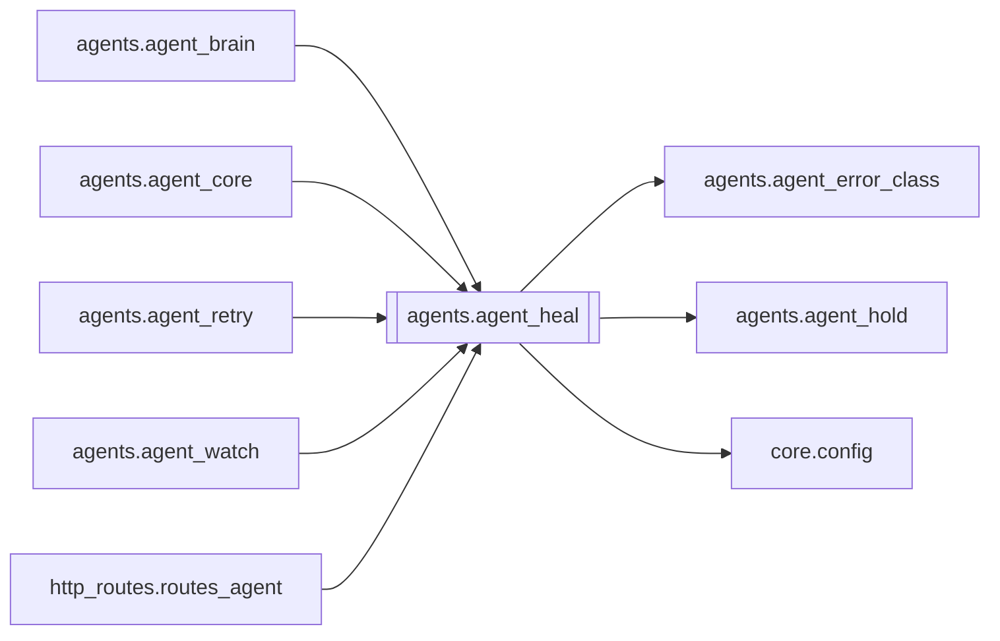

# `agents.agent_heal`

[← Index](../generated/module-index.md) · [Brain home](../README.md)

<!-- AUTO:START — sinh bởi scripts/brain_build.py 2026-11-17 19:05. Đừng sửa tay khối này. -->
**File:** `agents/agent_heal.py` · **Lớp:** `agent` · **830 dòng** (706 code) · **15 hàm**, **0 class** · sha1 `1d852475f7`

> agent_heal.py — Chẩn đoán + heal job lỗi (an toàn theo cấp). safe: heal stale running, vá dịch trống, TTS thiếu clip, mux lại nếu có audio. aggressive: thêm asr/tts force (chỉ khi user/agent allow + level=aggressive).

### Phụ thuộc

- **Gọi tới (import nội bộ):** [agents.agent_error_class](./agents.agent_error_class.md), [agents.agent_hold](./agents.agent_hold.md), [core.config](./core.config.md)
- **Được dùng bởi:** [agents.agent_brain](./agents.agent_brain.md), [agents.agent_core](./agents.agent_core.md), [agents.agent_retry](./agents.agent_retry.md), [agents.agent_watch](./agents.agent_watch.md), [http_routes.routes_agent](./http_routes.routes_agent.md)
- **Test:** `tests/test_agent_brain_events.py`, `tests/test_agent_brain_notify.py`, `tests/test_brain_finished_hold.py`, `tests/test_parent_rerun_after_done.py`, `tests/test_seat_lock_heal.py`

### Hàm & class top-level

| Tên | Dòng | Dài | Tham số | Docstring |
|---|---:|---:|---|---|
| `start_delay_sec` | 20 | 16 | `` | Hoãn lượt heal đầu tiên của watcher/brain sau khi start (AGENT_HEAL_START_DELAY_SEC, mặc định 180). |
| `_on_queue_seat` | 38 | 9 | `job_id, seat` | job là current, part của current, hoặc parent của part đang current. |
| `other_seat_busy` | 49 | 23 | `job_id` | Studio SOP: ghế queue đang của job KHÁC → không được xếp GPU (fill/TTS/ASR…). |
| `job_active` | 74 | 35 | `job_id, hooks` | Lý do job đang chạy thật (không được heal): queue.current / claim stage / engine sống. |
| `_mf` | 111 | 8 | `work` |  |
| `_stage` | 121 | 2 | `data, name` |  |
| `_count_missing_vi` | 125 | 11 | `work` |  |
| `_tts_missing` | 138 | 16 | `work, st` |  |
| `_finished` | 156 | 6 | `work, data` |  |
| `diagnose_job` | 164 | 202 ⚠️ | `work_root, job_id` |  |
| `heal_job` | 368 | 143 ⚠️ | `work_root, job_id, apply, level, hooks` | apply=False: chỉ trả plan. apply=True: chạy actions theo level. |
| `_job_needs_attention` | 513 | 12 | `diag` |  |
| `scan_problem_jobs` | 527 | 51 | `work_root, list_jobs, include_done_ok` | Quét mọi job có manifest — tìm fail/kẹt/thiếu bước. |
| `heal_failed_batch` | 580 | 56 | `work_root, apply, level, max_jobs, list_jobs, hooks` | Bắt mọi job lỗi/kẹt rồi heal (plan hoặc apply). |
| `reset_job_state` | 638 | 192 ⚠️ | `work_root, job_id, stages, keep_asr, restart, hooks` | Reset sạch các stage bị kẹt/lỗi của 1 job (xóa artifact dở, gỡ .stop, reset manifest về pending). |

**Hàm dài ≥120 dòng:** `diagnose_job` (202, L164), `reset_job_state` (192, L638), `heal_job` (143, L368)

### Config / env keys (1)

`AGENT_HEAL_START_DELAY_SEC`

**File/artifact nhắc tới:** `_filter_complex.txt`, `asr.json`, `audio.wav`, `audio.wav.json`, `dub_fit.wav`, `manifest.json`, `output.mp4`, `output.partial.mp4`, `script.display.json`, `script.json`, `script.pre_agent_review.json`, `script.pre_review.json`, `sub.vi.burn.follow.ass`, `sub.vi.burn.srt`, `sub.vi.srt`, `sub.zh.srt`, `tts.json`, `tts_config.json`, `tts_fit.json`

**Tín hiệu rủi ro (đếm tĩnh):** broad_except=22 · file_writes=1 · swallow_except=11

### Lịch sử (từ docs/)

- **Fix logs (3):**
  - [Port V2→V5: Brain — job đã xong không heal + park tự động ≠ HOLD cần người](../../fixes/2026-11-13-port-brain-finished-hold.md)
  - [Port V2→V5: Second Brain (Telegram events + gỡ HOLD khi chạy tay) + đóng dấu luồng dịch theo job](../../fixes/2026-11-12-port-brain-hold-pipeline.md)
  - [Video nguồn bị chép thành 2 bản (thư viện + job)](../../fixes/2026-10-07-source-duplicate-copy.md)
- **Reviews:** [_atoms_http_agents](../../reviews/_atoms_http_agents.md), [2026-11-06-v5-part-atoms](../../reviews/2026-11-06-v5-part-atoms.md), [2026-11-06-v5-func-catalog](../../reviews/2026-11-06-v5-func-catalog.md), [2026-11-02-v4-structure-sync](../../reviews/2026-11-02-v4-structure-sync.md), [2026-11-02-v4-structure-and-v2-port](../../reviews/2026-11-02-v4-structure-and-v2-port.md)
- Nhắc trong CHANGELOG: **3** lần · DECISIONS: **0** lần

<!-- AUTO:END -->

<!-- MANUAL:START -->
## Vai trò (viết tay)

_Chưa viết. 2–4 câu: module này chịu trách nhiệm gì trong pipeline, ai gọi nó, nó KHÔNG làm gì._

## Luồng chính

_Các hàm vào (entry) → bước chính → output/side effect. Ghi tên hàm thật._

## Bất biến & hợp đồng

_Điều luôn phải đúng (vd: chỉ ghi manifest qua `Manifest.update`; 1 job / ghế). Vi phạm = bug._

## Bẫy đã biết

_Lỗi từng gặp + link `docs/fixes/...`. Những chỗ dễ sửa sai._

## Ghi chú vận hành

_Config key quan trọng, cần restart gì khi sửa (:8801 / :8802 / hot-reload), cách test._
<!-- MANUAL:END -->
