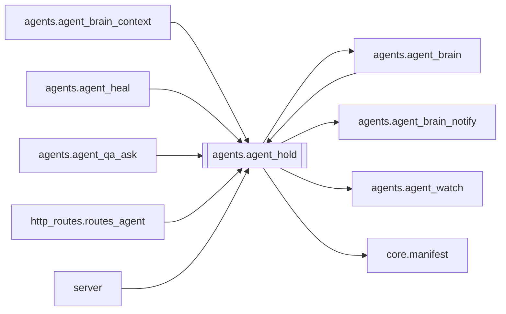

# `agents.agent_hold`

[← Index](../generated/module-index.md) · [Brain home](../README.md)

<!-- AUTO:START — sinh bởi scripts/brain_build.py 2026-11-17 19:05. Đừng sửa tay khối này. -->
**File:** `agents/agent_hold.py` · **Lớp:** `agent` · **432 dòng** (349 code) · **21 hàm**, **2 class** · sha1 `8c195e546e`

> agent_hold.py — gỡ HOLD khi người dùng CHẠY TAY 1 bước + chặn brain/auto đặt lại HOLD (fix 2026-11-12 agentH). Bối cảnh: HOLD (agent.hold_after_translate / qa_blocked / held_at) chặn TTS/mux trong luồng TỰ ĐỘNG. Khi ngườ

### Phụ thuộc

- **Gọi tới (import nội bộ):** [agents.agent_brain](./agents.agent_brain.md), [agents.agent_brain_notify](./agents.agent_brain_notify.md), [agents.agent_watch](./agents.agent_watch.md), [core.manifest](./core.manifest.md)
- **Được dùng bởi:** [agents.agent_brain](./agents.agent_brain.md), [agents.agent_brain_context](./agents.agent_brain_context.md), [agents.agent_heal](./agents.agent_heal.md), [agents.agent_qa_ask](./agents.agent_qa_ask.md), [http_routes.routes_agent](./http_routes.routes_agent.md), [server](./server.md)
- **Test:** `tests/test_agent_brain_notify.py`, `tests/test_agent_hold_telegram.py`, `tests/test_brain_finished_hold.py`

### Hàm & class top-level

| Tên | Dòng | Dài | Tham số | Docstring |
|---|---:|---:|---|---|
| **class `auto_context`** | 204 | 3 method | | with auto_context("brain"): ... — trong khối này set_hold coi là của brain/auto. |
| **class `user_context`** | 225 | 3 method | | with user_context("agent_chat:telegram"): ... — tool chạy in-process do NGƯỜI ra lệnh (route |
| `is_held` | 36 | 3 | `agent` |  |
| `_norm_st` | 52 | 3 | `v` |  |
| `_read_mf` | 57 | 6 | `work_dir` |  |
| `_output_ok` | 65 | 9 | `work_dir` |  |
| `merged_full` | 76 | 8 | `data` | Parent split đã ghép bản Full (split_info.status=merged hoặc mux.is_full_merged) + mux done. |
| `job_finished` | 86 | 34 | `work_dir, data, check_parent` | Job ĐÃ XONG — heal/watch/brain/LLM bỏ qua, không DECISION, không báo «heal thất bại». |
| `hold_class` | 139 | 18 | `agent` | None = không tạm dừng. park/split_wait = TỰ chạy lại (không cần người). Còn lại = HOLD cần người. |
| `review_retry_max` | 159 | 5 | `` |  |
| `hold_info` | 169 | 21 | `agent` | Mô tả tạm dừng cho tin Telegram / snapshot LLM. |
| `_qa_high` | 192 | 7 | `work_dir` |  |
| `auto_caller` | 221 | 2 | `` |  |
| `user_caller` | 243 | 2 | `` |  |
| `request_source` | 247 | 8 | `request` | Nhãn nguồn của request tay: header X-Pineline-Source (vd telegram) hoặc «ui». |
| `manual_source` | 257 | 10 | `request` | Nguồn «chạy tay» của lệnh hiện tại, None = tự động. |
| `is_manual_request` | 269 | 16 | `request` | Lệnh HTTP từ người dùng (UI/desktop). Gọi Python trực tiếp (request=None: agent/queue/heal hook) |
| `manual_override` | 290 | 53 | `work_dir, stage, by, source, notify` | Job đang HOLD → gỡ cờ + ghi agent.hold_override. Trả dict override (None nếu không HOLD/không ghi). |
| `maybe_manual_override` | 345 | 8 | `request, work_dir, stage, source` | Gọi từ route: chỉ gỡ khi là lệnh tay của người dùng (HTTP tay, hoặc tool Agent trong user_context). |
| `hold_suppressed` | 355 | 25 | `work_dir, agent, high_now, high_i_now` | True = KHÔNG được đặt lại HOLD (job đã override tay, chưa có high mới sau lần chạy đó). |
| `_log` | 383 | 10 | `work_dir, msg` |  |
| `render_override_msg` | 395 | 18 | `work_dir, stage, data` |  |
| `_notify_override` | 415 | 18 | `work_dir, stage, data` |  |

### Config / env keys (1)

`QUEUE_REVIEW_RETRY_MAX`

**File/artifact nhắc tới:** `agent_brain.log`, `manifest.json`, `output.mp4`, `output_full.mp4`, `qa_brain.json`

**Tín hiệu rủi ro (đếm tĩnh):** broad_except=11 · swallow_except=1 · threads=1

### Lịch sử (từ docs/)

- **Fix logs (2):**
  - [Port V2→V5: Brain — job đã xong không heal + park tự động ≠ HOLD cần người](../../fixes/2026-11-13-port-brain-finished-hold.md)
  - [Port V2→V5: Second Brain (Telegram events + gỡ HOLD khi chạy tay) + đóng dấu luồng dịch theo job](../../fixes/2026-11-12-port-brain-hold-pipeline.md)
- Nhắc trong CHANGELOG: **2** lần · DECISIONS: **0** lần

<!-- AUTO:END -->

<!-- MANUAL:START -->
## Vai trò (viết tay)

_Chưa viết. 2–4 câu: module này chịu trách nhiệm gì trong pipeline, ai gọi nó, nó KHÔNG làm gì._

## Luồng chính

_Các hàm vào (entry) → bước chính → output/side effect. Ghi tên hàm thật._

## Bất biến & hợp đồng

_Điều luôn phải đúng (vd: chỉ ghi manifest qua `Manifest.update`; 1 job / ghế). Vi phạm = bug._

## Bẫy đã biết

_Lỗi từng gặp + link `docs/fixes/...`. Những chỗ dễ sửa sai._

## Ghi chú vận hành

_Config key quan trọng, cần restart gì khi sửa (:8801 / :8802 / hot-reload), cách test._
<!-- MANUAL:END -->
