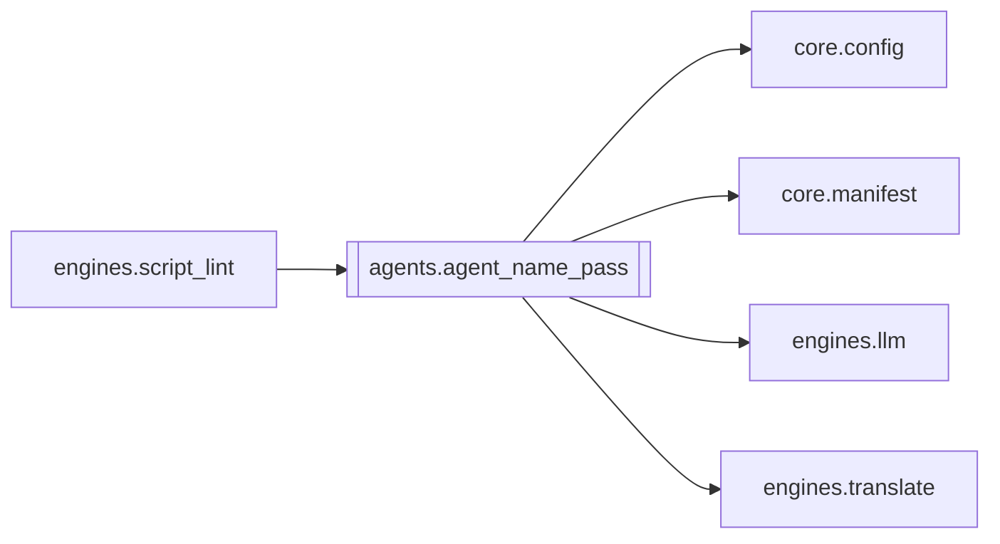

# `agents.agent_name_pass`

[← Index](../generated/module-index.md) · [Brain home](../README.md)

<!-- AUTO:START — sinh bởi scripts/brain_build.py 2026-11-11 02:38. Đừng sửa tay khối này. -->
**File:** `agents/agent_name_pass.py` · **Lớp:** `agent` · **134 dòng** (118 code) · **5 hàm**, **0 class** · sha1 `df1a1bd11f`

> Rà TÊN NHÂN VẬT trong bản dịch theo bảng nhân vật (glossary.json). 1. Quét: câu nào zh có tên nhân vật (苏林…) mà vi không có tên Việt đã chốt (Tô Lâm) → nghi sai tên. 2. Gửi các câu nghi ngờ cho LLM sửa, CHỈ đổi tên riêng

### Phụ thuộc

- **Gọi tới (import nội bộ):** [core.config](./core.config.md), [core.manifest](./core.manifest.md), [engines.llm](./engines.llm.md), [engines.translate](./engines.translate.md)
- **Được dùng bởi:** [engines.script_lint](./engines.script_lint.md)
- **Test:** ❌ chưa có test import trực tiếp

### Hàm & class top-level

| Tên | Dòng | Dài | Tham số | Docstring |
|---|---:|---:|---|---|
| `_fold` | 20 | 3 | `s` |  |
| `_names` | 25 | 21 | `plan` | Chỉ characters (+ terms type=lock). Terms thường = mềm, không ép name-pass. |
| `find_issues` | 48 | 13 | `rows, plan` |  |
| `_fix_batch` | 63 | 21 | `chunk, plan_block, model` |  |
| `run_name_pass` | 86 | 49 | `work_dir, model` |  |

**File/artifact nhắc tới:** `glossary.json`, `script.json`

**Tín hiệu rủi ro (đếm tĩnh):** broad_except=4 · file_writes=1 · swallow_except=1

### Lịch sử (từ docs/)

- **Fix logs (1):**
  - [NMT draft + glossary gầy + REVIEW GPT mini](../../fixes/2026-11-09-mt-draft-slim-gloss.md)
- **Reviews:** [_atoms_http_agents](../../reviews/_atoms_http_agents.md), [2026-11-06-v5-part-atoms](../../reviews/2026-11-06-v5-part-atoms.md), [2026-11-06-v5-func-catalog](../../reviews/2026-11-06-v5-func-catalog.md)
- Nhắc trong CHANGELOG: **1** lần · DECISIONS: **0** lần

<!-- AUTO:END -->

<!-- MANUAL:START -->
## Vai trò (viết tay)

_Chưa viết. 2–4 câu: module này chịu trách nhiệm gì trong pipeline, ai gọi nó, nó KHÔNG làm gì._

## Luồng chính

_Các hàm vào (entry) → bước chính → output/side effect. Ghi tên hàm thật._

## Bất biến & hợp đồng

_Điều luôn phải đúng (vd: chỉ ghi manifest qua `Manifest.update`; 1 job / ghế). Vi phạm = bug._

## Bẫy đã biết

_Lỗi từng gặp + link `docs/fixes/...`. Những chỗ dễ sửa sai._

## Ghi chú vận hành

_Config key quan trọng, cần restart gì khi sửa (:8801 / :8802 / hot-reload), cách test._
<!-- MANUAL:END -->
