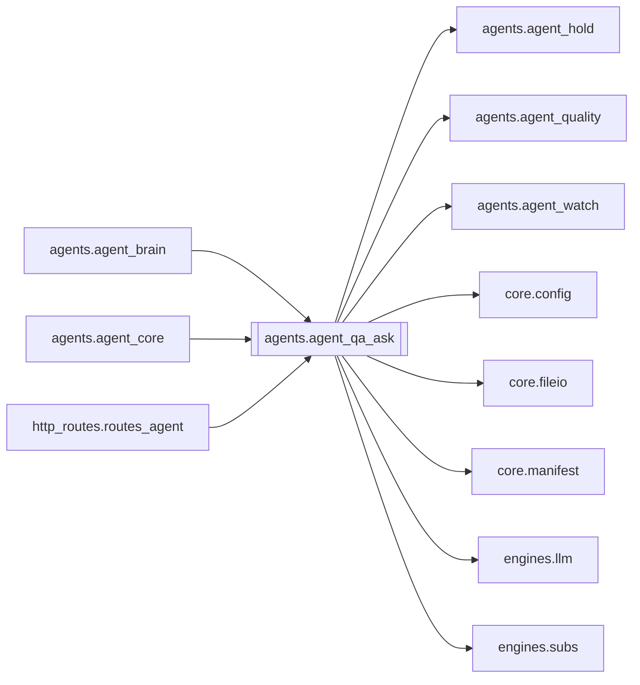

# `agents.agent_qa_ask`

[← Index](../generated/module-index.md) · [Brain home](../README.md)

<!-- AUTO:START — sinh bởi scripts/brain_build.py 2026-11-17 19:05. Đừng sửa tay khối này. -->
**File:** `agents/agent_qa_ask.py` · **Lớp:** `agent` · **777 dòng** (662 code) · **44 hàm**, **0 class** · sha1 `2cc7165129`

> Second Brain — HOLD QA hỏi người qua Telegram + tự xử lý khi quá hạn (2026-11-17 qaask). Vì sao: HOLD QA trước đây chỉ báo «cần người duyệt» (không nói câu nào, sai gì, nên sửa sao) và job giữ ghế hàng đợi vô hạn → 1 job

### Phụ thuộc

- **Gọi tới (import nội bộ):** [agents.agent_hold](./agents.agent_hold.md), [agents.agent_quality](./agents.agent_quality.md), [agents.agent_watch](./agents.agent_watch.md), [core.config](./core.config.md), [core.fileio](./core.fileio.md), [core.manifest](./core.manifest.md), [engines.llm](./engines.llm.md), [engines.subs](./engines.subs.md)
- **Được dùng bởi:** [agents.agent_brain](./agents.agent_brain.md), [agents.agent_core](./agents.agent_core.md), [http_routes.routes_agent](./http_routes.routes_agent.md)
- **Test:** `tests/test_brain_qa_ask.py`

### Hàm & class top-level

| Tên | Dòng | Dài | Tham số | Docstring |
|---|---:|---:|---|---|
| `_cfg` | 39 | 7 | `key, default` |  |
| `_f` | 48 | 5 | `key, default` |  |
| `sure_conf` | 55 | 2 | `` |  |
| `remind_min` | 59 | 2 | `` |  |
| `max_items` | 63 | 2 | `` |  |
| `_model` | 67 | 3 | `` |  |
| `_now` | 72 | 2 | `` |  |
| `is_soft` | 76 | 2 | `kind` |  |
| `load_ask` | 83 | 9 | `wd` |  |
| `save_ask` | 94 | 6 | `wd, ask` |  |
| `_index_path` | 102 | 4 | `work_root` |  |
| `_index_load` | 108 | 7 | `work_root` |  |
| `_index_add` | 117 | 6 | `work_root, chat_id, mid, jid` |  |
| `job_for_message` | 125 | 3 | `work_root, chat_id, mid` |  |
| `_rows` | 130 | 9 | `wd` |  |
| `_write_rows` | 141 | 18 | `wd, rows, vi_changed` |  |
| `_window` | 164 | 8 | `rows, j, radius` |  |
| `collect_items` | 174 | 42 | `rows, fallback_flags` | Cờ HIGH còn mở → item (gộp theo câu: 1 câu nhiều loại lỗi = 1 item). |
| `_llm_batch` | 232 | 26 | `cases` |  |
| `propose` | 260 | 22 | `items` | Điền prop_verdict/prop_vi/prop_why/prop_conf cho từng item. Trả danh sách lỗi (nếu có). |
| `has_prop` | 284 | 2 | `it` |  |
| `is_sure` | 288 | 2 | `it` |  |
| `create_ask` | 292 | 9 | `wd, jid, sig, fallback_flags, use_llm` |  |
| `open_items` | 303 | 2 | `ask` |  |
| `_cut` | 310 | 3 | `s, n` |  |
| `render_text` | 315 | 39 | `ask, title` |  |
| `keyboard` | 356 | 6 | `jid` |  |
| `_tg_enabled` | 364 | 2 | `` |  |
| `send` | 368 | 33 | `work_root, wd, ask, text, buttons` | Gửi tin (kèm nút) tới mọi user được phép; ghi message_id vào ask + index. Trả số tin gửi được. |
| `parse_reply` | 406 | 11 | `text, items` | `#12: câu` / `12. câu` mỗi dòng → {12: câu}. Không có số + đúng 1 câu đang mở → cả tin là câu mới. |
| `apply_decision` | 419 | 54 | `wd, ask, mode, only, user_lines, by` | mode: apply / skip / go / reply. Gắn qa_ack để scan không cờ lại. Trả {n_fix, n_ack, done, left}. |
| `auto_resolve` | 475 | 12 | `wd, ask` | Quá hạn: mềm → áp đề xuất (không có đề xuất = giữ nguyên); cứng chắc → áp đề xuất. |
| `clear_hold` | 489 | 14 | `wd` | Gỡ cờ HOLD QA trên manifest (dùng cho part job khi người xếp lại job cha). |
| `mark_deferred` | 505 | 18 | `wd, ask, ids` |  |
| `summary_line` | 525 | 7 | `res` |  |
| `answer` | 534 | 44 | `work_root, job_id, action, text, chat_id, reply_to, by` | Người trả lời (nút hoặc reply). Không tự resume — route gọi resume khi `release` = True. |
| `is_context_query` | 586 | 2 | `text` |  |
| `context_nums` | 590 | 3 | `text, items` |  |
| `context_text` | 595 | 37 | `wd, ask, nums, radius` | ±radius câu quanh mỗi câu (ZH/VI), câu bị cờ đánh ▶. Không gọi LLM. |
| `resolve_job` | 634 | 13 | `work_root, ref` | Job id đầy đủ hoặc tiền tố duy nhất (≥4 ký tự). |
| `current_sig` | 649 | 8 | `rows` | Cùng cách brain tính sig (summarize_flags.high_i, sort) → brain không hỏi trùng. |
| `show` | 659 | 30 | `work_root, ref` | /qa <job>: câu hỏi đang mở (hoặc tạo mới từ cờ high hiện tại) → text + nút. |
| `flags_for_agent` | 691 | 20 | `work_root, job_id` | Tool agent: câu đang bị cờ QA high (+ đề xuất nếu đã có câu hỏi). Không gọi LLM. |
| `mark_edited` | 713 | 65 | `wd, nums, by` | Sau khi sửa tay câu (agent): gắn qa_ack cho cờ high còn lại trên câu đó + đóng item câu hỏi. |

### Config / env keys (6)

`AGENT_TELEGRAM`, `HANG_FIX_MODEL`, `PRONOUN_MODEL`, `QA_ASK_MODEL`, `QA_FIX_MODEL`, `QA_HOLD_MAX_MIN`

**File/artifact nhắc tới:** `manifest.json`, `qa_ask.json`, `qa_ask_index.json`, `script.json`, `sub.vi.srt`

**Tín hiệu rủi ro (đếm tĩnh):** broad_except=16 · file_writes=4 · swallow_except=4

### Lịch sử (từ docs/)

- Fix logs: —
- Nhắc trong CHANGELOG: **1** lần · DECISIONS: **0** lần

<!-- AUTO:END -->

<!-- MANUAL:START -->
## Vai trò (viết tay)

_Chưa viết. 2–4 câu: module này chịu trách nhiệm gì trong pipeline, ai gọi nó, nó KHÔNG làm gì._

## Luồng chính

_Các hàm vào (entry) → bước chính → output/side effect. Ghi tên hàm thật._

## Bất biến & hợp đồng

_Điều luôn phải đúng (vd: chỉ ghi manifest qua `Manifest.update`; 1 job / ghế). Vi phạm = bug._

## Bẫy đã biết

_Lỗi từng gặp + link `docs/fixes/...`. Những chỗ dễ sửa sai._

## Ghi chú vận hành

_Config key quan trọng, cần restart gì khi sửa (:8801 / :8802 / hot-reload), cách test._
<!-- MANUAL:END -->
