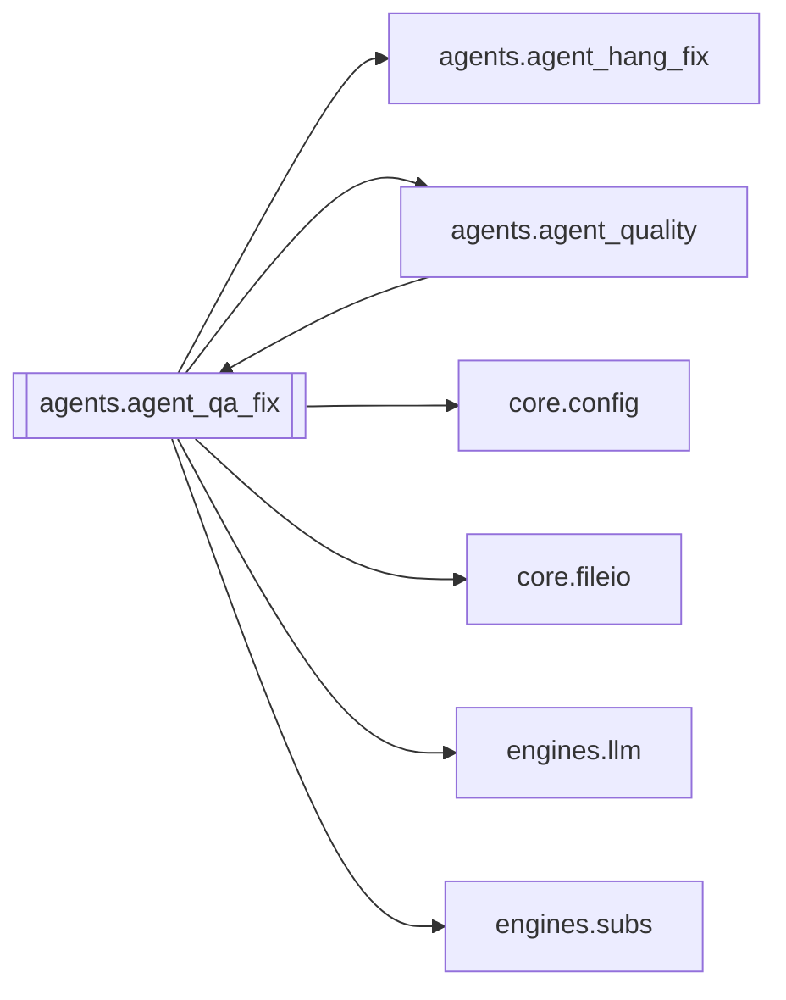

# `agents.agent_qa_fix`

[← Index](../generated/module-index.md) · [Brain home](../README.md)

<!-- AUTO:START — sinh bởi scripts/brain_build.py 2026-11-17 19:05. Đừng sửa tay khối này. -->
**File:** `agents/agent_qa_fix.py` · **Lớp:** `agent` · **202 dòng** (176 code) · **9 hàm**, **0 class** · sha1 `62a662fcc9`

> Second Brain — xử lý cờ QA HIGH loại khác `hang` (2026-11-17). Vì sao: trước đây chỉ `hang` có đường xử lý (agent_hang_fix). Cờ high khác (name_echo, calque, vi_pattern, empty_vi, nonsense_shape…) chỉ làm job HOLD và chờ

### Phụ thuộc

- **Gọi tới (import nội bộ):** [agents.agent_hang_fix](./agents.agent_hang_fix.md), [agents.agent_quality](./agents.agent_quality.md), [core.config](./core.config.md), [core.fileio](./core.fileio.md), [engines.llm](./engines.llm.md), [engines.subs](./engines.subs.md)
- **Được dùng bởi:** [agents.agent_quality](./agents.agent_quality.md)
- **Test:** `tests/test_brain_qa_fix_retry.py`

### Hàm & class top-level

| Tên | Dòng | Dài | Tham số | Docstring |
|---|---:|---:|---|---|
| `_cfg` | 27 | 7 | `key, default` |  |
| `enabled` | 36 | 2 | `` |  |
| `_model` | 40 | 3 | `` |  |
| `_max_tries` | 45 | 5 | `` |  |
| `_window` | 52 | 8 | `rows, j, radius` |  |
| `collect_cases` | 62 | 21 | `rows, flags` |  |
| `_llm_batch` | 98 | 20 | `cases` |  |
| `apply_items` | 120 | 28 | `rows, cases, items` |  |
| `fix_qa_job` | 150 | 53 | `work_dir, write` |  |

### Config / env keys (5)

`BRAIN_QA_FIX`, `HANG_FIX_MODEL`, `PRONOUN_MODEL`, `QA_FIX_MAX_TRIES`, `QA_FIX_MODEL`

**File/artifact nhắc tới:** `qa_fix_trace.json`, `script.json`, `sub.vi.srt`

**Tín hiệu rủi ro (đếm tĩnh):** broad_except=6 · file_writes=3 · swallow_except=2

### Lịch sử (từ docs/)

- Fix logs: —
- Nhắc trong CHANGELOG: **1** lần · DECISIONS: **0** lần

<!-- AUTO:END -->

<!-- MANUAL:START -->
## Vai trò (viết tay)

_Chưa viết. 2–4 câu: module này chịu trách nhiệm gì trong pipeline, ai gọi nó, nó KHÔNG làm gì._

## Luồng chính

_Các hàm vào (entry) → bước chính → output/side effect. Ghi tên hàm thật._

## Bất biến & hợp đồng

_Điều luôn phải đúng (vd: chỉ ghi manifest qua `Manifest.update`; 1 job / ghế). Vi phạm = bug._

## Bẫy đã biết

_Lỗi từng gặp + link `docs/fixes/...`. Những chỗ dễ sửa sai._

## Ghi chú vận hành

_Config key quan trọng, cần restart gì khi sửa (:8801 / :8802 / hot-reload), cách test._
<!-- MANUAL:END -->
