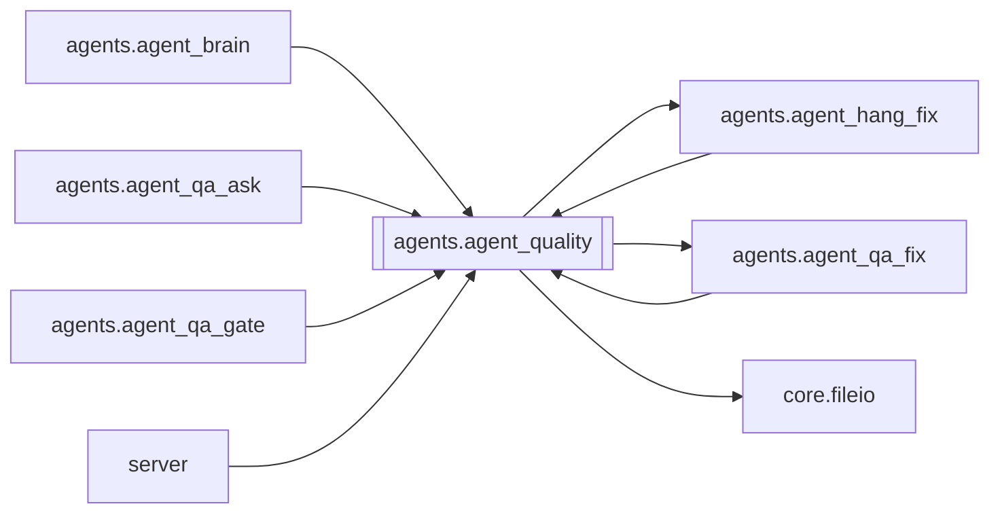

# `agents.agent_quality`

[← Index](../generated/module-index.md) · [Brain home](../README.md)

<!-- AUTO:START — sinh bởi scripts/brain_build.py 2026-11-17 19:05. Đừng sửa tay khối này. -->
**File:** `agents/agent_quality.py` · **Lớp:** `agent` · **389 dòng** (359 code) · **6 hàm**, **0 class** · sha1 `aeef85b33e`

> Deterministic VI quality scan + safe heals (Second Brain L2). Port từ D:\PinelineV2_tmp\_qa_watch_05670.py — không phụ thuộc Gemma.

### Phụ thuộc

- **Gọi tới (import nội bộ):** [agents.agent_hang_fix](./agents.agent_hang_fix.md), [agents.agent_qa_fix](./agents.agent_qa_fix.md), [core.fileio](./core.fileio.md)
- **Được dùng bởi:** [agents.agent_brain](./agents.agent_brain.md), [agents.agent_hang_fix](./agents.agent_hang_fix.md), [agents.agent_qa_ask](./agents.agent_qa_ask.md), [agents.agent_qa_fix](./agents.agent_qa_fix.md), [agents.agent_qa_gate](./agents.agent_qa_gate.md), [server](./server.md)
- **Test:** `tests/test_agent_quality.py`, `tests/test_brain_qa_ask.py`, `tests/test_brain_qa_fix_retry.py`

### Hàm & class top-level

| Tên | Dòng | Dài | Tham số | Docstring |
|---|---:|---:|---|---|
| `scan_script` | 68 | 119 | `rows` | Trả flags {i,sev,kind,note,zh,vi,rv,mt}. |
| `apply_safe_heals` | 189 | 51 | `rows` | Heal deterministic an toàn tại chỗ. Trả số câu đổi. |
| `summarize_flags` | 242 | 13 | `flags` |  |
| `write_qa_brain` | 257 | 13 | `work_dir, flags, healed` | Ghi work/<job>/qa_brain.json cho gate + UI. |
| `load_qa_brain` | 272 | 9 | `work_dir` |  |
| `scan_and_heal_job` | 283 | 107 | `work_dir, write` | Scan script.json → heal → (high hang) LLM trace/fix → qa_brain.json. |

**File/artifact nhắc tới:** `qa_brain.json`, `script.json`

**Tín hiệu rủi ro (đếm tĩnh):** broad_except=7 · file_writes=4

### Lịch sử (từ docs/)

- **Fix logs (2):**
  - [V5 không khởi động được → chuyển về bố cục package bằng sync_from_v2](../../fixes/2026-11-11-v5-package-sync.md)
  - [Brain HOLD vì high hang — cần LLM trace/xử lý rồi mới mở](../../fixes/2026-11-10-brain-hang-llm-fix.md)
- Nhắc trong CHANGELOG: **3** lần · DECISIONS: **1** lần

<!-- AUTO:END -->

<!-- MANUAL:START -->
## Vai trò (viết tay)

_Chưa viết. 2–4 câu: module này chịu trách nhiệm gì trong pipeline, ai gọi nó, nó KHÔNG làm gì._

## Luồng chính

_Các hàm vào (entry) → bước chính → output/side effect. Ghi tên hàm thật._

## Bất biến & hợp đồng

_Điều luôn phải đúng (vd: chỉ ghi manifest qua `Manifest.update`; 1 job / ghế). Vi phạm = bug._

## Bẫy đã biết

_Lỗi từng gặp + link `docs/fixes/...`. Những chỗ dễ sửa sai._

## Ghi chú vận hành

_Config key quan trọng, cần restart gì khi sửa (:8801 / :8802 / hot-reload), cách test._
<!-- MANUAL:END -->
