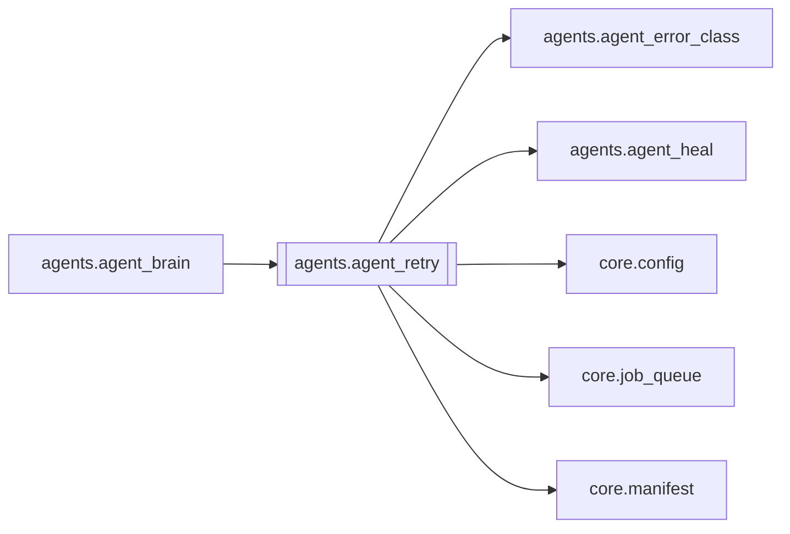

# `agents.agent_retry`

[← Index](../generated/module-index.md) · [Brain home](../README.md)

<!-- AUTO:START — sinh bởi scripts/brain_build.py 2026-11-17 19:05. Đừng sửa tay khối này. -->
**File:** `agents/agent_retry.py` · **Lớp:** `agent` · **196 dòng** (172 code) · **8 hàm**, **0 class** · sha1 `71bb0b57f4`

> Second Brain — tự thử lại stage FAILED (2026-11-17). Vì sao: L1 heal của brain chỉ chạy khi hàng đợi RẢNH, mà hàng đợi gần như luôn bận (log: 6071/6071 tick «tick busy — skip L1 heal») → job failed nằm đó mãi, không ai t

### Phụ thuộc

- **Gọi tới (import nội bộ):** [agents.agent_error_class](./agents.agent_error_class.md), [agents.agent_heal](./agents.agent_heal.md), [core.config](./core.config.md), [core.job_queue](./core.job_queue.md), [core.manifest](./core.manifest.md)
- **Được dùng bởi:** [agents.agent_brain](./agents.agent_brain.md)
- **Test:** `tests/test_brain_qa_fix_retry.py`

### Hàm & class top-level

| Tên | Dòng | Dài | Tham số | Docstring |
|---|---:|---:|---|---|
| `_cfg` | 28 | 7 | `key, default` |  |
| `enabled` | 37 | 2 | `` |  |
| `_backoff` | 41 | 5 | `` |  |
| `_max_tries` | 48 | 5 | `` |  |
| `_queued_ids` | 55 | 10 | `` |  |
| `_classify` | 67 | 6 | `stage, st` |  |
| `_soft_reset` | 75 | 23 | `d, failed` | failed → pending, giữ mọi artifact (pipeline tự bỏ qua / đọc bù phần đã có). |
| `retry_failed_jobs` | 100 | 97 | `work_root, state, hooks, log, notify, is_finished, max_jobs, now` |  |

### Config / env keys (3)

`AGENT_RETRY`, `RETRY_BACKOFF_MIN`, `RETRY_MAX`

**File/artifact nhắc tới:** `manifest.json`, `output.partial.mp4`

**Tín hiệu rủi ro (đếm tĩnh):** broad_except=6 · swallow_except=1

### Lịch sử (từ docs/)

- Fix logs: —
- Nhắc trong CHANGELOG: **1** lần · DECISIONS: **0** lần

<!-- AUTO:END -->

<!-- MANUAL:START -->
## Vai trò (viết tay)

_Chưa viết. 2–4 câu: module này chịu trách nhiệm gì trong pipeline, ai gọi nó, nó KHÔNG làm gì._

## Luồng chính

_Các hàm vào (entry) → bước chính → output/side effect. Ghi tên hàm thật._

## Bất biến & hợp đồng

_Điều luôn phải đúng (vd: chỉ ghi manifest qua `Manifest.update`; 1 job / ghế). Vi phạm = bug._

## Bẫy đã biết

_Lỗi từng gặp + link `docs/fixes/...`. Những chỗ dễ sửa sai._

## Ghi chú vận hành

_Config key quan trọng, cần restart gì khi sửa (:8801 / :8802 / hot-reload), cách test._
<!-- MANUAL:END -->
