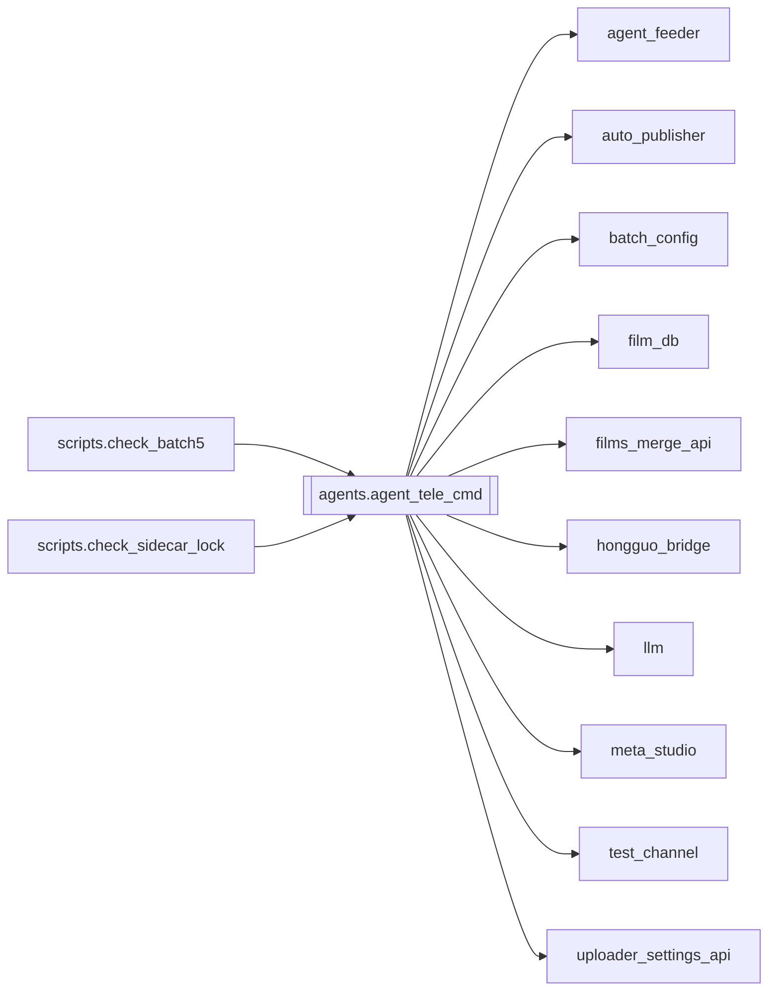

# `agents.agent_tele_cmd`

[← Index](../generated/module-index.md) · [Brain home](../README.md)

<!-- AUTO:START — sinh bởi scripts/brain_build.py 2026-11-11 02:38. Đừng sửa tay khối này. -->
**File:** `agents/agent_tele_cmd.py` · **Lớp:** `sidecar` · **2328 dòng** (2118 code) · **37 hàm**, **2 class** · sha1 `5904e3b2a7`

> Sidecar: Telegram lệnh + Auto-pilot + HTTP :8802 KHÔNG restart Pineline server — chỉ gọi API :8801. Chạy:  python agent_tele_cmd.py

### Phụ thuộc

- **Gọi tới (import nội bộ):** [agent_feeder](./agent_feeder.md), [auto_publisher](./auto_publisher.md), [batch_config](./batch_config.md), [film_db](./film_db.md), [films_merge_api](./films_merge_api.md), [hongguo_bridge](./hongguo_bridge.md), [llm](./llm.md), [meta_studio](./meta_studio.md), [test_channel](./test_channel.md), [uploader_settings_api](./uploader_settings_api.md)
- **Hot-reload (`importlib.reload`):** `hongguo_bridge`, `meta_studio`, `test_channel`
- **Được dùng bởi:** [scripts.check_batch5](./scripts.check_batch5.md), [scripts.check_sidecar_lock](./scripts.check_sidecar_lock.md)
- **Được nhắc tên file `.py` (subprocess/script) bởi:** [agent_tele_cmd](./agent_tele_cmd.md), [restart_server](./restart_server.md), [scripts.check_batch2](./scripts.check_batch2.md), [tools.migrate_work](./tools.migrate_work.md)
- **Test:** ❌ chưa có test import trực tiếp
- **Thư viện ngoài:** `PIL`, `agent_autopilot`, `agent_hongguo`, `agent_watch`, `canva_client`, `check_block`, `lib_check`, `requests`, `title_mt`

### Hàm & class top-level

| Tên | Dòng | Dài | Tham số | Docstring |
|---|---:|---:|---|---|
| **class `CtrlHandler`** | 904 | 8 method | |  |
| **class `_ExclusiveHTTPServer`** | 2254 | 1 method | | Windows: SO_REUSEADDR (mặc định của HTTPServer) cho bản thứ 2 bind trùng cổng. |
| `_load_history_from_disk` | 82 | 10 | `` |  |
| `_save_history_to_disk` | 94 | 11 | `` |  |
| `get_user_history` | 110 | 9 | `uid` |  |
| `add_user_history` | 121 | 11 | `uid, role, content` |  |
| `clear_user_history` | 134 | 5 | `uid` |  |
| `_ensure_agent_telegram` | 141 | 4 | `` |  |
| `tg_send` | 147 | 3 | `text, force` |  |
| `tg_api` | 152 | 13 | `method, payload` |  |
| `allowed_uids` | 167 | 3 | `` |  |
| `tg_send_video` | 172 | 19 | `chat_id, path, caption, buttons, meta` |  |
| `send_preview` | 196 | 42 | `uid, ref, ep` | Gửi tập xem thử (miễn phí) vào chat: video + nút chuyển tập + nút làm A-Z. |
| `send_covers` | 240 | 37 | `uid, page` | Album ảnh bìa (tối đa 10) của trang Leaderboard/Catalog đang xem — giống lưới poster của app. |
| `_edit_or_send` | 279 | 10 | `uid, cq, text, buttons` |  |
| `spawn_preview` | 291 | 2 | `uid, ref, ep` |  |
| `_parse_catalog_args` | 300 | 25 | `text` | '/hg catalog Urban popular completed' → genre / sort / status; phần còn lại = từ khoá. |
| `hg_tele_command` | 327 | 223 ⚠️ | `raw, uid` |  |
| `_send_confirm_buttons` | 552 | 12 | `uid, confirms` |  |
| `_agent_ask` | 566 | 10 | `msg, uid` | Chat agent; có uid (Telegram) thì tool phá huỷ đỗ lại và gửi nút ✅/❌. |
| `_confirm_callback` | 578 | 12 | `uid, cq, data` |  |
| `_slash_hint` | 600 | 32 | `text` | Chữ thường (không '/') mà đổi trạng thái → ("hint", gợi ý) nếu ngắn kiểu lệnh hoặc có tiền tố |
| `handle_command` | 634 | 218 ⚠️ | `text, uid` |  |
| `_agent_reply` | 854 | 10 | `msg, uid` |  |
| `_fetch_poster_bytes` | 866 | 33 | `name` |  |
| `autopilot_loop` | 1910 | 21 | `stop` |  |
| `filmdb_loop` | 1936 | 17 | `stop` |  |
| `runwatch_loop` | 2001 | 10 | `stop` | Luôn theo dõi job chạy + báo xong/treo; chỉ tự xử lý treo khi Auto-pilot ON. |
| `feeder_loop` | 2013 | 13 | `stop` |  |
| `_sync_and_report` | 2031 | 10 | `reason` |  |
| `config_watch_loop` | 2043 | 15 | `stop` |  |
| `_inline_kb` | 2060 | 3 | `rows` |  |
| `_on_callback` | 2065 | 92 | `cq, allow` |  |
| `telegram_loop` | 2159 | 46 | `stop` |  |
| `is_priority_cmd` | 2211 | 4 | `text` | Lệnh chạy ngay trên luồng poll, không xếp sau lượt agent đang nghĩ (tới 180s). |
| `_tg_worker` | 2217 | 10 | `stop` |  |
| `_handle_tg_text` | 2229 | 23 | `uid, text` |  |
| `_single_instance_lock` | 2264 | 14 | `` | Khoá 1 bản / cổng; trả file handle (giữ sống tới khi thoát) hoặc None nếu đã có bản khác. |
| `main` | 2280 | 45 | `` |  |

**Hàm dài ≥120 dòng:** `CtrlHandler.do_POST` (581, L1327), `CtrlHandler.do_GET` (365, L961), `hg_tele_command` (223, L327), `handle_command` (218, L634)

### Config / env keys (11)

`AGENT_TELEGRAM`, `AUTOPILOT_HOST`, `AUTOPILOT_PORT`, `AUTOPILOT_TICK_SEC`, `FILMDB_SEC`, `PINELINE_BASE`, `QUEUE_LIVE_CONFIG`, `RUNWATCH_SEC`, `TELEGRAM_POLL_SEC`, `TEMP`, `TMP`

**Cổng nhắc tới:** 8000, 8801, 8802

**File/artifact nhắc tới:** `tele_chat_history.json`

**Tín hiệu rủi ro (đếm tĩnh):** broad_except=58 · file_writes=3 · global_stmt=3 · sleep=3 · subprocess=1 · swallow_except=10 · threads=11

### Lịch sử (từ docs/)

- **Fix logs (12):**
  - [Meta tạo ảnh không work sau khi chuyển GPT local :3377](../../fixes/2026-11-09-meta-ai-image-3377.md)
  - [Helper Pineline leak / lệch WinUI (spawn riêng)](../../fixes/2026-11-08-helper-singleton-winui-parity.md)
  - [Settings + Uploader API 404 trên :8802; thiếu skip upload](../../fixes/2026-11-07-uploader-settings-8802.md)
  - [Films UI :8802 — onclick/`jq` chết + Settings/Uploader 404](../../fixes/2026-11-07-films-ui-syntax.md)
  - [Films UI thiếu nút gộp job đã làm (combine)](../../fixes/2026-11-07-films-combine-ui.md)
  - [Gộp job đã làm nối sai thứ tự Phần](../../fixes/2026-11-07-combine-part-order.md)
  - [Tìm mùa mới vẫn kéo download / mất base sau xoá Lib](../../fixes/2026-11-06-hg-watchlist-discover.md)
  - [Films UI: Studio lỗi + SyntaxError Test + poster 404 + toolbar rối](../../fixes/2026-11-06-films-ui-studio-test.md)
  - [Phim đã xoá thư mục vẫn tồn đọng trong films/ui và thiếu chức năng xoá phim](../../fixes/2026-10-09-films-ui-delete-missing.md)
  - [2026-10-06 — Đợt 5 review: agent an toàn hơn](../../fixes/2026-10-06-batch5-agent-safety.md)
  - [2026-10-06 — Đợt 4 review: tranh chấp ghi, một bản tiến trình, checkpoint an toàn](../../fixes/2026-10-06-batch4-write-races.md)
  - [2026-10-06 — Đợt 2 review: bảo mật + config một nguồn + LLM sập không để trống câu](../../fixes/2026-10-06-batch2-security.md)
- **Reviews:** [_atoms_http_agents](../../reviews/_atoms_http_agents.md), [2026-11-07-films-ui-swarm](../../reviews/2026-11-07-films-ui-swarm.md), [2026-11-06-v5-part-atoms](../../reviews/2026-11-06-v5-part-atoms.md), [2026-11-06-v5-func-catalog](../../reviews/2026-11-06-v5-func-catalog.md), [2026-11-02-v4-structure-sync](../../reviews/2026-11-02-v4-structure-sync.md), [2026-11-02-v4-structure-and-v2-port](../../reviews/2026-11-02-v4-structure-and-v2-port.md), [2026-10-06-code-review](../../reviews/2026-10-06-code-review.md)
- Nhắc trong CHANGELOG: **9** lần · DECISIONS: **1** lần

<!-- AUTO:END -->

<!-- MANUAL:START -->
## Vai trò (viết tay)

_Chưa viết. 2–4 câu: module này chịu trách nhiệm gì trong pipeline, ai gọi nó, nó KHÔNG làm gì._

## Luồng chính

_Các hàm vào (entry) → bước chính → output/side effect. Ghi tên hàm thật._

## Bất biến & hợp đồng

_Điều luôn phải đúng (vd: chỉ ghi manifest qua `Manifest.update`; 1 job / ghế). Vi phạm = bug._

## Bẫy đã biết

_Lỗi từng gặp + link `docs/fixes/...`. Những chỗ dễ sửa sai._

## Ghi chú vận hành

_Config key quan trọng, cần restart gì khi sửa (:8801 / :8802 / hot-reload), cách test._
<!-- MANUAL:END -->
