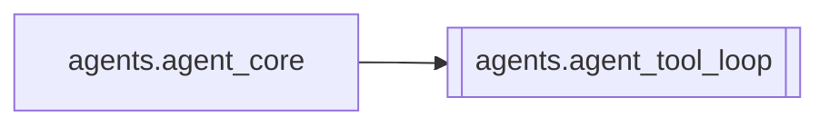

# `agents.agent_tool_loop`

[← Index](../generated/module-index.md) · [Brain home](../README.md)

<!-- AUTO:START — sinh bởi scripts/brain_build.py 2026-11-17 19:05. Đừng sửa tay khối này. -->
**File:** `agents/agent_tool_loop.py` · **Lớp:** `agent` · **481 dòng** (433 code) · **11 hàm**, **0 class** · sha1 `f8bd4a2143`

> Tool loop — điều khiển pipeline theo bước, chờ kết quả thật. Khác `pineline_run_stage` (fire-and-forget): mỗi bước start → poll manifest tới done|failed|stopped, rồi mới bước sau. Agent không spam GET API từ ngoài;

### Phụ thuộc

- **Gọi tới (import nội bộ):** —
- **Được dùng bởi:** [agents.agent_core](./agents.agent_core.md)
- **Test:** `tests/test_agent_tool_loop.py`

### Hàm & class top-level

| Tên | Dòng | Dài | Tham số | Docstring |
|---|---:|---:|---|---|
| `stage_snapshot` | 35 | 21 | `work_root, job_id, stage` | Đọc 1 stage từ manifest (disk) — không HTTP. |
| `_normalize_start` | 58 | 22 | `res` |  |
| `_looks_like_stop` | 82 | 12 | `work_root, job_id, snap` | True chỉ khi có .stop hoặc cur_text báo dừng — không nhầm salvage pending. |
| `wait_stage` | 96 | 103 | `work_root, job_id, stage, timeout_sec, poll_sec, stop_flag, pending…` | Poll disk tới terminal. Trả final snapshot + timeline ngắn. |
| `run_stage_wait` | 201 | 68 | `run_stage_fn, work_root, job_id, stage, opts, timeout_sec, poll_sec…` | Start 1 stage (hoặc skip nếu đã done & !force) rồi chờ terminal. |
| `pipeline_loop` | 271 | 61 | `run_stage_fn, work_root, job_id, stages, opts, timeout_sec, poll_se…` | Chạy tuần tự nhiều stage; mỗi stage chờ xong mới sang bước sau. |
| `http_job` | 336 | 4 | `base, job_id` |  |
| `http_run_stage` | 342 | 25 | `base, job_id, stage, opts` |  |
| `http_stage_snapshot` | 369 | 13 | `base, job_id, stage` |  |
| `http_run_stage_wait` | 384 | 61 | `base, job_id, stage, opts, timeout_sec, poll_sec` | Giống run_stage_wait nhưng qua HTTP + poll GET /api/jobs (cho smoke test). |
| `main` | 447 | 31 | `` |  |

### Config / env keys (1)

`PINELINE_BASE`

**Cổng nhắc tới:** 8801

**File/artifact nhắc tới:** `manifest.json`

**Tín hiệu rủi ro (đếm tĩnh):** broad_except=3 · sleep=2

### Lịch sử (từ docs/)

- **Fix logs (1):**
  - [REVIEW lỗi bị coi là đã soát · park treo hàng đợi · Brain V4 điều khiển nhầm V2](../../fixes/2026-11-11-review-fail-park-port.md)
- **Reviews:** [2026-11-11-v4-v5-port-review](../../reviews/2026-11-11-v4-v5-port-review.md), [2026-11-07-tool-loop](../../reviews/2026-11-07-tool-loop.md)
- Nhắc trong CHANGELOG: **1** lần · DECISIONS: **0** lần

<!-- AUTO:END -->

<!-- MANUAL:START -->
## Vai trò (viết tay)

_Chưa viết. 2–4 câu: module này chịu trách nhiệm gì trong pipeline, ai gọi nó, nó KHÔNG làm gì._

## Luồng chính

_Các hàm vào (entry) → bước chính → output/side effect. Ghi tên hàm thật._

## Bất biến & hợp đồng

_Điều luôn phải đúng (vd: chỉ ghi manifest qua `Manifest.update`; 1 job / ghế). Vi phạm = bug._

## Bẫy đã biết

_Lỗi từng gặp + link `docs/fixes/...`. Những chỗ dễ sửa sai._

## Ghi chú vận hành

_Config key quan trọng, cần restart gì khi sửa (:8801 / :8802 / hot-reload), cách test._
<!-- MANUAL:END -->
