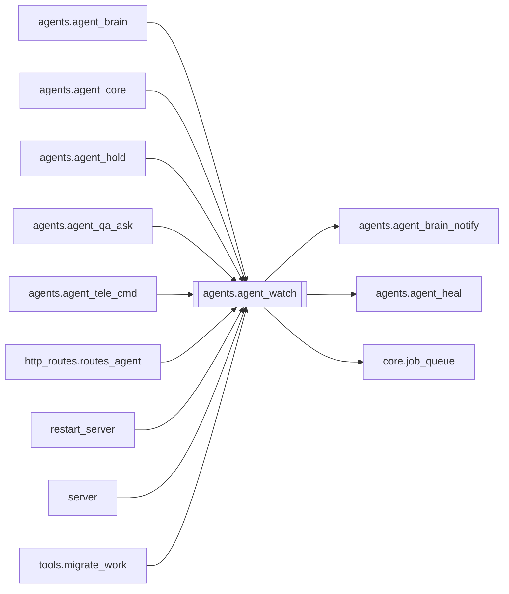

# `agents.agent_watch`

[← Index](../generated/module-index.md) · [Brain home](../README.md)

<!-- AUTO:START — sinh bởi scripts/brain_build.py 2026-11-17 19:05. Đừng sửa tay khối này. -->
**File:** `agents/agent_watch.py` · **Lớp:** `agent` · **408 dòng** (347 code) · **20 hàm**, **0 class** · sha1 `2f79f9105e`

> Watcher A: định kỳ scan → heal safe + log + Telegram (tuỳ chọn). Env: AGENT_WATCH=1

### Phụ thuộc

- **Gọi tới (import nội bộ):** [agents.agent_brain_notify](./agents.agent_brain_notify.md), [agents.agent_heal](./agents.agent_heal.md), [core.job_queue](./core.job_queue.md)
- **Được dùng bởi:** [agents.agent_brain](./agents.agent_brain.md), [agents.agent_core](./agents.agent_core.md), [agents.agent_hold](./agents.agent_hold.md), [agents.agent_qa_ask](./agents.agent_qa_ask.md), [agents.agent_tele_cmd](./agents.agent_tele_cmd.md), [http_routes.routes_agent](./http_routes.routes_agent.md), [restart_server](./restart_server.md), [server](./server.md), [tools.migrate_work](./tools.migrate_work.md)
- **Test:** `tests/test_agent_brain_notify.py`

### Hàm & class top-level

| Tên | Dòng | Dài | Tham số | Docstring |
|---|---:|---:|---|---|
| `_log_dir` | 33 | 4 | `root` |  |
| `log_line` | 39 | 9 | `root, msg` |  |
| `_state_path` | 50 | 2 | `root` |  |
| `_load_state` | 54 | 8 | `root` |  |
| `_save_state` | 64 | 7 | `root, state` |  |
| `_cooldown_sec` | 73 | 5 | `` |  |
| `_skip_prefixes` | 80 | 3 | `` |  |
| `_should_skip_job` | 85 | 3 | `job_id` |  |
| `_fingerprint` | 90 | 4 | `problem` |  |
| `_load_dotenv` | 96 | 14 | `path` |  |
| `telegram_config` | 112 | 13 | `` |  |
| `telegram_send` | 127 | 28 | `text, force, dedupe_key` |  |
| `_gpu_busy` | 157 | 21 | `work_root` |  |
| `_filter_problems` | 180 | 26 | `work_root, problems` | Bỏ job test + đang cooldown cùng fingerprint. |
| `_mark_healed` | 208 | 10 | `work_root, problems` |  |
| `_read_manifest` | 220 | 6 | `d` |  |
| `watch_once` | 228 | 116 | `work_root, list_jobs, hooks, max_jobs` |  |
| `_loop` | 346 | 27 | `work_root, list_jobs, hooks, interval, max_jobs` |  |
| `start_watcher` | 375 | 30 | `work_root, list_jobs, hooks` |  |
| `stop_watcher` | 407 | 2 | `` |  |

### Config / env keys (9)

`AGENT_TELEGRAM`, `AGENT_TELEGRAM_STARTUP`, `AGENT_WATCH`, `AGENT_WATCH_COOLDOWN`, `AGENT_WATCH_MAX_JOBS`, `AGENT_WATCH_SEC`, `AGENT_WATCH_SKIP_PREFIX`, `TELEGRAM_ALLOWED_USERS`, `TELEGRAM_BOT_TOKEN`

**File/artifact nhắc tới:** `agent_watch.log`, `agent_watch_state.json`, `manifest.json`

**Tín hiệu rủi ro (đếm tĩnh):** broad_except=16 · file_writes=1 · global_stmt=1 · swallow_except=5 · threads=1

### Lịch sử (từ docs/)

- **Fix logs (2):**
  - [Port V2→V5: Second Brain (Telegram events + gỡ HOLD khi chạy tay) + đóng dấu luồng dịch theo job](../../fixes/2026-11-12-port-brain-hold-pipeline.md)
  - [2026-10-06 — Đợt 4 review: tranh chấp ghi, một bản tiến trình, checkpoint an toàn](../../fixes/2026-10-06-batch4-write-races.md)
- **Reviews:** [_atoms_http_agents](../../reviews/_atoms_http_agents.md), [2026-11-06-v5-part-atoms](../../reviews/2026-11-06-v5-part-atoms.md), [2026-11-06-v5-func-catalog](../../reviews/2026-11-06-v5-func-catalog.md), [2026-11-02-v4-structure-sync](../../reviews/2026-11-02-v4-structure-sync.md), [2026-10-06-code-review](../../reviews/2026-10-06-code-review.md)
- Nhắc trong CHANGELOG: **1** lần · DECISIONS: **0** lần

<!-- AUTO:END -->

<!-- MANUAL:START -->
## Vai trò (viết tay)

_Chưa viết. 2–4 câu: module này chịu trách nhiệm gì trong pipeline, ai gọi nó, nó KHÔNG làm gì._

## Luồng chính

_Các hàm vào (entry) → bước chính → output/side effect. Ghi tên hàm thật._

## Bất biến & hợp đồng

_Điều luôn phải đúng (vd: chỉ ghi manifest qua `Manifest.update`; 1 job / ghế). Vi phạm = bug._

## Bẫy đã biết

_Lỗi từng gặp + link `docs/fixes/...`. Những chỗ dễ sửa sai._

## Ghi chú vận hành

_Config key quan trọng, cần restart gì khi sửa (:8801 / :8802 / hot-reload), cách test._
<!-- MANUAL:END -->
