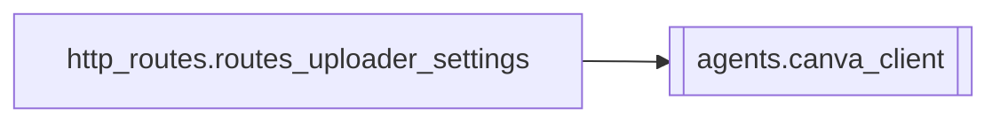

# `agents.canva_client`

[← Index](../generated/module-index.md) · [Brain home](../README.md)

<!-- AUTO:START — sinh bởi scripts/brain_build.py 2026-11-11 02:38. Đừng sửa tay khối này. -->
**File:** `agents/canva_client.py` · **Lớp:** `publish` · **406 dòng** (340 code) · **12 hàm**, **0 class** · sha1 `19407b1891`

> canva_client.py — Tích hợp Canva Connect API chính thức cho Pineline. Quản lý OAuth2 (PKCE), Upload Assets, Tạo Design YouTube Thumbnail (16:9) và Autofill.

### Phụ thuộc

- **Gọi tới (import nội bộ):** —
- **Được dùng bởi:** [http_routes.routes_uploader_settings](./http_routes.routes_uploader_settings.md)
- **Test:** ❌ chưa có test import trực tiếp
- **Thư viện ngoài:** `requests`

### Hàm & class top-level

| Tên | Dòng | Dài | Tham số | Docstring |
|---|---:|---:|---|---|
| `load_config` | 31 | 14 | `` |  |
| `save_config` | 47 | 17 | `client_id, client_secret, redirect_uri` |  |
| `load_token` | 66 | 13 | `` |  |
| `save_token` | 81 | 5 | `token_data` |  |
| `is_connected` | 88 | 3 | `` |  |
| `generate_auth_url` | 93 | 47 | `` | Tạo URL đăng nhập OAuth2 Canva kèm PKCE (code_verifier, code_challenge). |
| `exchange_code` | 142 | 35 | `code, state` | Đổi authorization code lấy access_token. |
| `refresh_access_token` | 179 | 22 | `refresh_token` | Tự động làm mới access_token bằng refresh_token. |
| `_get_auth_headers` | 203 | 7 | `` |  |
| `upload_asset` | 212 | 55 | `image_data_or_path, name` | Upload ảnh lên Canva Asset Library để sử dụng trong thiết kế. |
| `import_design_from_image` | 269 | 51 | `image_bytes, title` | Import ảnh trực tiếp vào Canva để tạo thiết kế có sẵn hình ảnh (không bị trang trắng). |
| `create_youtube_thumbnail` | 322 | 85 | `title, poster_source, thumb_image_source` | Tạo một thiết kế YouTube Thumbnail 16:9 mới trên Canva và trả về edit_url. |

### Config / env keys (4)

`CANVA_CLIENT_ID`, `CANVA_CLIENT_SECRET`, `CANVA_REDIRECT_URI`, `PORT`

**File/artifact nhắc tới:** `canva_config.json`, `canva_pkce.json`, `canva_token.json`

**Tín hiệu rủi ro (đếm tĩnh):** broad_except=9 · file_writes=3 · sleep=2 · swallow_except=4

### Lịch sử (từ docs/)

- Fix logs: —
- **Reviews:** [_atoms_http_agents](../../reviews/_atoms_http_agents.md), [2026-11-06-v5-part-atoms](../../reviews/2026-11-06-v5-part-atoms.md), [2026-11-06-v5-func-catalog](../../reviews/2026-11-06-v5-func-catalog.md), [2026-11-02-v4-duplication-audit](../../reviews/2026-11-02-v4-duplication-audit.md)
- Nhắc trong CHANGELOG: **0** lần · DECISIONS: **0** lần

<!-- AUTO:END -->

<!-- MANUAL:START -->
## Vai trò (viết tay)

_Chưa viết. 2–4 câu: module này chịu trách nhiệm gì trong pipeline, ai gọi nó, nó KHÔNG làm gì._

## Luồng chính

_Các hàm vào (entry) → bước chính → output/side effect. Ghi tên hàm thật._

## Bất biến & hợp đồng

_Điều luôn phải đúng (vd: chỉ ghi manifest qua `Manifest.update`; 1 job / ghế). Vi phạm = bug._

## Bẫy đã biết

_Lỗi từng gặp + link `docs/fixes/...`. Những chỗ dễ sửa sai._

## Ghi chú vận hành

_Config key quan trọng, cần restart gì khi sửa (:8801 / :8802 / hot-reload), cách test._
<!-- MANUAL:END -->
