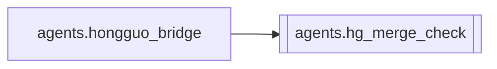

# `agents.hg_merge_check`

[← Index](../generated/module-index.md) · [Brain home](../README.md)

<!-- AUTO:START — sinh bởi scripts/brain_build.py 2026-11-17 19:05. Đừng sửa tay khối này. -->
**File:** `agents/hg_merge_check.py` · **Lớp:** `source` · **480 dòng** (426 code) · **17 hàm**, **0 class** · sha1 `f8d4a78980`

> hg_merge_check.py — kiểm tra + chuẩn hoá các tập TRƯỚC khi gộp, và kiểm file SAU khi gộp (2026-11-16). Vì sao: gộp `-c copy` thẳng các tập tải về cho ra nhiều file gộp hỏng — tập tải cụt / không đọc được, tập lệch độ phâ

### Phụ thuộc

- **Gọi tới (import nội bộ):** —
- **Được dùng bởi:** [agents.hongguo_bridge](./agents.hongguo_bridge.md)
- **Test:** `tests/test_hg_merge_check.py`

### Hàm & class top-level

| Tên | Dòng | Dài | Tham số | Docstring |
|---|---:|---:|---|---|
| `_cfg` | 40 | 11 | `key, default` |  |
| `_run` | 53 | 9 | `cmd, timeout` |  |
| `_f` | 64 | 5 | `v, d` |  |
| `_fps` | 71 | 6 | `s` |  |
| `_err_lines` | 79 | 2 | `stderr` |  |
| `probe` | 84 | 11 | `path` |  |
| `last_video_pts` | 97 | 14 | `path` | pts (giây) của gói hình cuối cùng thật sự có trong file — None nếu không đọc được. |
| `check_episode` | 113 | 87 | `path, deep` | {name, ok, fatal:[...], fix:[...], warn:[...], dur, sig{...}} — fatal = không dùng được; fix = cần chuẩn hoá. |
| `check_all` | 202 | 15 | `eps, deep, workers, on_pct` |  |
| `_sig_tuple` | 223 | 2 | `s` |  |
| `missing_numbers` | 227 | 6 | `nums` |  |
| `make_plan` | 235 | 46 | `checks, on_bad, ep_nums` | {"mode": copy/normalize/stop, "reasons": [...], "bad": [...], "use": [chỉ số tập dùng], "target": {...}} |
| `normalize_episode` | 284 | 23 | `src, dst, target, vargs, has_audio` |  |
| `concat_copy` | 309 | 16 | `parts, out` |  |
| `verify_merged` | 327 | 32 | `out, durs, span` | Độ dài file gộp ≈ tổng các tập; giải mã thử quanh mỗi mối nối. {"ok", "dur", "expect", "bad_joints": [...]} |
| `_write_report` | 361 | 7 | `folder, rep` |  |
| `run_merge` | 370 | 111 | `folder, eps, out_name, vargs, ep_nums, on_phase, on_note, on_bad, s…` | Kiểm → (chuẩn hoá) → gộp → kiểm lại. Trả {"ok", "merged_file", "policy", "report", "error"?}. |

### Config / env keys (4)

`HG_MERGE_CHECK`, `HG_MERGE_CHECK_WORKERS`, `HG_MERGE_ON_BAD`, `HG_MERGE_TMP`

**File/artifact nhắc tới:** `.tmp.mp4`, `list.txt`, `merge_check.json`

**Tín hiệu rủi ro (đếm tĩnh):** broad_except=1 · file_writes=1 · pools=2 · subprocess=1

### Lịch sử (từ docs/)

- **Fix logs (1):**
  - [2026-11-17 — Xoá Hongguo classic + kiểm tra/chuẩn hoá tập khi gộp](../../fixes/2026-11-17-hg-classic-removed-merge-check.md)
- Nhắc trong CHANGELOG: **1** lần · DECISIONS: **0** lần

<!-- AUTO:END -->

<!-- MANUAL:START -->
## Vai trò (viết tay)

_Chưa viết. 2–4 câu: module này chịu trách nhiệm gì trong pipeline, ai gọi nó, nó KHÔNG làm gì._

## Luồng chính

_Các hàm vào (entry) → bước chính → output/side effect. Ghi tên hàm thật._

## Bất biến & hợp đồng

_Điều luôn phải đúng (vd: chỉ ghi manifest qua `Manifest.update`; 1 job / ghế). Vi phạm = bug._

## Bẫy đã biết

_Lỗi từng gặp + link `docs/fixes/...`. Những chỗ dễ sửa sai._

## Ghi chú vận hành

_Config key quan trọng, cần restart gì khi sửa (:8801 / :8802 / hot-reload), cách test._
<!-- MANUAL:END -->
