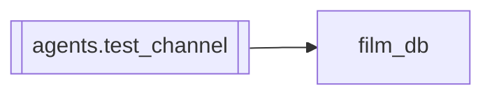

# `agents.test_channel`

[← Index](../generated/module-index.md) · [Brain home](../README.md)

<!-- AUTO:START — sinh bởi scripts/brain_build.py 2026-11-11 02:38. Đừng sửa tay khối này. -->
**File:** `agents/test_channel.py` · **Lớp:** `publish` · **1283 dòng** (1078 code) · **32 hàm**, **0 class** · sha1 `6626517662`

> test_channel.py — Quản lý Kênh Phụ Test (Burner Channel) độc lập trong Pineline. Chức năng: - Đăng nhập Google OAuth Kênh Phụ / Gmail Test riêng (tách biệt hoàn toàn với kênh Sage Review).

### Phụ thuộc

- **Gọi tới (import nội bộ):** [film_db](./film_db.md)
- **Được dùng bởi:** —
- **Test:** ❌ chưa có test import trực tiếp
- **Thư viện ngoài:** `check_block`, `google`, `google_auth_oauthlib`, `googleapiclient`, `lib_check`

### Hàm & class top-level

| Tên | Dòng | Dài | Tham số | Docstring |
|---|---:|---:|---|---|
| `_safe_resolve_title_vi` | 37 | 15 | `name, title_vi` | Gọi lib_check.resolve_title_vi an toàn, tự động reload nếu module bị cache cũ. |
| `_utc_now` | 97 | 2 | `` |  |
| `_utc_now_plus_minutes` | 101 | 2 | `minutes` |  |
| `_today_utc` | 105 | 2 | `` |  |
| `get_channel_limit_state` | 113 | 11 | `` | Kiểm tra xem kênh YouTube đã bị dính uploadLimitExceeded hôm nay chưa. |
| `mark_channel_limit_reached` | 126 | 9 | `channel_title` | Đánh dấu Kênh YouTube chạm giới hạn upload hôm nay. |
| `get_projects_health` | 137 | 8 | `` | Đọc dữ liệu kiểm tra tính khả dụng của từng Project. |
| `update_project_health` | 147 | 35 | `project_id, api_enabled, channel_title, channel_id, email, enable_u…` | Cập nhật trạng thái API của Project. |
| `verify_all_projects_health` | 184 | 75 | `force` | Kiểm tra thực tế trạng thái YouTube API và kênh kết nối cho từng Project. |
| `get_exhausted_projects` | 261 | 7 | `` |  |
| `mark_project_exhausted` | 270 | 4 | `project_id` |  |
| `reset_exhausted_projects` | 276 | 14 | `project_id` | Reset cờ hết quota 429 hoặc khóa upload cho project cụ thể hoặc toàn bộ. |
| `list_projects` | 292 | 40 | `` |  |
| `get_today_uploads_count` | 338 | 65 | `force` | Đếm số video đã upload trong ngày trên Kênh Test qua YouTube Data API (cache 120s, tốn chỉ 1-2 quota units). |
| `get_status` | 405 | 27 | `` | Kiểm tra trạng thái kết nối Kênh Phụ Test và danh sách Projects. |
| `disconnect` | 434 | 11 | `` | Ngắt kết nối Kênh Phụ Test. |
| `get_auth_url` | 447 | 50 | `redirect_uri, project_id` | Tạo URL đăng nhập Google OAuth cho Project được chọn hoặc project chưa kết nối tiếp theo. |
| `finish_oauth` | 499 | 92 | `code, redirect_uri, project_id` | Hoàn tất đăng nhập OAuth và lưu token cho Project tương ứng. |
| `get_available_service` | 593 | 78 | `` | Lấy YouTube service từ project khả dụng đầu tiên trong pool (chưa hết quota hôm nay và đã bật API). |
| `get_read_service` | 673 | 19 | `` | Lấy YouTube service từ bất kỳ project nào đã kết nối để đọc metadata (chỉ tốn 1 quota unit, không phụ thuộc quota upload). |
| `get_youtube_service` | 694 | 4 | `` | Lấy YouTube API service khả dụng. |
| `upload_test_sample` | 702 | 66 | `name, sample_path, title_vi` | Upload clip mẫu 90s lên Kênh Phụ Test ở chế độ Unlisted, tự động xoay vòng Project khi gặp Quota 429. |
| `delete_test_video` | 770 | 20 | `video_id` | Xoá video test trên YouTube sau khi đã kiểm tra xong. |
| `wait_and_check_test_video` | 792 | 84 | `video_id, name, max_wait_sec` | Chờ YouTube xử lý xong video và kiểm tra bản quyền Content ID chính xác. |
| `recheck_single` | 880 | 77 | `name` | Kiểm tra bản quyền Content ID của 1 video đã upload lên Kênh Phụ. |
| `check_and_process_pending_rechecks` | 959 | 26 | `force` | Quét và kiểm tra lại các video đang chờ (mặc định kiểm tra những video đã qua 15p). |
| `start_recheck_daemon` | 989 | 18 | `` | Khởi động daemon định kỳ kiểm tra các video đến hạn 5 phút. |
| `run_full_test_for_season` | 1011 | 99 | `name, auto_delete, wait_for_result, title_vi` | Thực hiện quy trình test 1 bộ phim: |
| `_batch_worker` | 1112 | 116 | `names, auto_delete, title_vi_map` |  |
| `stop_batch_test` | 1230 | 8 | `` | Yêu cầu dừng Test All sau item hiện tại (không kill giữa upload). |
| `start_batch_test` | 1240 | 27 | `names, limit, auto_delete, title_vi_map` | Bắt đầu chạy Test All hàng loạt ngầm. |
| `get_batch_progress` | 1269 | 11 | `` | Lấy tiến độ Test All hiện tại và thống kê số video đang chờ 15p. |

### Config / env keys (2)

`OAUTHLIB_RELAX_TOKEN_SCOPE`, `TEST_YT_SECRET`

**File/artifact nhắc tới:** `channel.json`, `channel_limit.json`, `client_secret.json`, `code_verifier.txt`, `current_oauth_project.txt`, `exhausted.json`, `projects.json`, `projects_health.json`, `token.json`

**Tín hiệu rủi ro (đếm tĩnh):** broad_except=31 · file_writes=15 · global_stmt=4 · sleep=6 · swallow_except=15 · threads=2

### Lịch sử (từ docs/)

- **Fix logs (3):**
  - [Films UI Test Block báo hết quota dù GCP còn hạn](../../fixes/2026-11-09-tc-quota-false-positive.md)
  - [Kênh Test báo token Kênh 3 chết dù đã Reset Quota](../../fixes/2026-11-07-test-channel-exhausted-mask.md)
  - [Films UI: Studio lỗi + SyntaxError Test + poster 404 + toolbar rối](../../fixes/2026-11-06-films-ui-studio-test.md)
- **Reviews:** [_atoms_tools_ui](../../reviews/_atoms_tools_ui.md), [2026-11-06-v5-func-catalog](../../reviews/2026-11-06-v5-func-catalog.md)
- Nhắc trong CHANGELOG: **2** lần · DECISIONS: **0** lần

<!-- AUTO:END -->

<!-- MANUAL:START -->
## Vai trò (viết tay)

_Chưa viết. 2–4 câu: module này chịu trách nhiệm gì trong pipeline, ai gọi nó, nó KHÔNG làm gì._

## Luồng chính

_Các hàm vào (entry) → bước chính → output/side effect. Ghi tên hàm thật._

## Bất biến & hợp đồng

_Điều luôn phải đúng (vd: chỉ ghi manifest qua `Manifest.update`; 1 job / ghế). Vi phạm = bug._

## Bẫy đã biết

_Lỗi từng gặp + link `docs/fixes/...`. Những chỗ dễ sửa sai._

## Ghi chú vận hành

_Config key quan trọng, cần restart gì khi sửa (:8801 / :8802 / hot-reload), cách test._
<!-- MANUAL:END -->
