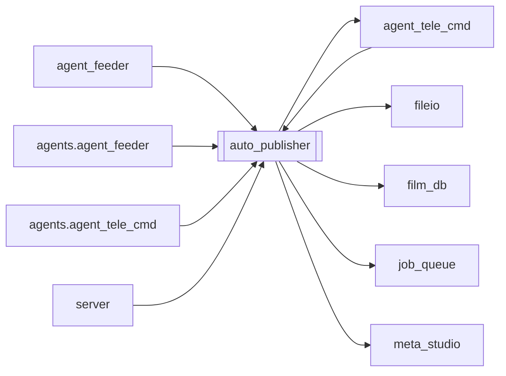

# `auto_publisher`

[← Index](../generated/module-index.md) · [Brain home](../README.md)

<!-- AUTO:START — sinh bởi scripts/brain_build.py 2026-11-11 02:38. Đừng sửa tay khối này. -->
**File:** `auto_publisher.py` · **Lớp:** `publish` · **1567 dòng** (1353 code) · **36 hàm**, **0 class** · sha1 `077c68d3f6`

> auto_publisher.py — Tự động hoá toàn trình: Sau khi render xong → Tự tạo Metadata SEO & Thumbnail 16:9 bằng Aurora AI → Tự Upload trực tiếp ngầm lên YouTube qua API.

### Phụ thuộc

- **Gọi tới (import nội bộ):** [agent_tele_cmd](./agent_tele_cmd.md), [fileio](./fileio.md), [film_db](./film_db.md), [job_queue](./job_queue.md), [meta_studio](./meta_studio.md)
- **Được dùng bởi:** [agent_feeder](./agent_feeder.md), [agent_tele_cmd](./agent_tele_cmd.md), [agents.agent_feeder](./agents.agent_feeder.md), [agents.agent_tele_cmd](./agents.agent_tele_cmd.md), [server](./server.md)
- **Test:** ❌ chưa có test import trực tiếp
- **Thư viện ngoài:** `PIL`, `google`, `googleapiclient`, `manifest`

### Hàm & class top-level

| Tên | Dòng | Dài | Tham số | Docstring |
|---|---:|---:|---|---|
| `get_auto_state` | 64 | 21 | `` | Lấy trạng thái tiến trình tự động xuất bản (đồng bộ liên tiến trình qua file). |
| `update_auto_state` | 87 | 21 | `**kwargs` | Cập nhật trạng thái tiến trình và ghi đồng bộ ra file cho các tiến trình khác đọc. |
| `_read_publish_queue` | 110 | 8 | `` |  |
| `_write_publish_queue` | 120 | 6 | `items` |  |
| `is_auto_split_part` | 132 | 24 | `job_id` | True nếu job là mảnh auto-split (…_p01) — chỉ parent Full được upload. |
| `_enqueue_job_record` | 158 | 61 | `job_id, privacy, schedule_hours, force, allow_oversized` | Thêm job vào hàng chờ upload liên tiến trình (data/auto_publish_queue.json). |
| `_dequeue_job_record` | 221 | 13 | `job_id` | Xoá job khỏi hàng chờ upload sau khi đã xử lý xong. |
| `_sync_queue_state_badge` | 236 | 10 | `` | Đồng bộ số lượng và danh sách job đang chờ upload vào auto_publish_state.json. |
| `touch_active_locks` | 248 | 9 | `` | Làm mới mtime của các file lock đang giữ khi upload chunk lớn (tránh bị coi là stale). |
| `is_pid_alive` | 259 | 15 | `pid` | Kiểm tra xem PID có đang thực sự chạy trên Windows không. |
| `get_job_lock_path` | 276 | 6 | `job_id` | Xác định đường dẫn file lock của job (ưu tiên trong thư mục work/<job_id>). |
| `acquire_job_lock` | 284 | 36 | `job_id, stale_sec` | Chiếm lock liên tiến trình cho job_id. |
| `release_job_lock` | 322 | 14 | `fd, lock_path` | Giải phóng lock liên tiến trình cho job. |
| `acquire_global_publish_lock` | 338 | 54 | `job_id, wait_timeout, stale_sec` | Chiếm khoá upload toàn cục liên tiến trình để đảm bảo tại mọi thời điểm |
| `release_global_publish_lock` | 394 | 14 | `fd, lock_path` | Giải phóng khoá upload toàn cục liên tiến trình. |
| `is_any_job_uploading` | 410 | 23 | `stale_sec` | Kiểm tra xem có bất kỳ job nào đang trong quá trình tự động xuất bản không. |
| `is_job_uploading` | 435 | 16 | `job_id` | Kiểm tra job có đang được xử lý upload ở bất kỳ tiến trình nào không. |
| `load_config` | 453 | 19 | `` | Tải cấu hình tự động upload. |
| `save_config` | 474 | 7 | `cfg` | Lưu cấu hình tự động upload. |
| `get_youtube_service` | 483 | 16 | `account_id` | Lấy YouTube API service từ tài khoản trong Z:\yt_uploader\accounts. |
| `format_youtube_title` | 501 | 64 | `ai_title, clean_name, season` | Chuẩn hoá tiêu đề YouTube theo format chuẩn: Phần X / [Tên phim] - [Hook]. |
| `upload_to_youtube` | 567 | 117 | `video_path, title, description, tags, thumb_path, privacy, publish_…` | Upload trực tiếp video + thumbnail lên YouTube qua API v3. |
| `_revert_job_to_done` | 686 | 24 | `job_id, error_msg` | Hoàn trả trạng thái job về 'done' khi quá trình upload bị lỗi hoặc gián đoạn để không bị kẹt ở 'uploading'. |
| `_oversized_youtube_reasons` | 712 | 17 | `row, out_path` | Lý do file quá dài/nặng cho YouTube (dùng từ chối auto-publish). |
| `enqueue_publish` | 731 | 58 | `job_id, privacy, schedule_hours, force, allow_oversized` | Đưa job vừa hoàn thành vào hàng đợi xuất bản tuần tự (không làm đứt quãng job đang upload). |
| `_drain_publish_queue_async` | 791 | 12 | `` | Khởi chạy luồng nền xử lý tuần tự từng job trong hàng đợi nếu chưa có luồng drain nào đang chạy. |
| `_is_yt_upload_limit_error` | 805 | 8 | `err` | True nếu YouTube báo hết hạn mức upload ngày (uploadLimitExceeded). |
| `_drain_publish_queue_loop` | 815 | 44 | `` | Vòng lặp lấy từng job từ hàng đợi ra xuất bản tuần tự cho đến khi hết. |
| `publish_job` | 861 | 112 | `job_id, privacy, schedule_hours, force, allow_oversized` | Quy trình toàn diện: Sinh Metadata qua Aurora → Dựng Thumbnail 16:9 → Upload lên YouTube. |
| `_publish_job_internal` | 975 | 387 ⚠️ | `job_id, privacy, schedule_hours, force` |  |
| `_collect_and_enqueue_done_jobs` | 1364 | 75 | `` | Đồng bộ films.db, tự động giải cứu các job bị kẹt trạng thái 'uploading' mồ côi (không còn tiến trình giữ lock), |
| `scan_and_publish_completed_jobs` | 1441 | 58 | `` | Quét và tự động xuất bản tất cả các job đã xong (done) nhưng chưa upload. |
| `_scan_and_publish_impl` | 1501 | 40 | `` |  |
| `_auto_publish_worker_loop` | 1543 | 9 | `` | Vòng lặp chạy ngầm tự động quét sau mỗi 60 giây. |
| `start_worker` | 1554 | 9 | `` | Khởi động worker ngầm nếu chưa chạy. |
| `stop_worker` | 1565 | 3 | `` | Dừng worker ngầm. |

**Hàm dài ≥120 dòng:** `_publish_job_internal` (387, L975)

### Config / env keys (1)

`YT_UPLOADER_DIR`

**File/artifact nhắc tới:** `.auto_publish_global.lock`, `.upload.lock`, `auto_publish_config.json`, `auto_publish_queue.json`, `auto_publish_state.json`, `client_secret.json`, `final.mp4`, `manifest.json`, `output.mp4`, `token.json`, `upload_history.jsonl`

**Tín hiệu rủi ro (đếm tĩnh):** broad_except=44 · file_writes=2 · global_stmt=2 · sleep=3 · swallow_except=25 · threads=2

### Lịch sử (từ docs/)

- **Fix logs (6):**
  - [`/api/hg/poster` 502 với job_id / `downloads`](../../fixes/2026-11-09-hg-poster-502-junk-name.md)
  - [Auto-split part (Phần N/N) bị đưa vào upload](../../fixes/2026-11-08-skip-split-part-upload.md)
  - [Skip đang upload khó tìm — UX sticky + Done; cảnh báo file >11.5h](../../fixes/2026-11-07-uploader-skip-ux.md)
  - [Auto-publish banner stuck 41% sau restart sidecar](../../fixes/2026-11-06-autopub-scan-lock-stuck.md)
  - [Auto-publish tiếp tục upload khi YouTube uploadLimitExceeded](../../fixes/2026-11-05-upload-limit-stop-queue.md)
  - [Thumb AI chữ sai / không hợp lý — prompt đóng cứng](../../fixes/2026-11-04-thumb-hardcoded-prompt.md)
- **Reviews:** [_atoms_http_agents](../../reviews/_atoms_http_agents.md), [2026-11-06-v5-part-atoms](../../reviews/2026-11-06-v5-part-atoms.md), [2026-11-06-v5-func-catalog](../../reviews/2026-11-06-v5-func-catalog.md), [2026-11-02-v4-structure-and-v2-port](../../reviews/2026-11-02-v4-structure-and-v2-port.md)
- Nhắc trong CHANGELOG: **5** lần · DECISIONS: **0** lần

<!-- AUTO:END -->

<!-- MANUAL:START -->
## Vai trò (viết tay)

_Chưa viết. 2–4 câu: module này chịu trách nhiệm gì trong pipeline, ai gọi nó, nó KHÔNG làm gì._

## Luồng chính

_Các hàm vào (entry) → bước chính → output/side effect. Ghi tên hàm thật._

## Bất biến & hợp đồng

_Điều luôn phải đúng (vd: chỉ ghi manifest qua `Manifest.update`; 1 job / ghế). Vi phạm = bug._

## Bẫy đã biết

_Lỗi từng gặp + link `docs/fixes/...`. Những chỗ dễ sửa sai._

## Ghi chú vận hành

_Config key quan trọng, cần restart gì khi sửa (:8801 / :8802 / hot-reload), cách test._
<!-- MANUAL:END -->
