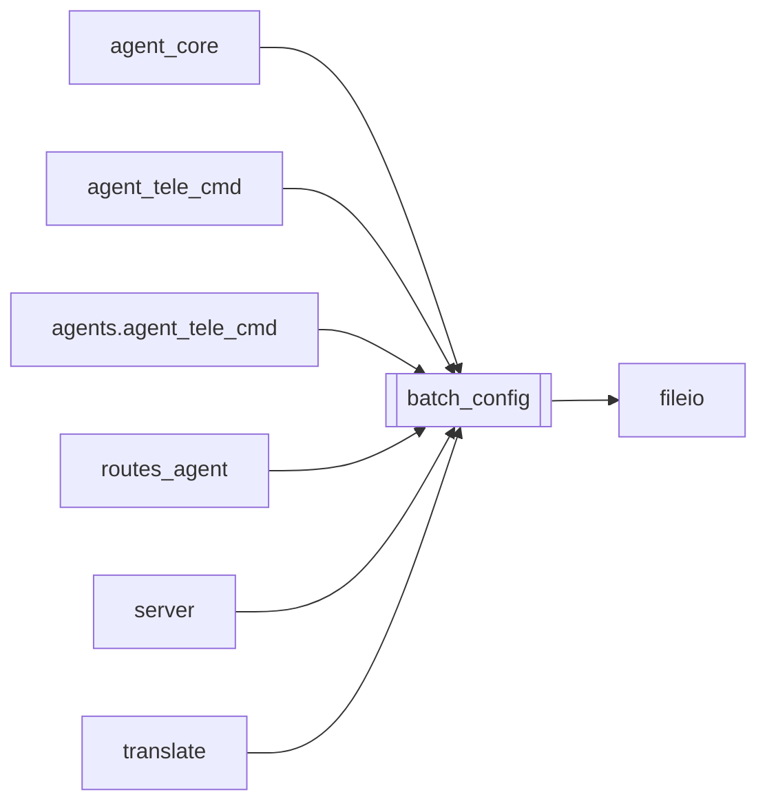

# `batch_config`

[← Index](../generated/module-index.md) · [Brain home](../README.md)

<!-- AUTO:START — sinh bởi scripts/brain_build.py 2026-11-11 02:38. Đừng sửa tay khối này. -->
**File:** `batch_config.py` · **Lớp:** `control` · **295 dòng** (257 code) · **14 hàm**, **0 class** · sha1 `8251967b54`

> Cấu hình batch dùng chung — 1 nguồn duy nhất cho Auto-pilot, Agent (queue_add), Telegram (/config /set) và UI (nút «Lưu làm config batch»). File: work/logs/batch_config.json

### Phụ thuộc

- **Gọi tới (import nội bộ):** [fileio](./fileio.md)
- **Được dùng bởi:** [agent_core](./agent_core.md), [agent_tele_cmd](./agent_tele_cmd.md), [agents.agent_tele_cmd](./agents.agent_tele_cmd.md), [routes_agent](./routes_agent.md), [server](./server.md), [translate](./translate.md)
- **Test:** `tests/test_hardsub_blur_toggle.py`

### Hàm & class top-level

| Tên | Dòng | Dài | Tham số | Docstring |
|---|---:|---:|---|---|
| `_now` | 84 | 2 | `` |  |
| `as_bool` | 88 | 12 | `val, default` | Parse bool an toàn — `bool("false")` là True nên không dùng raw bool(). |
| `_coerce` | 102 | 29 | `key, val` |  |
| `load` | 136 | 22 | `` | File hỏng/đang ghi dở → trả bản đọc tốt gần nhất (không rơi về DEFAULTS: Auto-pilot |
| `resolve_job_opts` | 160 | 12 | `*layers, fill_voice` | Opts của 1 job = config batch hiện tại ⊕ từng lớp (lớp sau đè lớp trước, bỏ None/pin_opts). |
| `_norm_zoom` | 174 | 11 | `v` |  |
| `render_kwargs` | 187 | 28 | `o` | Tham số render (_do_render / MuxReq) từ opts đã resolve. |
| `meta` | 217 | 8 | `` |  |
| `_write` | 227 | 7 | `opts, by` |  |
| `update` | 236 | 18 | `patch, by` | Gộp patch vào config hiện tại. Key lạ / giá trị sai → ValueError. |
| `reset` | 256 | 4 | `by` |  |
| `parse_kv` | 262 | 10 | `text` | 'audio_mode=voice_bgm orig_vol=0.3 brand_text="Kênh A"' → dict. |
| `describe` | 274 | 11 | `opts` |  |
| `review_backup_mode` | 287 | 9 | `opts` | off / aurora_parallel — Aurora GPT làm REVIEW (qua REVIEW_MODEL / AURORA_REVIEW_MODEL). |

**File/artifact nhắc tới:** `batch_config.json`

**Tín hiệu rủi ro (đếm tĩnh):** broad_except=2 · global_stmt=2 · sleep=1

### Lịch sử (từ docs/)

- **Fix logs (4):**
  - [Thêm bật/tắt che hardsub (blur)](../../fixes/2026-11-07-hardsub-blur-toggle.md)
  - [Phim dài ~12h lệch khung sub — nguyên nhân + split_parts](../../fixes/2026-11-02-longfilm-sub-drift-split.md)
  - [2026-10-06 — Đợt 3 review: opts một nguồn, config file-first, ghi nguyên tử](../../fixes/2026-10-06-batch3-single-source.md)
  - [2026-10-06 — Đợt 2 review: bảo mật + config một nguồn + LLM sập không để trống câu](../../fixes/2026-10-06-batch2-security.md)
- **Reviews:** [_atoms_core_server](../../reviews/_atoms_core_server.md), [2026-11-06-v5-part-atoms](../../reviews/2026-11-06-v5-part-atoms.md), [2026-11-06-v5-func-catalog](../../reviews/2026-11-06-v5-func-catalog.md), [2026-11-02-v4-structure-and-v2-port](../../reviews/2026-11-02-v4-structure-and-v2-port.md), [2026-10-06-code-review](../../reviews/2026-10-06-code-review.md)
- Nhắc trong CHANGELOG: **8** lần · DECISIONS: **2** lần

<!-- AUTO:END -->

<!-- MANUAL:START -->
## Vai trò (viết tay)

_Chưa viết. 2–4 câu: module này chịu trách nhiệm gì trong pipeline, ai gọi nó, nó KHÔNG làm gì._

## Luồng chính

_Các hàm vào (entry) → bước chính → output/side effect. Ghi tên hàm thật._

## Bất biến & hợp đồng

_Điều luôn phải đúng (vd: chỉ ghi manifest qua `Manifest.update`; 1 job / ghế). Vi phạm = bug._

## Bẫy đã biết

_Lỗi từng gặp + link `docs/fixes/...`. Những chỗ dễ sửa sai._

## Ghi chú vận hành

_Config key quan trọng, cần restart gì khi sửa (:8801 / :8802 / hot-reload), cách test._
<!-- MANUAL:END -->
