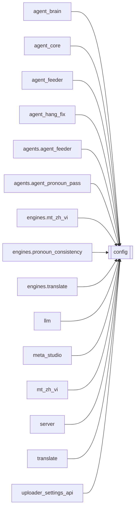

# `config`

[← Index](../generated/module-index.md) · [Brain home](../README.md)

<!-- AUTO:START — sinh bởi scripts/brain_build.py 2026-11-11 02:38. Đừng sửa tay khối này. -->
**File:** `config.py` · **Lớp:** `control` · **188 dòng** (148 code) · **8 hàm**, **0 class** · sha1 `af4401b1f1`

> config.py — Cấu hình/đường dẫn PORTABLE cho Pineline. Thứ tự ưu tiên khi lấy 1 giá trị: biến môi trường  >  pineline.config.json  >  mặc định. install.py sẽ ghi pineline.config.json với đường dẫn thật của máy (venv, HF c

### Phụ thuộc

- **Gọi tới (import nội bộ):** —
- **Được dùng bởi:** [agent_brain](./agent_brain.md), [agent_core](./agent_core.md), [agent_feeder](./agent_feeder.md), [agent_hang_fix](./agent_hang_fix.md), [agents.agent_feeder](./agents.agent_feeder.md), [agents.agent_pronoun_pass](./agents.agent_pronoun_pass.md), [engines.mt_zh_vi](./engines.mt_zh_vi.md), [engines.pronoun_consistency](./engines.pronoun_consistency.md), [engines.translate](./engines.translate.md), [llm](./llm.md), [meta_studio](./meta_studio.md), [mt_zh_vi](./mt_zh_vi.md), [server](./server.md), [translate](./translate.md), [uploader_settings_api](./uploader_settings_api.md)
- **Test:** ❌ chưa có test import trực tiếp

### Hàm & class top-level

| Tên | Dòng | Dài | Tham số | Docstring |
|---|---:|---:|---|---|
| `_load_cfg` | 20 | 19 | `force` | Nạp lại pineline.config.json khi file đổi (tránh setdefault env khóa giá trị cũ). |
| `_from_file_keys` | 73 | 2 | `` |  |
| `inject_env` | 77 | 24 | `` | Chép pineline.config.json (rồi config.json) vào os.environ để tiến trình con kế thừa. |
| `get` | 103 | 23 | `key, default` | env var  >  config.json  >  default. |
| `llm_settings` | 128 | 13 | `` | LLM cho job (dịch/review) — đọc lúc gọi để sửa pineline.config.json có hiệu lực không cần restart. |
| `pass_llm_model` | 143 | 14 | `kind` | Model cho pass ngắn (name/pronoun). Ưu tiên NAME_MODEL/PRONOUN_MODEL → CHATGPT_* → REVIEW → LLM. |
| `agent_llm` | 159 | 11 | `` | LLM cho agent chat / feeder: AGENT_* rồi LLM_* (cả hai file trước env). |
| `venv_python` | 172 | 4 | `venv_dir` | Đường dẫn python trong venv, đúng theo OS. |

### Config / env keys (25)

`AGENT_API_KEY`, `AGENT_BASE_URL`, `AGENT_FALLBACK_MODEL`, `AGENT_MODEL`, `AURORA_BASE_URL`, `CHATGPT_BASE_URL`, `CHATGPT_MODEL`, `HF_HOME`, `HF_HUB_DISABLE_SYMLINKS`, `HF_HUB_DISABLE_SYMLINKS_WARNING`, `LLM_API_KEY`, `LLM_BASE_URL`, `LLM_MODEL`, `NAME_MODEL`, `OMNI_CWD`, `OMNI_DEVICE`, `OMNI_MODEL`, `OMNI_PY`, `PINELINE_OMNI_ENV`, `PINELINE_VIENEU_ENV`, `PRONOUN_MODEL`, `REVIEW_MODEL`, `TRANSLATE_MODEL`, `VIENEU_DEVICE`, `VIENEU_PY`

**Cổng nhắc tới:** 8083

**File/artifact nhắc tới:** `config.json`, `pineline.config.json`

**Tín hiệu rủi ro (đếm tĩnh):** broad_except=2 · global_stmt=1

### Lịch sử (từ docs/)

- **Fix logs (3):**
  - [2026-10-06 — Đợt 6 review: bảo trì (git, pytest, M3, dọn script chết)](../../fixes/2026-10-06-batch6-maintenance.md)
  - [2026-10-06 — Đợt 3 review: opts một nguồn, config file-first, ghi nguyên tử](../../fixes/2026-10-06-batch3-single-source.md)
  - [2026-10-06 — Đợt 2 review: bảo mật + config một nguồn + LLM sập không để trống câu](../../fixes/2026-10-06-batch2-security.md)
- **Reviews:** [_atoms_core_server](../../reviews/_atoms_core_server.md), [2026-11-06-v5-part-atoms](../../reviews/2026-11-06-v5-part-atoms.md), [2026-11-06-v5-func-catalog](../../reviews/2026-11-06-v5-func-catalog.md), [2026-10-06-code-review](../../reviews/2026-10-06-code-review.md)
- Nhắc trong CHANGELOG: **4** lần · DECISIONS: **1** lần

<!-- AUTO:END -->

<!-- MANUAL:START -->
## Vai trò (viết tay)

_Chưa viết. 2–4 câu: module này chịu trách nhiệm gì trong pipeline, ai gọi nó, nó KHÔNG làm gì._

## Luồng chính

_Các hàm vào (entry) → bước chính → output/side effect. Ghi tên hàm thật._

## Bất biến & hợp đồng

_Điều luôn phải đúng (vd: chỉ ghi manifest qua `Manifest.update`; 1 job / ghế). Vi phạm = bug._

## Bẫy đã biết

_Lỗi từng gặp + link `docs/fixes/...`. Những chỗ dễ sửa sai._

## Ghi chú vận hành

_Config key quan trọng, cần restart gì khi sửa (:8801 / :8802 / hot-reload), cách test._
<!-- MANUAL:END -->
