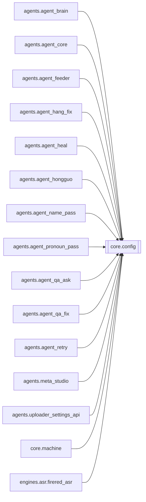

# `core.config`

[← Index](../generated/module-index.md) · [Brain home](../README.md)

<!-- AUTO:START — sinh bởi scripts/brain_build.py 2026-11-17 19:05. Đừng sửa tay khối này. -->
**File:** `core/config.py` · **Lớp:** `core` · **194 dòng** (154 code) · **8 hàm**, **0 class** · sha1 `6056d910ff`

> config.py — Cấu hình/đường dẫn PORTABLE cho Pineline. Thứ tự ưu tiên khi lấy 1 giá trị: biến môi trường  >  pineline.config.json  >  mặc định. install.py sẽ ghi pineline.config.json với đường dẫn thật của máy (venv, HF c

### Phụ thuộc

- **Gọi tới (import nội bộ):** —
- **Được dùng bởi:** [agents.agent_brain](./agents.agent_brain.md), [agents.agent_core](./agents.agent_core.md), [agents.agent_feeder](./agents.agent_feeder.md), [agents.agent_hang_fix](./agents.agent_hang_fix.md), [agents.agent_heal](./agents.agent_heal.md), [agents.agent_hongguo](./agents.agent_hongguo.md), [agents.agent_name_pass](./agents.agent_name_pass.md), [agents.agent_pronoun_pass](./agents.agent_pronoun_pass.md), [agents.agent_qa_ask](./agents.agent_qa_ask.md), [agents.agent_qa_fix](./agents.agent_qa_fix.md), [agents.agent_retry](./agents.agent_retry.md), [agents.meta_studio](./agents.meta_studio.md), [agents.uploader_settings_api](./agents.uploader_settings_api.md), [core.machine](./core.machine.md), [engines.asr.firered_asr](./engines.asr.firered_asr.md), [engines.clone_tts](./engines.clone_tts.md), [engines.cloud_retry](./engines.cloud_retry.md), [engines.download](./engines.download.md), [engines.hs_ocr_fast](./engines.hs_ocr_fast.md), [engines.llm](./engines.llm.md), [engines.media_ts](./engines.media_ts.md), [engines.mt_zh_vi](./engines.mt_zh_vi.md), [engines.pronoun_consistency](./engines.pronoun_consistency.md), [engines.render](./engines.render.md), [engines.render_fx](./engines.render_fx.md), [engines.sfx_lib](./engines.sfx_lib.md), [engines.source_preflight](./engines.source_preflight.md), [engines.subs](./engines.subs.md), [engines.translate](./engines.translate.md), [engines.translate_simple.cfg](./engines.translate_simple.cfg.md), [http_routes.routes_uploader_settings](./http_routes.routes_uploader_settings.md), [scripts.check_batch2](./scripts.check_batch2.md), [scripts.check_batch3](./scripts.check_batch3.md), [scripts.check_env](./scripts.check_env.md), [scripts.test_deepseek_plan](./scripts.test_deepseek_plan.md), [server](./server.md)
- **Được nhắc tên file `.py` (subprocess/script) bởi:** [core.machine](./core.machine.md), [restart_server](./restart_server.md), [scripts._tmp_extract_sigs_batch2](./scripts._tmp_extract_sigs_batch2.md), [scripts.brain_build](./scripts.brain_build.md), [scripts.check_env](./scripts.check_env.md)
- **Test:** `tests/test_chatgpt_route.py`, `tests/test_layout_paths.py`, `tests/test_translate_simple.py`

### Hàm & class top-level

| Tên | Dòng | Dài | Tham số | Docstring |
|---|---:|---:|---|---|
| `_load_cfg` | 20 | 19 | `force` | Nạp lại pineline.config.json khi file đổi (tránh setdefault env khóa giá trị cũ). |
| `_from_file_keys` | 75 | 2 | `` |  |
| `inject_env` | 79 | 24 | `` | Chép pineline.config.json (rồi config.json) vào os.environ để tiến trình con kế thừa. |
| `get` | 105 | 23 | `key, default` | env var  >  config.json  >  default. |
| `llm_settings` | 130 | 17 | `` | LLM cho job (dịch/review) — đọc lúc gọi để sửa pineline.config.json có hiệu lực không cần restart. |
| `pass_llm_model` | 149 | 14 | `kind` | Model cho pass ngắn (name/pronoun). Ưu tiên NAME_MODEL/PRONOUN_MODEL → CHATGPT_* → REVIEW → LLM. |
| `agent_llm` | 165 | 11 | `` | LLM cho agent chat / feeder: AGENT_* rồi LLM_* (cả hai file trước env). |
| `venv_python` | 178 | 4 | `venv_dir` | Đường dẫn python trong venv, đúng theo OS. |

### Config / env keys (2)

`HF_HUB_DISABLE_SYMLINKS`, `HF_HUB_DISABLE_SYMLINKS_WARNING`

**Cổng nhắc tới:** 8083

**File/artifact nhắc tới:** `config.json`, `pineline.config.json`

**Tín hiệu rủi ro (đếm tĩnh):** broad_except=2 · global_stmt=1

### Lịch sử (từ docs/)

- **Fix logs (3):**
  - [2026-10-06 — Đợt 6 review: bảo trì (git, pytest, M3, dọn script chết)](../../fixes/2026-10-06-batch6-maintenance.md)
  - [2026-10-06 — Đợt 3 review: opts một nguồn, config file-first, ghi nguyên tử](../../fixes/2026-10-06-batch3-single-source.md)
  - [2026-10-06 — Đợt 2 review: bảo mật + config một nguồn + LLM sập không để trống câu](../../fixes/2026-10-06-batch2-security.md)
- **Reviews:** [_atoms_core_server](../../reviews/_atoms_core_server.md), [2026-11-06-v5-part-atoms](../../reviews/2026-11-06-v5-part-atoms.md), [2026-11-06-v5-func-catalog](../../reviews/2026-11-06-v5-func-catalog.md), [2026-10-06-code-review](../../reviews/2026-10-06-code-review.md)
- Nhắc trong CHANGELOG: **5** lần · DECISIONS: **1** lần

<!-- AUTO:END -->

<!-- MANUAL:START -->
> ⚠️ Chép từ thẻ V2 ngày 2026-11-11 — **chưa xác minh với bản `core/` của V5** (có thể cũ hơn root/V2). brain-keeper cần soát lại.

## Vai trò (viết tay)

Nguồn cấu hình portable: đường dẫn máy, venv, model, key LLM. Đọc `pineline.config.json` (secret — **không commit, không in**) + env + default. Tự nạp lại file khi mtime đổi (`_load_cfg`).

## Luồng chính

- `get(key, default)` — hàm mọi module dùng (thường alias `cfg`, `_cfg_get`, `_get`…). Danh sách key + nơi đọc: `generated/config-keys.md`.
- `inject_env()` — đẩy giá trị file vào env cho subprocess.
- `llm_settings()`, `pass_llm_model(kind)`, `agent_llm()` — gói cấu hình LLM theo vai.
- `venv_python(venv_dir)` — đường python của venv engine.

## Bất biến & hợp đồng — thứ tự ưu tiên

| Nhóm key | Thắng |
|---|---|
| `LLM_FILE_FIRST_KEYS` (LLM_*, TRANSLATE/REVIEW/NAME/PRONOUN_MODEL, CHATGPT_*, AURORA_*, REVIEW_PARALLEL*, REVIEW_BACKUP, REVIEW_PASS1_*…), `AGENT_FILE_FIRST_KEYS`, `RENDER_ENCODER/DUB_VOL/BGM_VOL`, tiền tố `SUB_`, `HARDSUB_` | **file** > env > default — sửa file có hiệu lực ngay |
| Còn lại | env (`run_v2.bat`, shell) > file > default |
| Opts job | snapshot `queue_opts` lúc xếp hàng (không thuộc config.py) |

Lý do file-first: env kế thừa từ shell khởi động server từng giữ model đã bỏ suốt phiên (comment trong `config.py`).

## Bẫy đã biết

- Module đọc key **lúc import** (hằng số module-level) sẽ không thấy thay đổi file tới khi restart — kiểm trước khi hứa "có hiệu lực ngay".
- Key mới phải thêm vào `pineline.config.example.json`; key LLM/REVIEW mới cân nhắc thêm vào `LLM_FILE_FIRST_KEYS`.
- Docs không được ghi giá trị secret — chỉ tên key.

## Ghi chú vận hành

Sửa `config.py` → restart :8801 + :8802. Sửa `pineline.config.json` → key file-first ăn ngay, key env-first cần restart với `--clean-env`.
<!-- MANUAL:END -->
