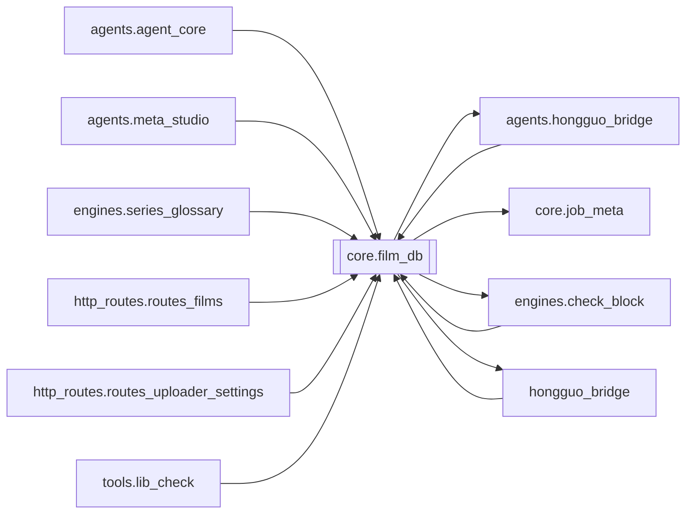

# `core.film_db`

[← Index](../generated/module-index.md) · [Brain home](../README.md)

<!-- AUTO:START — sinh bởi scripts/brain_build.py 2026-11-11 02:38. Đừng sửa tay khối này. -->
**File:** `core/film_db.py` · **Lớp:** `core` · **1064 dòng** (933 code) · **41 hàm**, **0 class** · sha1 `70648478ee`

> Database phim đã làm (SQLite) — nguồn sự thật lâu dài, không mất khi xoá thư mục job. films   : 1 dòng / job — tên gốc + tên Việt, series/mùa, file nguồn, trạng thái, thời lượng, output, config lồng tiếng, link YouTube (

### Phụ thuộc

- **Gọi tới (import nội bộ):** [agents.hongguo_bridge](./agents.hongguo_bridge.md), [core.job_meta](./core.job_meta.md), [engines.check_block](./engines.check_block.md), [hongguo_bridge](./hongguo_bridge.md)
- **Được dùng bởi:** [agents.agent_core](./agents.agent_core.md), [agents.hongguo_bridge](./agents.hongguo_bridge.md), [agents.meta_studio](./agents.meta_studio.md), [engines.check_block](./engines.check_block.md), [engines.series_glossary](./engines.series_glossary.md), [hongguo_bridge](./hongguo_bridge.md), [http_routes.routes_films](./http_routes.routes_films.md), [http_routes.routes_uploader_settings](./http_routes.routes_uploader_settings.md), [tools.lib_check](./tools.lib_check.md)
- **Được nhắc tên file `.py` (subprocess/script) bởi:** [restart_server](./restart_server.md), [scripts._hg_watchlist_snippet](./scripts._hg_watchlist_snippet.md), [scripts._port_hg_watchlist_film_db](./scripts._port_hg_watchlist_film_db.md), [scripts._tmp_extract_sigs_batch2](./scripts._tmp_extract_sigs_batch2.md)
- **Test:** `tests/test_auto_publisher_dedup.py`, `tests/test_film_db_queue_meta.py`, `tests/test_queue_http_state.py`

### Hàm & class top-level

| Tên | Dòng | Dài | Tham số | Docstring |
|---|---:|---:|---|---|
| `_utc` | 128 | 2 | `` |  |
| `norm_path` | 132 | 2 | `p` |  |
| `connect` | 136 | 34 | `` |  |
| `log_event` | 172 | 6 | `job_id, kind, detail` |  |
| `_status_of` | 182 | 12 | `stages` |  |
| `_series_season` | 196 | 8 | `title, series_id` |  |
| `_num` | 206 | 5 | `v, cast` |  |
| `_is_upload_lock_active` | 213 | 20 | `job_id` | Kiểm tra nhanh xem .upload.lock của job còn thuộc về tiến trình đang sống không. |
| `row_from_manifest` | 235 | 56 | `job_id, m` |  |
| `sync_one` | 301 | 38 | `job_id` | Đồng bộ tức thì 1 job từ work/<job_id>/manifest.json vào films.db. |
| `sync` | 341 | 57 | `hg_library` | Quét manifest → upsert films; ghi event khi trạng thái đổi. Trả {new, changed, total}. |
| `needs_series_ids` | 400 | 4 | `` |  |
| `sync_uploads` | 406 | 82 | `` | Link YouTube từ Z:\yt_uploader\upload_history.jsonl và queue_state.json. |
| `source_keys` | 492 | 3 | `` |  |
| `series_ids` | 497 | 3 | `` |  |
| `update_block_status` | 502 | 18 | `job_id, status, reason` | Cập nhật trạng thái bản quyền (clean/blocked/claim/private/unknown) và lý do cho 1 phim. |
| `query` | 522 | 32 | `q, status, limit, order, work_exists, block_status` |  |
| `get` | 556 | 9 | `job_id` |  |
| `get_lite` | 567 | 5 | `job_id` | 1 row films, không kèm events — cho queue/sort. |
| `get_many` | 574 | 21 | `job_ids` | Batch SELECT films theo job_id (không events). Giữ thứ tự ưu tiên theo input. |
| `delete_film` | 597 | 19 | `job_id, delete_work` | Xoá 1 film khỏi database và tuỳ chọn xoá thư mục work trên ổ đĩa. |
| `delete_films` | 618 | 21 | `job_ids, delete_work` | Xoá nhiều film theo danh sách job_id. |
| `purge_missing` | 641 | 13 | `only_pending_failed` | Xoá toàn bộ hoặc các job chưa hoàn thành mà thư mục work đã bị xoá (work_exists = 0). |
| `stats` | 656 | 18 | `` |  |
| `to_csv` | 676 | 10 | `rows` |  |
| `_dur` | 688 | 5 | `sec` |  |
| `format_stats` | 695 | 12 | `` |  |
| `format_rows` | 709 | 12 | `rows` |  |
| `format_detail` | 723 | 18 | `job_id` |  |
| `upsert_library_block` | 745 | 64 | `name, core, title_vi, video_path, status, reason, test_yt_url, test…` | Lưu hoặc cập nhật trạng thái bản quyền phim trong Thư viện gốc. |
| `get_library_block` | 811 | 4 | `name` |  |
| `list_pending_rechecks` | 817 | 7 | `` | Lấy danh sách các bản ghi đang chờ recheck (status='testing'). |
| `list_library_blocks` | 826 | 5 | `` | Trả về dict name -> record của tất cả các bộ đã check trong Thư viện. |
| `delete_library_block` | 833 | 4 | `name` |  |
| `upsert_hg_watchlist` | 844 | 58 | `sid, title, name, core, season, eps, score, album, source, on_disk,…` | Ghi/ cập nhật 1 series Hongguo vào watchlist (chỉ meta, không video). |
| `upsert_hg_watchlist_many` | 904 | 24 | `items, source, on_disk, deleted` |  |
| `mark_hg_watchlist_deleted_by_names` | 930 | 15 | `names` | Đánh dấu xoá theo tên folder Lib (giữ sid/core). |
| `list_hg_watchlist` | 947 | 9 | `include_deleted` |  |
| `known_hg_sids` | 958 | 8 | `` | Mọi sid đã biết: films + watchlist. |
| `watchlist_cores` | 968 | 46 | `limit` | Franchise cores để quét mùa mới (watchlist + films.series). |
| `sync_library_blocks_from_yt_queue` | 1016 | 48 | `check_live` | Đồng bộ trạng thái bản quyền từ Z:\yt_uploader\queue_state.json cho các video D:\Lib. |

### Config / env keys (2)

`FILM_DB`, `YT_UPLOADER_DIR`

**File/artifact nhắc tới:** `.upload.lock`, `films.db`, `manifest.json`, `queue_state.json`, `upload_history.jsonl`

**Tín hiệu rủi ro (đếm tĩnh):** broad_except=17 · swallow_except=8

### Lịch sử (từ docs/)

- **Fix logs (5):**
  - [`/api/hg/poster` 502 với job_id / `downloads`](../../fixes/2026-11-09-hg-poster-502-junk-name.md)
  - [Queue metadata từ films.db (V5) — bớt đọc manifest](../../fixes/2026-11-04-film-db-queue-meta.md)
  - [`/library/action` crash — gọi API film_db không tồn tại](../../fixes/2026-11-02-library-action-missing-api.md)
  - [Phim đã xoá thư mục vẫn tồn đọng trong films/ui và thiếu chức năng xoá phim](../../fixes/2026-10-09-films-ui-delete-missing.md)
  - [2026-10-06 — Đợt 6 review: bảo trì (git, pytest, M3, dọn script chết)](../../fixes/2026-10-06-batch6-maintenance.md)
- **Reviews:** [_atoms_core_server](../../reviews/_atoms_core_server.md), [2026-11-06-v5-part-atoms](../../reviews/2026-11-06-v5-part-atoms.md), [2026-11-06-v5-func-catalog](../../reviews/2026-11-06-v5-func-catalog.md), [2026-11-02-v4-structure-and-v2-port](../../reviews/2026-11-02-v4-structure-and-v2-port.md), [2026-10-06-code-review](../../reviews/2026-10-06-code-review.md)
- Nhắc trong CHANGELOG: **3** lần · DECISIONS: **1** lần

<!-- AUTO:END -->

<!-- MANUAL:START -->
## Vai trò (viết tay)

_Chưa viết. 2–4 câu: module này chịu trách nhiệm gì trong pipeline, ai gọi nó, nó KHÔNG làm gì._

## Luồng chính

_Các hàm vào (entry) → bước chính → output/side effect. Ghi tên hàm thật._

## Bất biến & hợp đồng

_Điều luôn phải đúng (vd: chỉ ghi manifest qua `Manifest.update`; 1 job / ghế). Vi phạm = bug._

## Bẫy đã biết

_Lỗi từng gặp + link `docs/fixes/...`. Những chỗ dễ sửa sai._

## Ghi chú vận hành

_Config key quan trọng, cần restart gì khi sửa (:8801 / :8802 / hot-reload), cách test._
<!-- MANUAL:END -->
