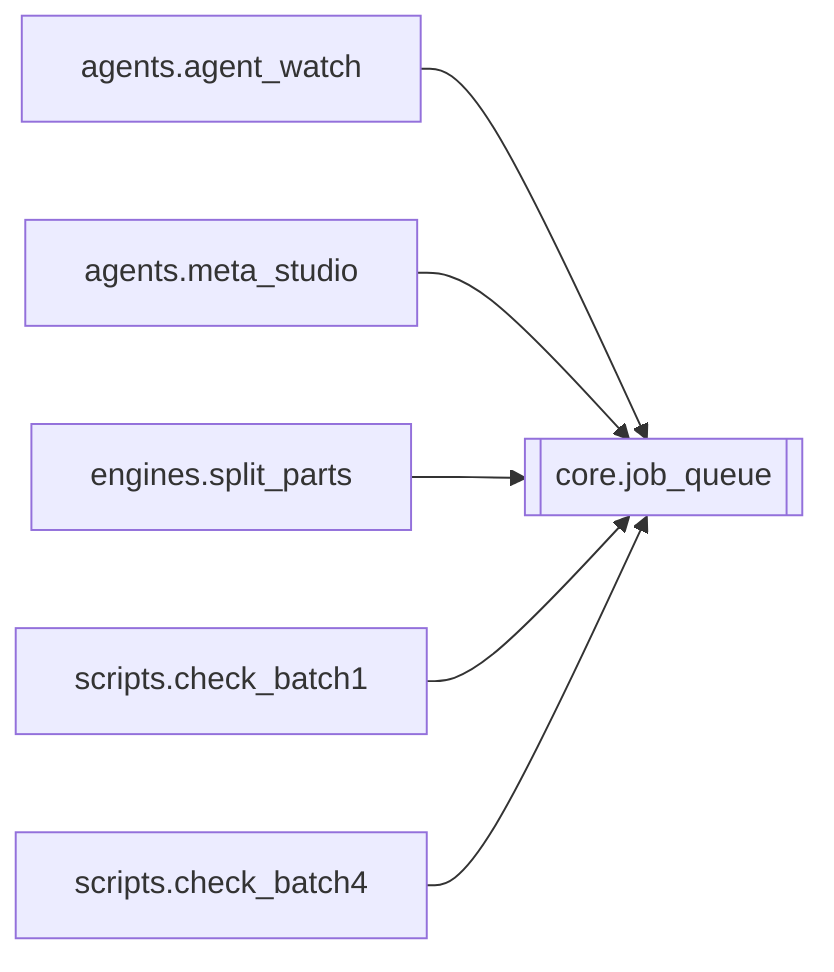

# `core.job_queue`

[← Index](../generated/module-index.md) · [Brain home](../README.md)

<!-- AUTO:START — sinh bởi scripts/brain_build.py 2026-11-11 02:38. Đừng sửa tay khối này. -->
**File:** `core/job_queue.py` · **Lớp:** `core` · **658 dòng** (564 code) · **32 hàm**, **0 class** · sha1 `9661f66ff6`

### Phụ thuộc

- **Gọi tới (import nội bộ):** —
- **Được dùng bởi:** [agents.agent_watch](./agents.agent_watch.md), [agents.meta_studio](./agents.meta_studio.md), [engines.split_parts](./engines.split_parts.md), [scripts.check_batch1](./scripts.check_batch1.md), [scripts.check_batch4](./scripts.check_batch4.md)
- **Được nhắc tên file `.py` (subprocess/script) bởi:** [restart_server](./restart_server.md)
- **Test:** `tests/test_film_db_queue_meta.py`, `tests/test_job_queue.py`, `tests/test_layout_paths.py`, `tests/test_queue_http_state.py`

### Hàm & class top-level

| Tên | Dòng | Dài | Tham số | Docstring |
|---|---:|---:|---|---|
| `_parse_season_from_text` | 19 | 30 | `*texts` | Bóc số phần/mùa từ title (Phần N / P N / 第N季). Không dùng group_index. |
| `_norm_series_key` | 51 | 13 | `name` | Chuẩn hoá tên bộ để sort: gom biến thể ngàn/nghìn, bỏ dấu câu thừa. |
| `get_job_info` | 66 | 68 | `job_id` | Lấy thông tin tiêu đề, bộ phim (series), mùa/phần (season) từ manifest để sort và hiển thị. |
| `job_sort_key` | 136 | 5 | `job_id` | Khóa sắp xếp: (group_id/series_norm, season P1..Pn, title). |
| `_reset_for_tests` | 158 | 23 | `load_disk` | Chỉ dùng trong pytest. |
| `set_runner` | 183 | 3 | `fn` |  |
| `set_park_ready_hook` | 188 | 4 | `fn` | Server gắn hook: True = job HOLD/waiting có thể chạy tiếp (TTS/mux). |
| `is_park_status` | 194 | 2 | `status` |  |
| `_default_park_ready` | 198 | 36 | `job_id` | Fallback khi chưa wire hook: bỏ HOLD flags + (waiting_review → hết câu chưa rv). |
| `_park_ready` | 236 | 7 | `job_id` |  |
| `is_wired_done` | 245 | 11 | `work_dir` |  |
| `_persist_path` | 258 | 2 | `` |  |
| `_save` | 262 | 15 | `` |  |
| `_load` | 279 | 26 | `` |  |
| `_hist_push` | 307 | 5 | `job_id, status, detail` |  |
| `queue_busy` | 314 | 4 | `` | True nếu worker đang chạy hoặc còn job trong hàng — dùng GPU gate heal/watch. |
| `queue_state` | 320 | 13 | `` |  |
| `queue_add` | 335 | 50 | `job_ids, opts, skip_done, sort_first` |  |
| `queue_sort` | 387 | 15 | `by` | Sắp xếp lại các job đang chờ trong hàng: |
| `queue_move` | 404 | 28 | `job_id, action` | Di chuyển vị trí của 1 job trong hàng chờ: |
| `queue_reorder` | 434 | 10 | `new_order` | Gán lại toàn bộ thứ tự cho hàng chờ theo danh sách client gửi. |
| `queue_add_group` | 446 | 37 | `group_id, opts, skip_done` | Enqueue mọi member của group theo group_index tăng dần. |
| `queue_front` | 485 | 6 | `job_id` |  |
| `queue_remove` | 493 | 11 | `job_ids` | Bỏ job khỏi hàng chờ (không stop current). |
| `queue_update_opts` | 506 | 10 | `updates` | Đổi opts của job ĐANG CHỜ tại chỗ (giữ thứ tự, không đụng current) — thay cho remove+add. |
| `queue_clear` | 518 | 6 | `` |  |
| `queue_stop` | 526 | 20 | `` | Clear queue + báo worker dừng; gọi _stop_job(current) nếu server đã wire. |
| `set_stop_hook` | 548 | 2 | `fn` |  |
| `set_clear_stop_hook` | 552 | 3 | `fn` |  |
| `_ensure_worker_unlocked` | 557 | 9 | `` |  |
| `_ensure_worker` | 568 | 3 | `` |  |
| `_worker_loop` | 573 | 80 | `` |  |

### Config / env keys (1)

`QUEUE_PARK_POLL_SEC`

**File/artifact nhắc tới:** `_job_queue.json`, `manifest.json`, `output.mp4`, `script.json`

**Tín hiệu rủi ro (đếm tĩnh):** broad_except=10 · global_stmt=10 · sleep=1 · swallow_except=2 · threads=1

### Lịch sử (từ docs/)

- **Fix logs (12):**
  - [Studio SOP: 1 job / ghế — ASR→NMT→Aurora∥ REVIEW→TTS→mux→Done→next](../../fixes/2026-11-11-studio-1job-pipeline.md)
  - [Queue nhảy job khi còn HOLD/soát dở — mất invariant studio 1 job→output](../../fixes/2026-11-10-queue-park-held.md)
  - [Auto-pub «Phần Cuối» thành «Phần 1 | Xuyên Không Thành Nô Lệ…» (+ nhiều draft YT)](../../fixes/2026-11-07-autopub-phan-cuoi-as-p1.md)
  - [V5: queue/jobs dual-route + queue_state đọc N lần](../../fixes/2026-11-04-v5-queue-ssot.md)
  - [Hàng chờ: sort/move không đổi thứ tự thật](../../fixes/2026-11-04-queue-sort-move.md)
  - [Queue metadata từ films.db (V5) — bớt đọc manifest](../../fixes/2026-11-04-film-db-queue-meta.md)
  - [Hàng đợi render đứng khi ổ D: đầy](../../fixes/2026-10-08-queue-worker-disk-full.md)
  - [2026-10-06 — Đợt 4 review: tranh chấp ghi, một bản tiến trình, checkpoint an toàn](../../fixes/2026-10-06-batch4-write-races.md)
  - [2026-10-06 — Đợt 3 review: opts một nguồn, config file-first, ghi nguyên tử](../../fixes/2026-10-06-batch3-single-source.md)
  - [Đợt 1 — chặn mất dữ liệu (review 6/10)](../../fixes/2026-10-06-batch1-data-loss.md)
  - [2026-09-26 — P0 job management (PinelineV2)](../../fixes/2026-09-26-p0-job-management.md)
  - [Queue dùng sai giọng hoặc bỏ qua lệnh dừng](../../fixes/2026-09-24-queue-voice-stop-race.md)
- **Reviews:** [_atoms_core_server](../../reviews/_atoms_core_server.md), [2026-11-06-v5-part-atoms](../../reviews/2026-11-06-v5-part-atoms.md), [2026-11-06-v5-func-catalog](../../reviews/2026-11-06-v5-func-catalog.md), [2026-11-02-v4-structure-and-v2-port](../../reviews/2026-11-02-v4-structure-and-v2-port.md), [2026-10-06-code-review](../../reviews/2026-10-06-code-review.md)
- Nhắc trong CHANGELOG: **6** lần · DECISIONS: **3** lần

<!-- AUTO:END -->

<!-- MANUAL:START -->
> ⚠️ Chép từ thẻ V2 ngày 2026-11-11 — **chưa xác minh với bản `core/` của V5** (có thể cũ hơn root/V2). brain-keeper cần soát lại.

## Vai trò (viết tay)

Hàng chờ GPU **một ghế** cho toàn server: giữ thứ tự job, opts snapshot từng job, job `current`, trạng thái park. Không biết cách chạy job — server tiêm runner (`set_runner` ← `server._queue_run_one`) và hook mở park (`set_park_ready_hook`). Không import `server` (tránh vòng). Lưu `work/logs/queue.json`.

## Luồng chính

- Thêm: `queue_add(job_ids, opts, skip_done, sort_first)`, `queue_add_group(group_id…)` (theo `group_index`), `queue_front`.
- Sắp/di chuyển: `queue_sort(by)` (khoá `job_sort_key`: series chuẩn hoá → mùa/phần `_parse_season_from_text` → title), `queue_move`, `queue_reorder`, `queue_remove`, `queue_update_opts` (đổi opts job đang chờ tại chỗ).
- Worker: pop job → runner → kết quả; job ở trạng thái park (`is_park_status`) thì **giữ ghế** tới khi `_park_ready(job_id)` True (hook server, fallback `_default_park_ready`: bỏ HOLD flags + hết câu chưa `rv`).
- Đọc: `queue_state`, `queue_busy` (agent heal/watch dùng để không tranh GPU), `get_job_info` (title/series/season từ manifest).
- Bền vững: `_save` / `_load`, lịch sử `_hist_push`.

## Bất biến & hợp đồng

- **Studio SOP**: tối đa 1 job `current`; HOLD/waiting_review ⇒ park, không pop job kế (DECISIONS 11-10, 11-11).
- Opts của job = snapshot lúc xếp hàng; `queue_update_opts` chỉ đụng job đang chờ, không đụng `current`.
- `_reset_for_tests` chỉ dùng trong pytest.

## Bẫy đã biết

- Nhảy job khi job hiện tại HOLD → fix `docs/fixes/2026-11-10-queue-park-held.md`.
- Queue rỗng sau restart (STATE 10/11) — kiểm `_load` / `queue.json` khi restart.
- Nhiều tác nhân tự động cùng mutate (brain, autopilot/feeder qua HTTP, agent_core) → xem `processes/queue-studio-sop.md`.
- Đĩa đầy làm worker chết: `docs/fixes/2026-10-08-queue-worker-disk-full.md`; giới hạn upload dừng queue: `2026-11-05-upload-limit-stop-queue.md`.

## Ghi chú vận hành

Sửa → restart :8801 (queue chạy → hỏi user). Test: `pytest -q tests/test_job_queue.py tests/test_job_queue_worker.py tests/test_queue_run_one.py tests/test_queue_jobs_api.py`.
<!-- MANUAL:END -->
