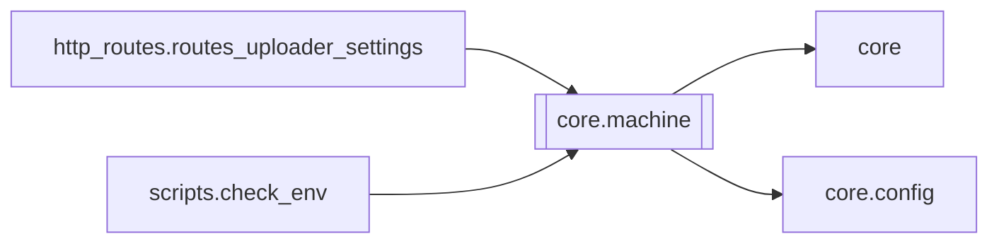

# `core.machine`

[← Index](../generated/module-index.md) · [Brain home](../README.md)

<!-- AUTO:START — sinh bởi scripts/brain_build.py 2026-11-17 19:05. Đừng sửa tay khối này. -->
**File:** `core/machine.py` · **Lớp:** `core` · **255 dòng** (189 code) · **24 hàm**, **0 class** · sha1 `f296cb3c07`

> machine.py — Cấu hình PHỤ THUỘC MÁY (cổng dịch vụ ngoài, thư mục model/thư viện, lệnh đổi preset). Mục đích (2026-11-11 machine-config): chạy cùng codebase trên máy khác cấu hình mà KHÔNG sửa code. Mọi giá trị đọc qua `c

### Phụ thuộc

- **Gọi tới (import nội bộ):** [core](./core.md), [core.config](./core.config.md)
- **Được dùng bởi:** [http_routes.routes_uploader_settings](./http_routes.routes_uploader_settings.md), [scripts.check_env](./scripts.check_env.md)
- **Test:** ❌ chưa có test import trực tiếp

### Hàm & class top-level

| Tên | Dòng | Dài | Tham số | Docstring |
|---|---:|---:|---|---|
| `setting` | 58 | 10 | `key, default` | Giá trị key máy: config.get(key) → default truyền vào → mặc định MACHINE_KEYS. |
| `flag` | 70 | 2 | `key, default` |  |
| `_strip_v1` | 74 | 3 | `url` |  |
| `is_loopback_url` | 79 | 6 | `url` |  |
| `llama_base_url` | 91 | 8 | `` | URL /v1 của llama-server: LLAMA_BASE_URL > LLM_BASE_URL (chỉ khi localhost) > :8083 cũ. |
| `llama_root_url` | 101 | 3 | `` | URL gốc (không /v1) — /health, /v1/models. |
| `llama_host_port` | 106 | 4 | `` |  |
| `presets_dir` | 113 | 2 | `` |  |
| `presets_active_json` | 117 | 2 | `` |  |
| `presets_models_json` | 121 | 2 | `` |  |
| `model_start_script` | 125 | 3 | `` |  |
| `_split` | 130 | 5 | `cmd` |  |
| `model_start_cmd` | 137 | 19 | `preset_id` | Lệnh đổi preset (list argv). MODEL_START_CMD là template; trống = PowerShell như cũ. |
| `preset_switch_unavailable_reason` | 158 | 13 | `` | '' = đổi preset được; ngược lại lý do bỏ qua (KHÔNG phải lỗi). |
| `aurora_base_urls` | 174 | 17 | `` | Thứ tự thử: AURORA_BASE_URL, CHATGPT_BASE_URL, :3377 local, AURORA_FALLBACK_URLS. |
| `aurora_base_url` | 193 | 2 | `` |  |
| `aurora_missing_hint` | 201 | 8 | `` | Thông điệp khi gọi model chatgpt/... mà không tới được Aurora. |
| `cloud_llm_base_url` | 212 | 2 | `` |  |
| `hongguo_base_url` | 216 | 2 | `` |  |
| `mt_model_dir` | 220 | 2 | `` |  |
| `library_dir` | 224 | 2 | `` |  |
| `in_library` | 228 | 5 | `path` | Đường dẫn nằm trong LIBRARY_DIR? (so chuỗi như code cũ 'D:\Lib' in p, chấp nhận / và \). |
| `yt_uploader_dir` | 235 | 2 | `` |  |
| `summary` | 239 | 17 | `` | Giá trị hiệu lực (doctor / debug). Không trả key bí mật. |

**Cổng nhắc tới:** 3377, 8000, 8083

**File/artifact nhắc tới:** `active.json`, `models.json`

**Tín hiệu rủi ro (đếm tĩnh):** broad_except=1

### Lịch sử (từ docs/)

- **Fix logs (1):**
  - [2026-11-11 — machine-config: cổng/thư mục phụ thuộc máy thành setting (V5)](../../fixes/2026-11-11-machine-config.md)
- Nhắc trong CHANGELOG: **2** lần · DECISIONS: **0** lần

<!-- AUTO:END -->

<!-- MANUAL:START -->
## Vai trò (viết tay)

_Chưa viết. 2–4 câu: module này chịu trách nhiệm gì trong pipeline, ai gọi nó, nó KHÔNG làm gì._

## Luồng chính

_Các hàm vào (entry) → bước chính → output/side effect. Ghi tên hàm thật._

## Bất biến & hợp đồng

_Điều luôn phải đúng (vd: chỉ ghi manifest qua `Manifest.update`; 1 job / ghế). Vi phạm = bug._

## Bẫy đã biết

_Lỗi từng gặp + link `docs/fixes/...`. Những chỗ dễ sửa sai._

## Ghi chú vận hành

_Config key quan trọng, cần restart gì khi sửa (:8801 / :8802 / hot-reload), cách test._
<!-- MANUAL:END -->
