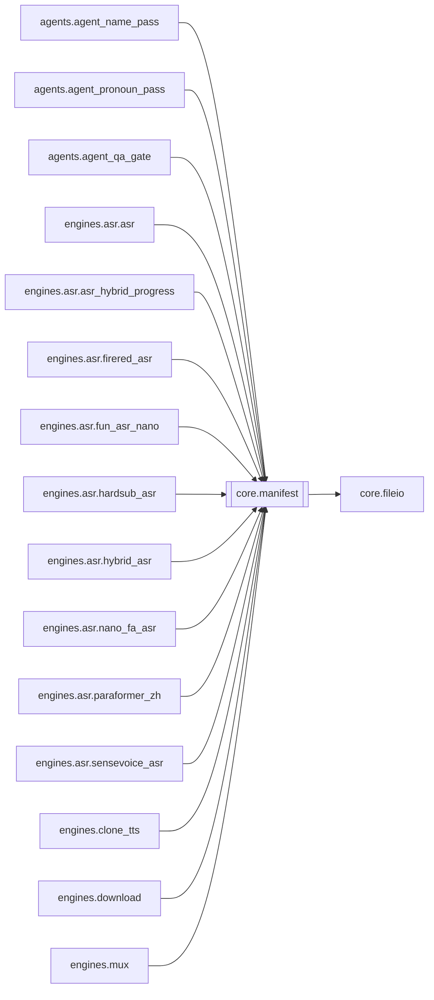

# `core.manifest`

[← Index](../generated/module-index.md) · [Brain home](../README.md)

<!-- AUTO:START — sinh bởi scripts/brain_build.py 2026-11-11 02:38. Đừng sửa tay khối này. -->
**File:** `core/manifest.py` · **Lớp:** `core` · **242 dòng** (190 code) · **4 hàm**, **1 class** · sha1 `c7cd54c8e3`

> manifest.py — Trạng thái/checkpoint cho pipeline. Mỗi job (mỗi video) có một thư mục làm việc riêng chứa manifest.json. Mỗi stage ghi trạng thái vào đây; crash/mất điện thì resume từ stage cuối

### Phụ thuộc

- **Gọi tới (import nội bộ):** [core.fileio](./core.fileio.md)
- **Được dùng bởi:** [agents.agent_name_pass](./agents.agent_name_pass.md), [agents.agent_pronoun_pass](./agents.agent_pronoun_pass.md), [agents.agent_qa_gate](./agents.agent_qa_gate.md), [engines.asr.asr](./engines.asr.asr.md), [engines.asr.asr_hybrid_progress](./engines.asr.asr_hybrid_progress.md), [engines.asr.firered_asr](./engines.asr.firered_asr.md), [engines.asr.fun_asr_nano](./engines.asr.fun_asr_nano.md), [engines.asr.hardsub_asr](./engines.asr.hardsub_asr.md), [engines.asr.hybrid_asr](./engines.asr.hybrid_asr.md), [engines.asr.nano_fa_asr](./engines.asr.nano_fa_asr.md), [engines.asr.paraformer_zh](./engines.asr.paraformer_zh.md), [engines.asr.sensevoice_asr](./engines.asr.sensevoice_asr.md), [engines.clone_tts](./engines.clone_tts.md), [engines.download](./engines.download.md), [engines.mux](./engines.mux.md), [engines.ocr](./engines.ocr.md), [engines.render](./engines.render.md), [engines.separate](./engines.separate.md), [engines.split_parts](./engines.split_parts.md), [engines.translate_alts](./engines.translate_alts.md), [http_routes.routes_agent](./http_routes.routes_agent.md), [render](./render.md), [scripts.check_batch4](./scripts.check_batch4.md)
- **Được nhắc tên file `.py` (subprocess/script) bởi:** [restart_server](./restart_server.md), [scripts._tmp_extract_sigs_batch2](./scripts._tmp_extract_sigs_batch2.md)
- **Test:** `tests/test_agent_core_smoke.py`, `tests/test_asr_demucs.py`

### Hàm & class top-level

| Tên | Dòng | Dài | Tham số | Docstring |
|---|---:|---:|---|---|
| **class `Manifest`** | 96 | 11 method | |  |
| `_now` | 26 | 2 | `` |  |
| `_lock_for` | 39 | 8 | `path` |  |
| `_merge3` | 52 | 22 | `base, mine, theirs` | Gộp 3 chiều dict JSON. Key mình không đổi so với lúc load → lấy bản đĩa (người khác |
| `_xproc_lock` | 77 | 17 | `path` | Khoá liên tiến trình (server + subprocess asr/tts cùng ghi). Không lấy được thì vẫn ghi |

**File/artifact nhắc tới:** `manifest.json`

**Tín hiệu rủi ro (đếm tĩnh):** broad_except=2 · file_writes=2 · sleep=3

### Lịch sử (từ docs/)

- **Fix logs (3):**
  - [REVIEW CLI song song + heal làm UI mất/soát % tụt](../../fixes/2026-11-10-review-heal-parallel.md)
  - [Queue metadata từ films.db (V5) — bớt đọc manifest](../../fixes/2026-11-04-film-db-queue-meta.md)
  - [2026-10-06 — Đợt 4 review: tranh chấp ghi, một bản tiến trình, checkpoint an toàn](../../fixes/2026-10-06-batch4-write-races.md)
- **Reviews:** [_atoms_core_server](../../reviews/_atoms_core_server.md), [2026-11-06-v5-part-atoms](../../reviews/2026-11-06-v5-part-atoms.md), [2026-11-06-v5-func-catalog](../../reviews/2026-11-06-v5-func-catalog.md), [2026-10-06-code-review](../../reviews/2026-10-06-code-review.md)
- Nhắc trong CHANGELOG: **1** lần · DECISIONS: **1** lần

<!-- AUTO:END -->

<!-- MANUAL:START -->
> ⚠️ Chép từ thẻ V2 ngày 2026-11-11 — **chưa xác minh với bản `core/` của V5** (có thể cũ hơn root/V2). brain-keeper cần soát lại.

## Vai trò (viết tay)

Trạng thái/checkpoint của **mỗi job**: `work/<job>/manifest.json` (`stages.{download,asr,translate,tts,mux}` + `agent`, opts, title…). Mọi stage, server, agent và cả subprocess ASR/TTS đều đọc-ghi file này ⇒ đây là **trái tim đồng thời** của hệ thống (~26 module nhắc tới `manifest.json`, xem `generated/artifacts-ports.md`). Không chứa logic pipeline.

## Luồng chính

- `Manifest(work_dir)` → `load()` (khoá theo path, retry 6 lần nếu đọc trúng lúc ghi; hỏng → `_load_failed=True`, giữ data cũ).
- **Ghi an toàn — ưu tiên `update(fn)`**: khoá thread (`_lock_for`) + khoá liên tiến trình (`_xproc_lock` → `fileio.file_lock`) → đọc lại đĩa → `fn(data)` → `_write_locked`. Trả `False` nếu đĩa hỏng/thiếu `stages` hoặc `fn` trả `False`.
- `save()`: cho object sống lâu — gộp 3 chiều `_merge3(base, mine, disk)` (mình không đổi key → lấy đĩa; cả hai đổi dict → gộp sâu; còn lại mình thắng).
- `_write_locked`: ghi tmp riêng theo pid+thread → `os.replace` (retry ~2.5s cho WinError 5/32) → bó tay thì ghi thẳng.
- Helper stage: `mark_running`, `set_stage`, `mark_done`, `mark_failed`, `is_done`, `stage`.

## Bất biến & hợp đồng

- Không bao giờ ghi manifest bằng `json.dump` trực tiếp ngoài module này — dùng `update(fn)` (đọc-sửa-ghi nguyên tử) hoặc `save()`.
- Không ghi đè bằng data rỗng: `save()` bỏ qua nếu `_load_failed` hoặc `stages` rỗng trong khi đĩa còn `stages`.
- `fn` trong `update` phải nhanh và không gọi I/O nặng (đang giữ khoá liên tiến trình, timeout 5s).

## Bẫy đã biết

- `_xproc_lock` **không lấy được khoá vẫn ghi** (log `[manifest] không lấy được khoá … — ghi không khoá`) → lúc tranh chấp nặng có thể mất cập nhật của tiến trình khác. Grep log này khi nghi race. (chưa xác minh tần suất)
- Fallback cuối của `_write_locked` ghi **không atomic** → mất điện đúng lúc đó có thể hỏng file; `load()` sẽ đánh dấu `_load_failed` thay vì xoá.
- `save()` "mình thắng" khi cả hai đổi cùng key không phải dict → object giữ lâu có thể ghi đè giá trị mới của người khác (vd `status`). Ưu tiên `update`.
- Lịch sử: wipe dữ liệu job (`docs/fixes/2026-10-06-batch1-data-loss.md`, `batch4-write-races.md`), mất `script.json` sau restart (`2026-11-10-05670-script-wipe.md` — khác file nhưng cùng loại).

## Ghi chú vận hành

Import ở mọi nơi ⇒ sửa module này cần restart **:8801 và :8802**, subprocess ASR/TTS mới sẽ tự nạp. Test: `tests/test_job_queue*.py`, `scripts/check_batch4.py` (races).
<!-- MANUAL:END -->
