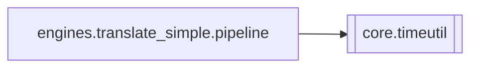

# `core.timeutil`

[← Index](../generated/module-index.md) · [Brain home](../README.md)

<!-- AUTO:START — sinh bởi scripts/brain_build.py 2026-11-17 19:05. Đừng sửa tay khối này. -->
**File:** `core/timeutil.py` · **Lớp:** `core` · **42 dòng** (34 code) · **3 hàm**, **0 class** · sha1 `d7896e8552`

> core/timeutil.py — MỘT kiểu mốc thời gian cho manifest (port từ V6). Quy ước (fix 2026-11-14 R1.4): `started_at` / `finished_at` / `created_at` = ISO-8601 UTC. `updated_at` của stage vẫn epoch float (nhịp tim).

### Phụ thuộc

- **Gọi tới (import nội bộ):** —
- **Được dùng bởi:** [engines.translate_simple.pipeline](./engines.translate_simple.pipeline.md)
- **Test:** `tests/test_simple_r1_bugs.py`

### Hàm & class top-level

| Tên | Dòng | Dài | Tham số | Docstring |
|---|---:|---:|---|---|
| `now_iso` | 12 | 2 | `` |  |
| `to_epoch` | 16 | 17 | `v` |  |
| `to_iso` | 35 | 8 | `v` |  |

### Lịch sử (từ docs/)

- Fix logs: —
- Nhắc trong CHANGELOG: **0** lần · DECISIONS: **0** lần

<!-- AUTO:END -->

<!-- MANUAL:START -->
## Vai trò (viết tay)

_Chưa viết. 2–4 câu: module này chịu trách nhiệm gì trong pipeline, ai gọi nó, nó KHÔNG làm gì._

## Luồng chính

_Các hàm vào (entry) → bước chính → output/side effect. Ghi tên hàm thật._

## Bất biến & hợp đồng

_Điều luôn phải đúng (vd: chỉ ghi manifest qua `Manifest.update`; 1 job / ghế). Vi phạm = bug._

## Bẫy đã biết

_Lỗi từng gặp + link `docs/fixes/...`. Những chỗ dễ sửa sai._

## Ghi chú vận hành

_Config key quan trọng, cần restart gì khi sửa (:8801 / :8802 / hot-reload), cách test._
<!-- MANUAL:END -->
