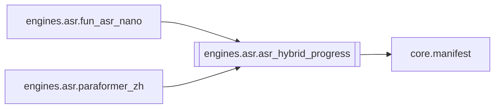

# `engines.asr.asr_hybrid_progress`

[← Index](../generated/module-index.md) · [Brain home](../README.md)

<!-- AUTO:START — sinh bởi scripts/brain_build.py 2026-11-11 02:38. Đừng sửa tay khối này. -->
**File:** `engines/asr/asr_hybrid_progress.py` · **Lớp:** `asr` · **144 dòng** (124 code) · **5 hàm**, **0 class** · sha1 `c1f2db1366`

> asr_hybrid_progress.py — Đưa tiến độ sidecar (Nano/Para) vào stages.asr cho UI Hybrid. UI đọc manifest stages.asr; sidecar chỉ ghi asr.*.progress.json → UI kẹt 5%. Hàm này map % sidecar vào khoảng Hybrid và ghi/đè vào st

### Phụ thuộc

- **Gọi tới (import nội bộ):** [core.manifest](./core.manifest.md)
- **Được dùng bởi:** [engines.asr.fun_asr_nano](./engines.asr.fun_asr_nano.md), [engines.asr.paraformer_zh](./engines.asr.paraformer_zh.md)
- **Test:** ❌ chưa có test import trực tiếp

### Hàm & class top-level

| Tên | Dòng | Dài | Tham số | Docstring |
|---|---:|---:|---|---|
| `_load_json` | 21 | 7 | `p` |  |
| `map_sidecar_pct` | 30 | 4 | `tag, pct` |  |
| `active_sidecar_progress` | 36 | 40 | `work_dir` | Trả (tag, payload) sidecar đang chạy mới nhất; ưu tiên Para nếu cả hai. |
| `mirror_to_asr_stage` | 78 | 42 | `work_dir, tag, progress, cur_text, n_segments, done_sec, total_sec` | Ghi tiến độ sidecar vào stages.asr (giữ hybrid_fa). Trả stage đã cập nhật. |
| `overlay_job_asr` | 122 | 23 | `work_dir, asr_stage` | Overlay tiến độ sidecar lên dict stages.asr (cho API, không ghi đĩa). |

**File/artifact nhắc tới:** `.progress.json`

**Tín hiệu rủi ro (đếm tĩnh):** broad_except=1 · swallow_except=1

### Lịch sử (từ docs/)

- Fix logs: —
- **Reviews:** [_atoms_engines](../../reviews/_atoms_engines.md), [2026-11-06-v5-part-atoms](../../reviews/2026-11-06-v5-part-atoms.md), [2026-11-06-v5-func-catalog](../../reviews/2026-11-06-v5-func-catalog.md)
- Nhắc trong CHANGELOG: **0** lần · DECISIONS: **0** lần

<!-- AUTO:END -->

<!-- MANUAL:START -->
## Vai trò (viết tay)

_Chưa viết. 2–4 câu: module này chịu trách nhiệm gì trong pipeline, ai gọi nó, nó KHÔNG làm gì._

## Luồng chính

_Các hàm vào (entry) → bước chính → output/side effect. Ghi tên hàm thật._

## Bất biến & hợp đồng

_Điều luôn phải đúng (vd: chỉ ghi manifest qua `Manifest.update`; 1 job / ghế). Vi phạm = bug._

## Bẫy đã biết

_Lỗi từng gặp + link `docs/fixes/...`. Những chỗ dễ sửa sai._

## Ghi chú vận hành

_Config key quan trọng, cần restart gì khi sửa (:8801 / :8802 / hot-reload), cách test._
<!-- MANUAL:END -->
