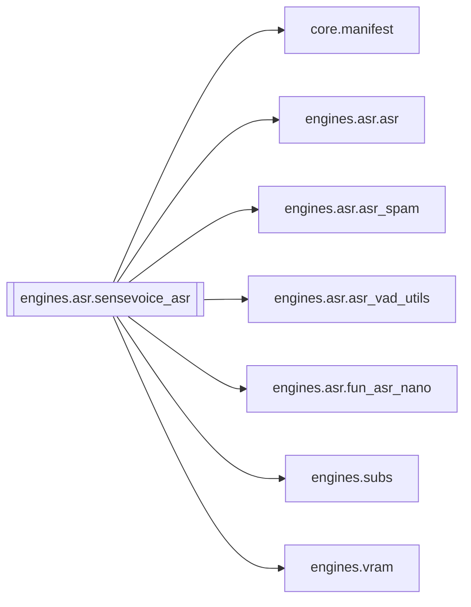

# `engines.asr.sensevoice_asr`

[← Index](../generated/module-index.md) · [Brain home](../README.md)

<!-- AUTO:START — sinh bởi scripts/brain_build.py 2026-11-11 02:38. Đừng sửa tay khối này. -->
**File:** `engines/asr/sensevoice_asr.py` · **Lớp:** `asr` · **255 dòng** (220 code) · **4 hàm**, **0 class** · sha1 `d1b7d75b78`

> sensevoice_asr.py — STAGE ASR bằng FunASR SenseVoiceSmall (nhanh, đa ngôn ngữ). Model : iic/SenseVoiceSmall (+ fsmn-vad) Đầu vào : work/<job>/source.* hoặc audio.wav có sẵn

### Phụ thuộc

- **Gọi tới (import nội bộ):** [core.manifest](./core.manifest.md), [engines.asr.asr](./engines.asr.asr.md), [engines.asr.asr_spam](./engines.asr.asr_spam.md), [engines.asr.asr_vad_utils](./engines.asr.asr_vad_utils.md), [engines.asr.fun_asr_nano](./engines.asr.fun_asr_nano.md), [engines.subs](./engines.subs.md), [engines.vram](./engines.vram.md)
- **Được dùng bởi:** —
- **Được nhắc tên file `.py` (subprocess/script) bởi:** [restart_server](./restart_server.md), [server](./server.md)
- **Test:** ❌ chưa có test import trực tiếp
- **Thư viện ngoài:** `funasr`

### Hàm & class top-level

| Tên | Dòng | Dài | Tham số | Docstring |
|---|---:|---:|---|---|
| `_clean_sv_text` | 51 | 12 | `text` |  |
| `_post_clean_segs` | 65 | 10 | `segs` |  |
| `run_asr_sensevoice` | 77 | 158 ⚠️ | `work_dir, device, force, language, hub, sidecar` | sidecar: ghi asr.<tag>.json + sub.zh.<tag>.srt, không đụng asr.json / manifest ASR chính. |
| `main` | 237 | 15 | `argv` |  |

**Hàm dài ≥120 dòng:** `run_asr_sensevoice` (158, L77)

### Config / env keys (3)

`ASR_VAD_MAX_SINGLE_SEGMENT_MS`, `HF_HUB_DISABLE_SYMLINKS`, `HF_HUB_DISABLE_SYMLINKS_WARNING`

**File/artifact nhắc tới:** `.progress.json`, `asr.json`, `audio.wav`, `sub.zh.srt`

**Tín hiệu rủi ro (đếm tĩnh):** broad_except=3 · file_writes=7

### Lịch sử (từ docs/)

- **Fix logs (1):**
  - [2026-10-06 — Đợt 4 review: tranh chấp ghi, một bản tiến trình, checkpoint an toàn](../../fixes/2026-10-06-batch4-write-races.md)
- **Reviews:** [_atoms_engines](../../reviews/_atoms_engines.md), [2026-11-06-v5-part-atoms](../../reviews/2026-11-06-v5-part-atoms.md), [2026-11-06-v5-func-catalog](../../reviews/2026-11-06-v5-func-catalog.md), [2026-11-02-v4-structure-and-v2-port](../../reviews/2026-11-02-v4-structure-and-v2-port.md), [2026-10-06-code-review](../../reviews/2026-10-06-code-review.md)
- Nhắc trong CHANGELOG: **0** lần · DECISIONS: **0** lần

<!-- AUTO:END -->

<!-- MANUAL:START -->
## Vai trò (viết tay)

_Chưa viết. 2–4 câu: module này chịu trách nhiệm gì trong pipeline, ai gọi nó, nó KHÔNG làm gì._

## Luồng chính

_Các hàm vào (entry) → bước chính → output/side effect. Ghi tên hàm thật._

## Bất biến & hợp đồng

_Điều luôn phải đúng (vd: chỉ ghi manifest qua `Manifest.update`; 1 job / ghế). Vi phạm = bug._

## Bẫy đã biết

_Lỗi từng gặp + link `docs/fixes/...`. Những chỗ dễ sửa sai._

## Ghi chú vận hành

_Config key quan trọng, cần restart gì khi sửa (:8801 / :8802 / hot-reload), cách test._
<!-- MANUAL:END -->
