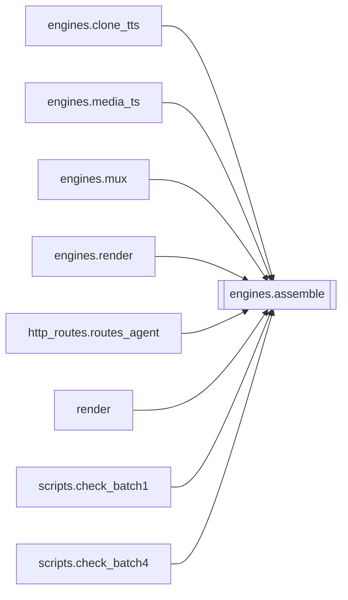

# `engines.assemble`

[← Index](../generated/module-index.md) · [Brain home](../README.md)

<!-- AUTO:START — sinh bởi scripts/brain_build.py 2026-11-11 02:38. Đừng sửa tay khối này. -->
**File:** `engines/assemble.py` · **Lớp:** `render` · **417 dòng** (350 code) · **16 hàm**, **0 class** · sha1 `fc2163acde`

> assemble.py — Ghép clip TTS thành MỘT track + kiểm khớp SRT. Hai chế độ: - assemble()      : NAIVE, đặt clip đúng mốc SRT (có thể ĐÈ). Chủ yếu để ĐO độ

### Phụ thuộc

- **Gọi tới (import nội bộ):** —
- **Được dùng bởi:** [engines.clone_tts](./engines.clone_tts.md), [engines.media_ts](./engines.media_ts.md), [engines.mux](./engines.mux.md), [engines.render](./engines.render.md), [http_routes.routes_agent](./http_routes.routes_agent.md), [render](./render.md), [scripts.check_batch1](./scripts.check_batch1.md), [scripts.check_batch4](./scripts.check_batch4.md)
- **Được nhắc tên file `.py` (subprocess/script) bởi:** [restart_server](./restart_server.md), [scripts._tmp_extract_sigs_batch2](./scripts._tmp_extract_sigs_batch2.md)
- **Test:** `tests/test_layout_paths.py`
- **Thư viện ngoài:** `numpy`, `soundfile`, `soxr`

### Hàm & class top-level

| Tên | Dòng | Dài | Tham số | Docstring |
|---|---:|---:|---|---|
| `_read_mono` | 31 | 32 | `path, target_sr` | Đọc 1 clip về mono float32 @ target_sr (bounded — chỉ 1 clip trong RAM). |
| `_compress_to_file` | 65 | 19 | `in_path, ratio` | Nén 'ratio'× bằng rubberband giữ formant -> file tạm. ratio<=1 trả nguyên in_path. |
| `_load_clips` | 86 | 7 | `work_dir` |  |
| `_slot_sec` | 95 | 2 | `c` |  |
| `_natural_max_sec` | 99 | 4 | `vi, slot` | Trần độ dài đọc hợp lý (không phải câu TTS runaway). |
| `_runaway_cap_sec` | 105 | 13 | `c, dur` | VieNeu đôi khi hú 15–23s cho câu 1–2 tiếng. Cắt trần, không đẩy cả film. |
| `is_runaway_tts` | 120 | 3 | `c, dur` | True nếu wav quá dài bất thường so với slot/chữ (VieNeu hú). |
| `_resolve_max_speed` | 125 | 5 | `explicit` | UI/API thắng. Env ASSEMBLE_MAX_SPEED chỉ khi không truyền (None). |
| `_fit_mode` | 139 | 6 | `max_speed` | fixed (max_speed>1 từ UI/API) / adaptive (mặc định) / off (ASSEMBLE_FIT_MODE=off). |
| `_is_bloated` | 147 | 4 | `c, dur` | TTS kéo dài bất thường so với số chữ, hoặc ASR dồn mốc (khe ≤0.25s mà đọc >0.6s). |
| `_place` | 153 | 18 | `c, dur, orig, nxt, cursor, gap, mode, max_speed` | (start, ratio) của một câu theo chế độ khớp. |
| `compute_fit_placements` | 173 | 44 | `clips, max_speed, gap` | Đủ câu + khớp hình theo khoảng trống (KHÔNG cắt, nén theo _place). |
| `write_fit_timings` | 219 | 16 | `work_dir, max_speed, gap` | Ghi tts_fit.json từ tts.json (không cần ghép lại audio). |
| `assemble` | 238 | 43 | `work_dir, sr, out_name` | NAIVE: báo cáo độ khớp (từ metadata, mọi độ dài). Dựng file chỉ khi ngắn. |
| `assemble_fit` | 284 | 110 | `work_dir, sr, max_speed, gap, out_name` | Đủ câu + ghép cạnh + bắt kịp khoảng trống (đúng yêu cầu user). |
| `main` | 396 | 18 | `argv` |  |

### Config / env keys (2)

`ASSEMBLE_FIT_MODE`, `ASSEMBLE_MAX_SPEED`

**File/artifact nhắc tới:** `dub_fit.wav`, `dub_tts.wav`, `tts.json`, `tts_fit.json`

**Tín hiệu rủi ro (đếm tĩnh):** broad_except=3 · file_writes=3 · sleep=1 · subprocess=1 · swallow_except=1

### Lịch sử (từ docs/)

- **Fix logs (2):**
  - [2026-10-06 — Đợt 4 review: tranh chấp ghi, một bản tiến trình, checkpoint an toàn](../../fixes/2026-10-06-batch4-write-races.md)
  - [Đợt 1 — chặn mất dữ liệu (review 6/10)](../../fixes/2026-10-06-batch1-data-loss.md)
- **Reviews:** [_atoms_engines](../../reviews/_atoms_engines.md), [2026-11-06-v5-part-atoms](../../reviews/2026-11-06-v5-part-atoms.md), [2026-11-06-v5-func-catalog](../../reviews/2026-11-06-v5-func-catalog.md), [2026-11-02-v4-structure-and-v2-port](../../reviews/2026-11-02-v4-structure-and-v2-port.md), [2026-10-06-code-review](../../reviews/2026-10-06-code-review.md)
- Nhắc trong CHANGELOG: **5** lần · DECISIONS: **0** lần

<!-- AUTO:END -->

<!-- MANUAL:START -->
## Vai trò (viết tay)

_Chưa viết. 2–4 câu: module này chịu trách nhiệm gì trong pipeline, ai gọi nó, nó KHÔNG làm gì._

## Luồng chính

_Các hàm vào (entry) → bước chính → output/side effect. Ghi tên hàm thật._

## Bất biến & hợp đồng

_Điều luôn phải đúng (vd: chỉ ghi manifest qua `Manifest.update`; 1 job / ghế). Vi phạm = bug._

## Bẫy đã biết

_Lỗi từng gặp + link `docs/fixes/...`. Những chỗ dễ sửa sai._

## Ghi chú vận hành

_Config key quan trọng, cần restart gì khi sửa (:8801 / :8802 / hot-reload), cách test._
<!-- MANUAL:END -->
