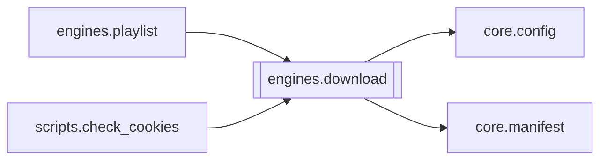

# `engines.download`

[← Index](../generated/module-index.md) · [Brain home](../README.md)

<!-- AUTO:START — sinh bởi scripts/brain_build.py 2026-11-11 02:38. Đừng sửa tay khối này. -->
**File:** `engines/download.py` · **Lớp:** `source` · **692 dòng** (565 code) · **20 hàm**, **0 class** · sha1 `b1a07f7cb5`

> download.py — STAGE 1: Tải video (Douyin / Bilibili / TikTok / ...). Engine: yt-dlp. Tự resume — đã tải xong thì bỏ qua. Đã gộp kỹ thuật production từ Galaxy Video Downloader (Jonathan Nguyen):

### Phụ thuộc

- **Gọi tới (import nội bộ):** [core.config](./core.config.md), [core.manifest](./core.manifest.md)
- **Được dùng bởi:** [engines.playlist](./engines.playlist.md), [scripts.check_cookies](./scripts.check_cookies.md)
- **Được nhắc tên file `.py` (subprocess/script) bởi:** [engines.playlist](./engines.playlist.md), [scripts._tmp_extract_sigs_batch2](./scripts._tmp_extract_sigs_batch2.md), [scripts.check_cookies](./scripts.check_cookies.md)
- **Test:** `tests/test_layout_paths.py`
- **Thư viện ngoài:** `psutil`, `yt_dlp`

### Hàm & class top-level

| Tên | Dòng | Dài | Tham số | Docstring |
|---|---:|---:|---|---|
| `_request_stop` | 54 | 3 | `work_dir` |  |
| `_is_stopped` | 59 | 3 | `work_dir` |  |
| `_clear_stop` | 64 | 3 | `work_dir` |  |
| `_kill_job_aria2c` | 69 | 20 | `work_dir` | Kill tiến trình aria2c đang tải cho ĐÚNG job này (nhận diện qua job_id/đường |
| `_aria2_downloaded` | 91 | 20 | `ctrl_path` | Byte ĐÃ TẢI THẬT theo file điều khiển .aria2. Khi tải đa kết nối, file .part |
| `_clean_incomplete_fragments` | 113 | 12 | `work_dir` | Xoá RIÊNG các mảnh tải DỞ (file .part + control .aria2) để tải lại sạch bằng |
| `_delete_sources` | 127 | 9 | `work_dir` | Xoá mọi source.* ; trả True nếu SẠCH (không còn file nào kẹt/khoá). |
| `_format_sel` | 141 | 25 | `max_height, hevc` | Selector yt-dlp. max_height giới hạn chiều cao; hevc=True ưu tiên H.265 cùng độ phân giải. |
| `_cfg_max_height` | 172 | 16 | `` | DOWNLOAD_MAX_HEIGHT từ env/config (vd 720/480). 0/off = không giới hạn. |
| `_cfg_prefer_hevc` | 190 | 10 | `` | DOWNLOAD_PREFER_HEVC=1 → ưu tiên H.265 cùng độ phân giải (file nhẹ, CDN đỡ đứt). |
| `_auto_height_for_duration` | 202 | 12 | `duration_sec, cap` | Phim rất dài (Bilibili multi-season) → 720p AVC dễ ~3GB+, CDN hay đứt. |
| `_probe_duration` | 216 | 12 | `url, base_opts` | Lấy duration nhanh (không tải) để chọn format. |
| `detect_platform` | 232 | 9 | `url` |  |
| `normalize_url` | 243 | 7 | `url` | Chuyển link Bilibili kiểu mới về format yt-dlp hiểu (từ code Galaxy). |
| `job_id_from_url` | 252 | 3 | `url` | Job id mặc định = hash URL. Chạy lại cùng URL -> cùng thư mục -> resume. |
| `find_cookie_file` | 257 | 12 | `platform, cookies_dir` | Tìm file cookie theo nền tảng trong cookies_dir (vd bilibili_cookies.txt). |
| `get_aria2c_path` | 271 | 8 | `` | Tìm aria2c -> trả ĐƯỜNG DẪN TUYỆT ĐỐI (yt-dlp tìm external_downloader trong |
| `apply_speed_opts` | 281 | 22 | `opts, conn` | Tải mảnh song song + aria2c nếu có (args tune từ code Galaxy). |
| `download_video` | 305 | 352 ⚠️ | `url, work_dir, cookies, cookies_dir, cookies_from_browser, proxy, f…` | Tải 1 video về work_dir. Trả về dict trạng thái stage (video_path + metadata). |
| `main` | 659 | 30 | `argv` |  |

**Hàm dài ≥120 dòng:** `download_video` (352, L305)

### Config / env keys (2)

`DOWNLOAD_MAX_HEIGHT`, `DOWNLOAD_PREFER_HEVC`

**File/artifact nhắc tới:** `meta.json`, `source.info.json`, `source.mp4`

**Tín hiệu rủi ro (đếm tĩnh):** broad_except=10 · file_writes=1 · threads=1

### Lịch sử (từ docs/)

- **Fix logs (2):**
  - [Phim đã xoá thư mục vẫn tồn đọng trong films/ui và thiếu chức năng xoá phim](../../fixes/2026-10-09-films-ui-delete-missing.md)
  - [Video nguồn bị chép thành 2 bản (thư viện + job)](../../fixes/2026-10-07-source-duplicate-copy.md)
- **Reviews:** [_atoms_engines](../../reviews/_atoms_engines.md), [2026-11-06-v5-part-atoms](../../reviews/2026-11-06-v5-part-atoms.md), [2026-11-06-v5-func-catalog](../../reviews/2026-11-06-v5-func-catalog.md)
- Nhắc trong CHANGELOG: **1** lần · DECISIONS: **0** lần

<!-- AUTO:END -->

<!-- MANUAL:START -->
## Vai trò (viết tay)

_Chưa viết. 2–4 câu: module này chịu trách nhiệm gì trong pipeline, ai gọi nó, nó KHÔNG làm gì._

## Luồng chính

_Các hàm vào (entry) → bước chính → output/side effect. Ghi tên hàm thật._

## Bất biến & hợp đồng

_Điều luôn phải đúng (vd: chỉ ghi manifest qua `Manifest.update`; 1 job / ghế). Vi phạm = bug._

## Bẫy đã biết

_Lỗi từng gặp + link `docs/fixes/...`. Những chỗ dễ sửa sai._

## Ghi chú vận hành

_Config key quan trọng, cần restart gì khi sửa (:8801 / :8802 / hot-reload), cách test._
<!-- MANUAL:END -->
