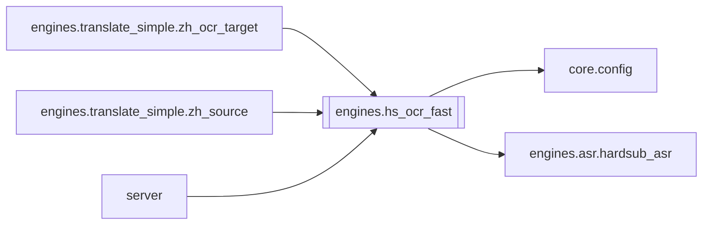

# `engines.hs_ocr_fast`

[← Index](../generated/module-index.md) · [Brain home](../README.md)

<!-- AUTO:START — sinh bởi scripts/brain_build.py 2026-11-17 19:05. Đừng sửa tay khối này. -->
**File:** `engines/hs_ocr_fast.py` · **Lớp:** `misc` · **412 dòng** (363 code) · **14 hàm**, **0 class** · sha1 `4973d4bf51`

> hs_ocr_fast.py — OCR hardsub NHANH cho luồng simple (SIMPLE_ZH_SOURCE) — fix 2026-11-13. Vì sao: hardsub_asr.extract_hardsub_cues OCR MỌI khung 2 fps (≈16.700 khung / 2h19) trên CPU, ghi JPG ra đĩa → hàng giờ. Phụ đề đứn

### Phụ thuộc

- **Gọi tới (import nội bộ):** [core.config](./core.config.md), [engines.asr.hardsub_asr](./engines.asr.hardsub_asr.md)
- **Được dùng bởi:** [engines.translate_simple.zh_ocr_target](./engines.translate_simple.zh_ocr_target.md), [engines.translate_simple.zh_source](./engines.translate_simple.zh_source.md), [server](./server.md)
- **Test:** `tests/test_translate_simple_next.py`, `tests/test_translate_simple_next_review.py`
- **Thư viện ngoài:** `numpy`, `onnxruntime`, `rapidocr_onnxruntime`, `translate_simple`

### Hàm & class top-level

| Tên | Dòng | Dài | Tham số | Docstring |
|---|---:|---:|---|---|
| `_cfg` | 41 | 7 | `key, default` |  |
| `_cfg_f` | 50 | 5 | `key, default` |  |
| `_atomic_json` | 57 | 4 | `path, data` |  |
| `band_rect` | 64 | 20 | `work_dir, W, H` | (x, y, w, h) pixel của dải phụ đề. Ưu tiên hardsub_band.json [y0,y1,x0,x1]; không có → 25% đáy. |
| `_preload_cuda` | 90 | 21 | `ort` | Nạp CUDA/cuDNN cho onnxruntime-gpu. KHÔNG dùng preload_dlls() mặc định: server đã import torch (cu12) |
| `cuda_ok` | 113 | 9 | `` |  |
| `_active_providers` | 124 | 22 | `eng` | Provider THẬT của các phiên ONNX trong RapidOCR (tìm InferenceSession trong thuộc tính, sâu ≤ 4). |
| `make_ocr` | 148 | 61 | `use_gpu` | Trả (fn(img_gray)->str, mô tả). Không có RapidOCR → ném lỗi (caller giữ ASR). |
| `extract_cues_fast` | 212 | 84 | `work_dir, ocr, video, dur, fps, progress` |  |
| `_pid_alive` | 299 | 15 | `pid` |  |
| `status` | 316 | 11 | `work_dir` |  |
| `start_background` | 329 | 24 | `work_dir` | Mở tiến trình OCR nền (thấp ưu tiên). Bỏ qua khi đã có cue / đang chạy / script đã soát đủ. |
| `get_cues` | 355 | 26 | `work_dir, wait_sec, progress` | Cho zh_source.prepare: có cue → trả; đang chạy nền → chờ ≤ wait_sec (SIMPLE_ZH_WAIT_SEC, 900); |
| `_main` | 383 | 26 | `argv` |  |

### Config / env keys (4)

`CUDA_PATH`, `OCR_HS_GPU`, `OCR_HS_HWDEC`, `OCR_HS_THREADS`

**File/artifact nhắc tới:** `hardsub_band.json`, `hardsub_cues.json`, `hardsub_cues.progress.json`, `hardsub_ocr.log`

**Tín hiệu rủi ro (đếm tĩnh):** broad_except=13 · file_writes=1 · sleep=1 · subprocess=4 · swallow_except=6

### Lịch sử (từ docs/)

- Fix logs: —
- Nhắc trong CHANGELOG: **1** lần · DECISIONS: **0** lần

<!-- AUTO:END -->

<!-- MANUAL:START -->
## Vai trò (viết tay)

_Chưa viết. 2–4 câu: module này chịu trách nhiệm gì trong pipeline, ai gọi nó, nó KHÔNG làm gì._

## Luồng chính

_Các hàm vào (entry) → bước chính → output/side effect. Ghi tên hàm thật._

## Bất biến & hợp đồng

_Điều luôn phải đúng (vd: chỉ ghi manifest qua `Manifest.update`; 1 job / ghế). Vi phạm = bug._

## Bẫy đã biết

_Lỗi từng gặp + link `docs/fixes/...`. Những chỗ dễ sửa sai._

## Ghi chú vận hành

_Config key quan trọng, cần restart gì khi sửa (:8801 / :8802 / hot-reload), cách test._
<!-- MANUAL:END -->
