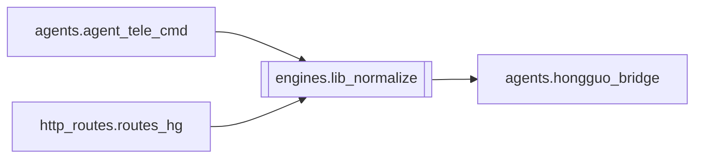

# `engines.lib_normalize`

[← Index](../generated/module-index.md) · [Brain home](../README.md)

<!-- AUTO:START — sinh bởi scripts/brain_build.py 2026-11-17 19:05. Đừng sửa tay khối này. -->
**File:** `engines/lib_normalize.py` · **Lớp:** `misc` · **303 dòng** (254 code) · **17 hàm**, **0 class** · sha1 `f989aea8db`

> Chuẩn hóa video thư viện (D:\Lib\<mùa>) — hàng đợi NỀN trong sidecar :8802 (2026-11-17/18). Vì sao: file gộp cũ (`-c copy` từ các tập tải lẻ lệch tiếng/codec/độ phân giải, gói hỏng) làm Pineline báo lỗi giải mã (h264 «In

### Phụ thuộc

- **Gọi tới (import nội bộ):** [agents.hongguo_bridge](./agents.hongguo_bridge.md)
- **Được dùng bởi:** [agents.agent_tele_cmd](./agents.agent_tele_cmd.md), [http_routes.routes_hg](./http_routes.routes_hg.md)
- **Test:** `tests/test_lib_normalize.py`

### Hàm & class top-level

| Tên | Dòng | Dài | Tham số | Docstring |
|---|---:|---:|---|---|
| `lib_root` | 36 | 2 | `` |  |
| `set_log_dir` | 40 | 3 | `d` |  |
| `_log` | 45 | 11 | `name, msg` |  |
| `_fmt_sec` | 58 | 3 | `s` |  |
| `find_merged` | 66 | 17 | `name` | → (file gộp, lỗi). Chặn tên có `..` / `\` (chỉ 1 cấp dưới thư viện). |
| `_probe` | 85 | 11 | `path` |  |
| `_brief` | 98 | 8 | `pr` |  |
| `check` | 108 | 24 | `path` | {need: bool, why: str, info: str}. |
| `enqueue` | 137 | 24 | `names, force, front` |  |
| `cancel_queued` | 163 | 10 | `` |  |
| `_ensure_worker_locked` | 175 | 5 | `` |  |
| `_set` | 182 | 5 | `name, **kw` |  |
| `_work_loop` | 189 | 12 | `` |  |
| `_process` | 203 | 40 | `name, force` |  |
| `_with_eta` | 248 | 8 | `st` |  |
| `describe` | 258 | 30 | `st` |  |
| `status` | 290 | 14 | `name, log_lines` |  |

### Config / env keys (1)

`PINELINE_LIB_ROOT`

**File/artifact nhắc tới:** `lib_normalize.log`, `merge_check.json`, `merged.mp4`

**Tín hiệu rủi ro (đếm tĩnh):** broad_except=3 · global_stmt=2 · subprocess=1 · threads=1

### Lịch sử (từ docs/)

- Fix logs: —
- Nhắc trong CHANGELOG: **1** lần · DECISIONS: **0** lần

<!-- AUTO:END -->

<!-- MANUAL:START -->
## Vai trò (viết tay)

_Chưa viết. 2–4 câu: module này chịu trách nhiệm gì trong pipeline, ai gọi nó, nó KHÔNG làm gì._

## Luồng chính

_Các hàm vào (entry) → bước chính → output/side effect. Ghi tên hàm thật._

## Bất biến & hợp đồng

_Điều luôn phải đúng (vd: chỉ ghi manifest qua `Manifest.update`; 1 job / ghế). Vi phạm = bug._

## Bẫy đã biết

_Lỗi từng gặp + link `docs/fixes/...`. Những chỗ dễ sửa sai._

## Ghi chú vận hành

_Config key quan trọng, cần restart gì khi sửa (:8801 / :8802 / hot-reload), cách test._
<!-- MANUAL:END -->
