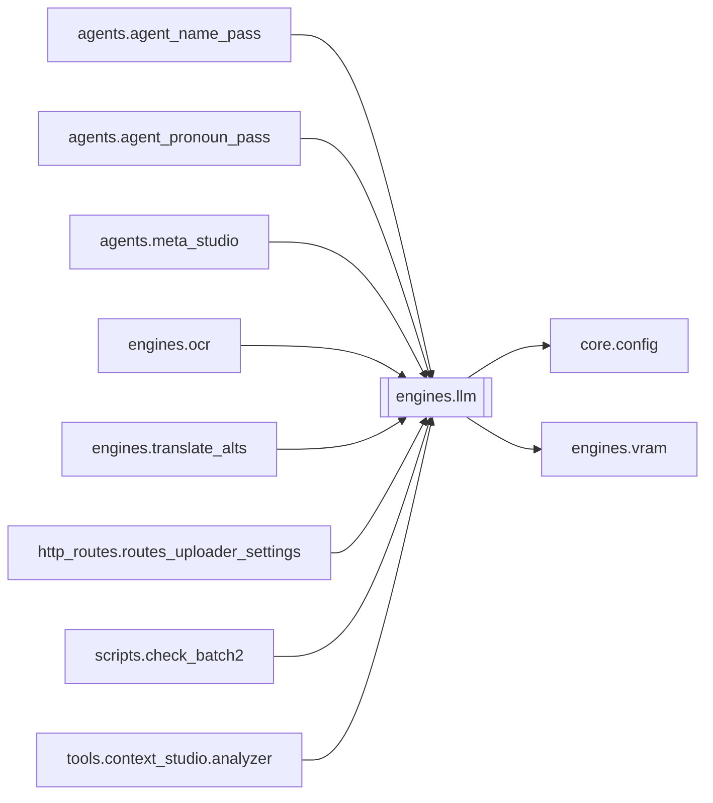

# `engines.llm`

[← Index](../generated/module-index.md) · [Brain home](../README.md)

<!-- AUTO:START — sinh bởi scripts/brain_build.py 2026-11-11 02:38. Đừng sửa tay khối này. -->
**File:** `engines/llm.py` · **Lớp:** `translate` · **872 dòng** (752 code) · **23 hàm**, **1 class** · sha1 `3cddd85b29`

> llm.py — Gọi LLM qua 9router API (tương thích chuẩn OpenAI). Cấu hình qua config.json / pineline.config.json (LLM_* / TRANSLATE_MODEL / REVIEW_MODEL: file config thắng env): LLM_BASE_URL   mặc định http://192.168.31.247:

### Phụ thuộc

- **Gọi tới (import nội bộ):** [core.config](./core.config.md), [engines.vram](./engines.vram.md)
- **Được dùng bởi:** [agents.agent_name_pass](./agents.agent_name_pass.md), [agents.agent_pronoun_pass](./agents.agent_pronoun_pass.md), [agents.meta_studio](./agents.meta_studio.md), [engines.ocr](./engines.ocr.md), [engines.translate_alts](./engines.translate_alts.md), [http_routes.routes_uploader_settings](./http_routes.routes_uploader_settings.md), [scripts.check_batch2](./scripts.check_batch2.md), [tools.context_studio.analyzer](./tools.context_studio.analyzer.md)
- **Được nhắc tên file `.py` (subprocess/script) bởi:** [llm](./llm.md), [restart_server](./restart_server.md), [scripts.check_batch2](./scripts.check_batch2.md), [scripts.check_batch3](./scripts.check_batch3.md), [tools.context_studio.__main__](./tools.context_studio.__main__.md), [tools.context_studio.app_streamlit](./tools.context_studio.app_streamlit.md)
- **Test:** `tests/test_chatgpt_route.py`, `tests/test_layout_paths.py`
- **Thư viện ngoài:** `requests`



### Hàm & class top-level

| Tên | Dòng | Dài | Tham số | Docstring |
|---|---:|---:|---|---|
| **class `LLMUnavailable`** | 53 | 0 method | | Không gọi được LLM (mất mạng / sai key / 429-5xx kéo dài). Caller phải DỪNG stage, |
| `_settings` | 58 | 9 | `` | (base, key, model) đọc LÚC GỌI (file config trước env) — sửa pineline.config.json |
| `_llama_base` | 69 | 6 | `` |  |
| `get_llama_models` | 77 | 16 | `llama_base` | Lấy danh sách các model đang load trên llama-server (:8083). |
| `get_ollama_models` | 95 | 11 | `ollama_base` | Lấy danh sách model trên Ollama (:11434). |
| `list_available_models` | 108 | 48 | `` | Trả về toàn bộ model khả dụng (llama-server 8083, ollama 11434, config). |
| `_is_loopback_base` | 158 | 3 | `url` |  |
| `is_local` | 163 | 2 | `model` |  |
| `is_chatgpt` | 170 | 4 | `model` | Model route qua Aurora / Chat2Api (pool account Free). Tiền tố chatgpt/ hoặc aurora/. |
| `_chatgpt_settings` | 176 | 26 | `` | (bases, key, default_model) cho Aurora pool. |
| `_jwt_expired` | 204 | 13 | `token` | True nếu JWT có claim exp đã qua (token local hết hạn không được đè Aurora pool). |
| `_chatgpt_token_file` | 219 | 17 | `` | Đọc access token tùy chọn từ data/chatgpt_token.txt (bỏ qua nếu JWT hết hạn). |
| `_chatgpt_chat` | 238 | 75 | `model, messages, temperature, max_tokens, json_mode, retries, timeout` | Gọi Aurora/Chat2Api (OpenAI-compatible). Pool Free xoay phía server Aurora. |
| `aurora_upload_file` | 315 | 74 | `path, purpose` | Upload file lên Aurora `POST /v1/files` (cần ChatGPT access_token thật). |
| `_file_unread_response` | 391 | 18 | `text` | GPT trả JSON/text báo không đọc được file đã upload (thường do lệch account pool). |
| `chatgpt_chat_with_file` | 411 | 97 | `file_id, prompt, model, temperature, max_tokens, json_mode, timeout…` | Hỏi GPT kèm file đã upload (`type: input_file` + `file_id`) — 1 lần đọc file. |
| `ensure_ollama_model` | 513 | 20 | `name` | Model Ollama chưa pull -> TỰ pull (lần đầu, có thể vài GB). Auto cho bước dịch. |
| `free_ollama_vram` | 535 | 4 | `reason` | Alias — nhả VRAM (Ollama + torch) trước/sau bước GPU. |
| `unload_local` | 541 | 7 | `model` | Nhả model Ollama khỏi VRAM (RTX 3060 12GB không chứa nổi LLM + TTS cùng |
| `_ollama_num_ctx` | 550 | 8 | `` | Gemma3/4 mặc định context 131072. Cấp KV 128k trên RTX 3060 12GB -> tràn |
| `_ollama_chat` | 560 | 50 | `model, messages, temperature, max_tokens, json_mode, retries, timeout` | Gọi Ollama qua endpoint GỐC /api/chat + TẮT thinking (think=False). |
| `chat` | 612 | 151 ⚠️ | `messages, model, temperature, max_tokens, json_mode, retries, timeo…` | Gửi messages, trả về text của assistant. Tự retry khi lỗi mạng/429/5xx. |
| `chat_with_meta` | 765 | 55 | `messages, model, temperature, max_tokens, json_mode, timeout` | Giống chat() OpenAI-path nhưng trả (content, meta) gồm usage/timings/TPS. |
| `parse_json` | 822 | 50 | `text` | Bóc JSON kể cả khi model bọc trong ```json ... ```, trailing commas hoặc kèm chữ thừa. |

**Hàm dài ≥120 dòng:** `chat` (151, L612)

### Config / env keys (11)

`CHATGPT_ACCESS_TOKEN`, `CHATGPT_API_KEY`, `CHATGPT_FORCE_TOKEN`, `CHATGPT_MODEL`, `LLAMA_BASE_URL`, `LLM_API_KEY`, `LLM_BASE_URL`, `LLM_ENABLE_THINKING`, `LLM_MODEL`, `LLM_NUM_CTX`, `LOCAL_LLM_BASE_URL`

**Cổng nhắc tới:** 11434, 8083

**File/artifact nhắc tới:** `chatgpt_token.txt`

**Tín hiệu rủi ro (đếm tĩnh):** broad_except=19 · sleep=7 · subprocess=2 · swallow_except=5

### Lịch sử (từ docs/)

- **Fix logs (4):**
  - [Pronoun-QA GPT vá đỏ → Aurora 413 (payload quá lớn)](../../fixes/2026-11-06-pronoun-qa-413-slim.md)
  - [2026-10-06 — Đợt 6 review: bảo trì (git, pytest, M3, dọn script chết)](../../fixes/2026-10-06-batch6-maintenance.md)
  - [2026-10-06 — Đợt 3 review: opts một nguồn, config file-first, ghi nguyên tử](../../fixes/2026-10-06-batch3-single-source.md)
  - [2026-10-06 — Đợt 2 review: bảo mật + config một nguồn + LLM sập không để trống câu](../../fixes/2026-10-06-batch2-security.md)
- **Reviews:** [_atoms_engines](../../reviews/_atoms_engines.md), [2026-11-09-plan-file-review-style-code](../../reviews/2026-11-09-plan-file-review-style-code.md), [2026-11-06-v5-part-atoms](../../reviews/2026-11-06-v5-part-atoms.md), [2026-11-06-v5-func-catalog](../../reviews/2026-11-06-v5-func-catalog.md), [2026-11-02-v4-structure-and-v2-port](../../reviews/2026-11-02-v4-structure-and-v2-port.md), [2026-10-06-code-review](../../reviews/2026-10-06-code-review.md)
- Nhắc trong CHANGELOG: **9** lần · DECISIONS: **0** lần

<!-- AUTO:END -->

<!-- MANUAL:START -->
## Vai trò (viết tay)

_Chưa viết. 2–4 câu: module này chịu trách nhiệm gì trong pipeline, ai gọi nó, nó KHÔNG làm gì._

## Luồng chính

_Các hàm vào (entry) → bước chính → output/side effect. Ghi tên hàm thật._

## Bất biến & hợp đồng

_Điều luôn phải đúng (vd: chỉ ghi manifest qua `Manifest.update`; 1 job / ghế). Vi phạm = bug._

## Bẫy đã biết

_Lỗi từng gặp + link `docs/fixes/...`. Những chỗ dễ sửa sai._

## Ghi chú vận hành

_Config key quan trọng, cần restart gì khi sửa (:8801 / :8802 / hot-reload), cách test._
<!-- MANUAL:END -->
