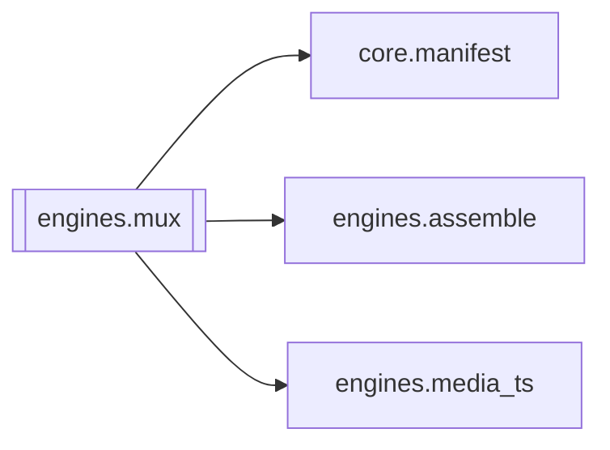

# `engines.mux`

[← Index](../generated/module-index.md) · [Brain home](../README.md)

<!-- AUTO:START — sinh bởi scripts/brain_build.py 2026-11-11 02:38. Đừng sửa tay khối này. -->
**File:** `engines/mux.py` · **Lớp:** `render` · **135 dòng** (109 code) · **5 hàm**, **0 class** · sha1 `0b05721da4`

> mux.py — STAGE cuối: ghép track lồng tiếng vào video -> output.mp4 (thuyết minh). Kiểu thuyết minh: GIỮ video + GIỮ tiếng gốc nhưng hạ nhỏ, phủ giọng Việt lên trên. Dùng ducking ĐỘNG (sidechaincompress): tiếng gốc chỉ tụ

### Phụ thuộc

- **Gọi tới (import nội bộ):** [core.manifest](./core.manifest.md), [engines.assemble](./engines.assemble.md), [engines.media_ts](./engines.media_ts.md)
- **Được dùng bởi:** —
- **Được nhắc tên file `.py` (subprocess/script) bởi:** [scripts._tmp_extract_sigs_batch2](./scripts._tmp_extract_sigs_batch2.md)
- **Test:** ❌ chưa có test import trực tiếp

### Hàm & class top-level

| Tên | Dòng | Dài | Tham số | Docstring |
|---|---:|---:|---|---|
| `_find_video` | 31 | 7 | `work_dir, m` |  |
| `_pick_dub` | 40 | 17 | `work_dir, m` | Chọn track lồng tiếng: audio ngoài > dub_fit.wav > (tự ghép fit). |
| `_has_audio` | 59 | 11 | `path` | Video gốc có luồng audio không (để biết có ducking được không). |
| `run_mux` | 72 | 50 | `work_dir, orig_vol, out_name, force` |  |
| `main` | 124 | 8 | `argv` |  |

**File/artifact nhắc tới:** `dub_fit.wav`, `output.mp4`, `tts.json`

**Tín hiệu rủi ro (đếm tĩnh):** broad_except=2 · subprocess=2

### Lịch sử (từ docs/)

- **Fix logs (3):**
  - [2026-10-06 — Đợt 4 review: tranh chấp ghi, một bản tiến trình, checkpoint an toàn](../../fixes/2026-10-06-batch4-write-races.md)
  - [Nút Dừng không tắt được mux/ffmpeg](../../fixes/2026-09-24-stop-mux-ffmpeg.md)
  - [1-click (run-all) lỗi liên tục / kẹt mux running](../../fixes/2026-09-24-run-all-stale-mux.md)
- **Reviews:** [_atoms_engines](../../reviews/_atoms_engines.md), [2026-11-06-v5-part-atoms](../../reviews/2026-11-06-v5-part-atoms.md), [2026-11-06-v5-func-catalog](../../reviews/2026-11-06-v5-func-catalog.md), [2026-10-06-code-review](../../reviews/2026-10-06-code-review.md)
- Nhắc trong CHANGELOG: **2** lần · DECISIONS: **0** lần

<!-- AUTO:END -->

<!-- MANUAL:START -->
## Vai trò (viết tay)

_Chưa viết. 2–4 câu: module này chịu trách nhiệm gì trong pipeline, ai gọi nó, nó KHÔNG làm gì._

## Luồng chính

_Các hàm vào (entry) → bước chính → output/side effect. Ghi tên hàm thật._

## Bất biến & hợp đồng

_Điều luôn phải đúng (vd: chỉ ghi manifest qua `Manifest.update`; 1 job / ghế). Vi phạm = bug._

## Bẫy đã biết

_Lỗi từng gặp + link `docs/fixes/...`. Những chỗ dễ sửa sai._

## Ghi chú vận hành

_Config key quan trọng, cần restart gì khi sửa (:8801 / :8802 / hot-reload), cách test._
<!-- MANUAL:END -->
