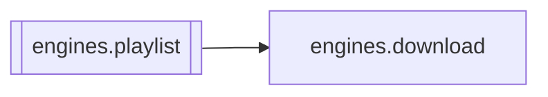

# `engines.playlist`

[← Index](../generated/module-index.md) · [Brain home](../README.md)

<!-- AUTO:START — sinh bởi scripts/brain_build.py 2026-11-11 02:38. Đừng sửa tay khối này. -->
**File:** `engines/playlist.py` · **Lớp:** `source` · **214 dòng** (182 code) · **5 hàm**, **0 class** · sha1 `d97cf6d1e9`

> playlist.py — Bóc 1 link thành DANH SÁCH video rồi tải hàng loạt. Vì sao tách riêng: Pineline theo kiến trúc "1 job = 1 video" (mỗi video 1 thư mục work/<hash>/ có manifest + resume riêng). Nên KHÔNG nhét vòng lặp tải nh

### Phụ thuộc

- **Gọi tới (import nội bộ):** [engines.download](./engines.download.md)
- **Được dùng bởi:** —
- **Test:** ❌ chưa có test import trực tiếp
- **Thư viện ngoài:** `yt_dlp`

### Hàm & class top-level

| Tên | Dòng | Dài | Tham số | Docstring |
|---|---:|---:|---|---|
| `_build_url_from_entry` | 37 | 14 | `entry, platform` | Lấy URL đầy đủ từ một entry playlist. extract_flat có khi chỉ trả id. |
| `expand_meta` | 53 | 51 | `url, cookies, cookies_dir, cookies_from_browser, proxy` | Như expand nhưng trả THÊM metadata để gom nhóm: |
| `expand` | 106 | 11 | `url, cookies, cookies_dir, cookies_from_browser, proxy` | Đọc link, trả danh sách URL video. Video đơn -> [url]; playlist -> [nhiều]. |
| `batch_download` | 119 | 55 | `url, work_root, workers, conn, cookies, cookies_dir, cookies_from_b…` | Tải tất cả video của 1 link. Trả list kết quả {url, job_id, ok, error}. |
| `main` | 176 | 35 | `argv` |  |

**Tín hiệu rủi ro (đếm tĩnh):** broad_except=1 · pools=1

### Lịch sử (từ docs/)

- Fix logs: —
- **Reviews:** [_atoms_engines](../../reviews/_atoms_engines.md), [2026-11-06-v5-part-atoms](../../reviews/2026-11-06-v5-part-atoms.md), [2026-11-06-v5-func-catalog](../../reviews/2026-11-06-v5-func-catalog.md)
- Nhắc trong CHANGELOG: **0** lần · DECISIONS: **0** lần

<!-- AUTO:END -->

<!-- MANUAL:START -->
## Vai trò (viết tay)

_Chưa viết. 2–4 câu: module này chịu trách nhiệm gì trong pipeline, ai gọi nó, nó KHÔNG làm gì._

## Luồng chính

_Các hàm vào (entry) → bước chính → output/side effect. Ghi tên hàm thật._

## Bất biến & hợp đồng

_Điều luôn phải đúng (vd: chỉ ghi manifest qua `Manifest.update`; 1 job / ghế). Vi phạm = bug._

## Bẫy đã biết

_Lỗi từng gặp + link `docs/fixes/...`. Những chỗ dễ sửa sai._

## Ghi chú vận hành

_Config key quan trọng, cần restart gì khi sửa (:8801 / :8802 / hot-reload), cách test._
<!-- MANUAL:END -->
