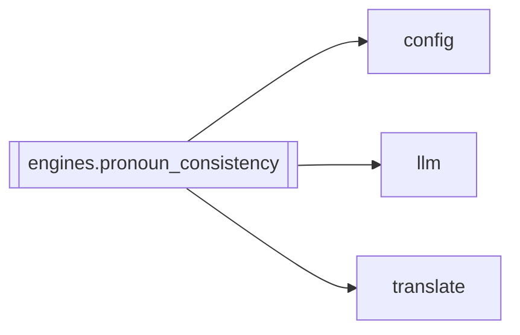

# `engines.pronoun_consistency`

[← Index](../generated/module-index.md) · [Brain home](../README.md)

<!-- AUTO:START — sinh bởi scripts/brain_build.py 2026-11-11 02:38. Đừng sửa tay khối này. -->
**File:** `engines/pronoun_consistency.py` · **Lớp:** `translate` · **870 dòng** (764 code) · **30 hàm**, **0 class** · sha1 `4ebfca4fc5`

> Đồng nhất xưng hô không cần diarization (A–C + vá câu đỏ). A) analyze_full_zh: quét TOÀN BỘ ZH theo lô + memory → glossary.pronouns + lock B) inject lock/ledger vào mỗi lô dịch

### Phụ thuộc

- **Gọi tới (import nội bộ):** [config](./config.md), [llm](./llm.md), [translate](./translate.md)
- **Được dùng bởi:** —
- **Test:** `tests/test_pronoun_consistency.py`
- **Thư viện ngoài:** `agent_pronoun_pass`, `manifest`

### Hàm & class top-level

| Tên | Dòng | Dài | Tham số | Docstring |
|---|---:|---:|---|---|
| `_cfg` | 30 | 6 | `key, default` |  |
| `analyze_enabled` | 38 | 3 | `` |  |
| `analyze_model` | 43 | 9 | `` |  |
| `chunk_size` | 54 | 5 | `` |  |
| `analyze_mode` | 61 | 3 | `` | file = upload SRT ZH 1 lần (Aurora /v1/files). fast = mẫu+lô. full = quét hết. |
| `max_chunks` | 66 | 5 | `` |  |
| `min_chunks_before_stop` | 73 | 5 | `` |  |
| `early_stop_enabled` | 80 | 3 | `` |  |
| `is_pronouns_locked` | 85 | 7 | `plan` |  |
| `mark_locked` | 94 | 14 | `plan, source` |  |
| `export_zh_lines` | 110 | 16 | `segments_or_rows` | Chuẩn hoá [{i, zh}] từ asr segments hoặc script rows. |
| `write_zh_export` | 128 | 8 | `work_dir, lines` |  |
| `write_zh_srt` | 138 | 51 | `work_dir, lines, segments, annotate_i` | Xuất sub.zh.srt để Aurora upload (API.md: POST /v1/files). |
| `_apply_analyze_delta_to_plan` | 191 | 17 | `plan, data, source` |  |
| `analyze_via_srt_file` | 210 | 86 | `work_dir, plan, lines, segments, model` | Upload sub.zh.srt → GPT đọc 1 lần → glossary pronouns (Aurora file QA). |
| `select_analyze_lines` | 298 | 40 | `lines, mode` | fast: phủ đầu/giữa/cuối + câu có hô ngữ — ít lô hơn full scan. |
| `_slim_memory` | 340 | 22 | `memory` | Giảm token gửi Aurora mỗi lô. |
| `_merge_pronouns` | 364 | 26 | `base, incoming` |  |
| `_merge_chars` | 392 | 16 | `base, incoming` |  |
| `_analyze_chunk` | 410 | 35 | `chunk, memory, model, genre_hint` |  |
| `analyze_full_zh` | 447 | 165 ⚠️ | `work_dir, plan, segments, model, force` | A) Quét toàn bộ ZH theo lô + memory → cập nhật plan + lock pronouns. |
| `lock_banner` | 614 | 24 | `plan` | Block inject vào plan_block / batch khi đã lock. |
| `review_lock_rules` | 640 | 17 | `plan` | Prompt review xưng hô — linh hoạt theo cảnh (đô thị↔tu tiên). |
| `fix_preserves_locked_register` | 659 | 17 | `vi_nhap, vi_fix` | True nếu bản sửa không đổi thanh ngữ chính so với nháp (khi đang lock). |
| `filter_review_fixes_for_lock` | 678 | 26 | `fixes, rows, plan` | Lọc fix phá xưng hô — bỏ qua khi mixed/linh hoạt (đô thị↔tu tiên). |
| `ledger_from_prev` | 706 | 23 | `prev_ctx` | B) Ledger từ vài câu VI trước — nhắc model giữ thanh ngữ đang dùng. |
| `_forms_in` | 731 | 10 | `vi` |  |
| `find_pronoun_jumps` | 743 | 41 | `rows, window` | C) QA: trong cửa sổ gần nhau, vừa có {anh,em} vừa có {ông} ngôi hô / tôi lệch kiểu. |
| `ensure_analyze_before_translate` | 786 | 21 | `work_dir, plan, segments, force` | Gọi từ translate.run_translate sau khi có plan. |
| `run_post_translate_consistency` | 809 | 62 | `work_dir, rows, plan, fix_with_gpt` | C+D sau dịch/polish: post-pass + QA jumps + GPT vá đỏ. |

**Hàm dài ≥120 dòng:** `analyze_full_zh` (165, L447)

### Config / env keys (7)

`PRONOUN_ANALYZE`, `PRONOUN_ANALYZE_CHUNK`, `PRONOUN_ANALYZE_EARLY_STOP`, `PRONOUN_ANALYZE_MAX_CHUNKS`, `PRONOUN_ANALYZE_MIN_CHUNKS`, `PRONOUN_ANALYZE_MODE`, `PRONOUN_ANALYZE_MODEL`

**File/artifact nhắc tới:** `asr.json`, `glossary.json`, `pronoun_lock.json`, `pronoun_qa.json`, `script.json`, `sub.zh.analyze.txt`, `sub.zh.srt`, `zh_full_for_pronoun.txt`

**Tín hiệu rủi ro (đếm tĩnh):** broad_except=11 · file_writes=8 · swallow_except=3

### Lịch sử (từ docs/)

- **Fix logs (2):**
  - [Pronoun-QA GPT vá đỏ → Aurora 413 (payload quá lớn)](../../fixes/2026-11-06-pronoun-qa-413-slim.md)
  - [Đồng nhất xưng hô A–C (analyze full ZH → lock → ledger → QA)](../../fixes/2026-11-02-pronoun-consistency-abc.md)
- **Reviews:** [_atoms_engines](../../reviews/_atoms_engines.md), [2026-11-09-plan-file-review-style-code](../../reviews/2026-11-09-plan-file-review-style-code.md), [2026-11-06-v5-part-atoms](../../reviews/2026-11-06-v5-part-atoms.md), [2026-11-06-v5-func-catalog](../../reviews/2026-11-06-v5-func-catalog.md)
- Nhắc trong CHANGELOG: **2** lần · DECISIONS: **0** lần

<!-- AUTO:END -->

<!-- MANUAL:START -->
## Vai trò (viết tay)

_Chưa viết. 2–4 câu: module này chịu trách nhiệm gì trong pipeline, ai gọi nó, nó KHÔNG làm gì._

## Luồng chính

_Các hàm vào (entry) → bước chính → output/side effect. Ghi tên hàm thật._

## Bất biến & hợp đồng

_Điều luôn phải đúng (vd: chỉ ghi manifest qua `Manifest.update`; 1 job / ghế). Vi phạm = bug._

## Bẫy đã biết

_Lỗi từng gặp + link `docs/fixes/...`. Những chỗ dễ sửa sai._

## Ghi chú vận hành

_Config key quan trọng, cần restart gì khi sửa (:8801 / :8802 / hot-reload), cách test._
<!-- MANUAL:END -->
