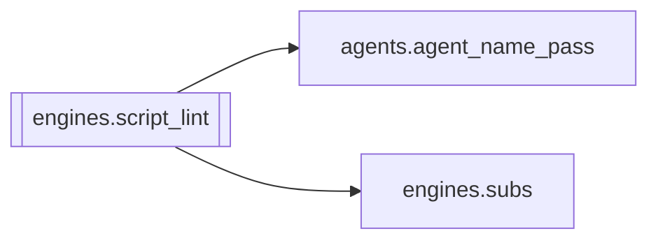

# `engines.script_lint`

[← Index](../generated/module-index.md) · [Brain home](../README.md)

<!-- AUTO:START — sinh bởi scripts/brain_build.py 2026-11-11 02:38. Đừng sửa tay khối này. -->
**File:** `engines/script_lint.py` · **Lớp:** `translate` · **170 dòng** (142 code) · **10 hàm**, **0 class** · sha1 `c7bf09d576`

> Soát lỗi máy móc bản dịch VI (script.json) — chạy SAU review/polish, trước TTS. autofix_rows: sửa chắc chắn đúng (không cần LLM) · «ông tôi / cô tôi» khi zh là 他/她 (không phải họ hàng)

### Phụ thuộc

- **Gọi tới (import nội bộ):** [agents.agent_name_pass](./agents.agent_name_pass.md), [engines.subs](./engines.subs.md)
- **Được dùng bởi:** —
- **Test:** ❌ chưa có test import trực tiếp

### Hàm & class top-level

| Tên | Dòng | Dài | Tham số | Docstring |
|---|---:|---:|---|---|
| `_fix_kin` | 33 | 4 | `zh, vi` |  |
| `_fix_punct` | 39 | 2 | `vi` |  |
| `_fix_num` | 43 | 2 | `vi` |  |
| `_glossary_terms` | 47 | 8 | `plan` |  |
| `_variant_re` | 57 | 6 | `vi` |  |
| `_chi_majority` | 65 | 9 | `rows` |  |
| `autofix_rows` | 76 | 29 | `rows, plan` |  |
| `lint_rows` | 107 | 29 | `rows, plan` | Đếm lỗi còn lại — không sửa. Dùng cho QA gate / agent / UI. |
| `run_lint` | 138 | 15 | `work_dir, fix` | Lint script.json của 1 job; fix=True thì autofix + ghi lại (+ SRT/display). |
| `write_display` | 155 | 9 | `work_dir, rows` |  |

**File/artifact nhắc tới:** `glossary.json`, `script.display.json`, `script.json`, `sub.vi.srt`

**Tín hiệu rủi ro (đếm tĩnh):** file_writes=4

### Lịch sử (từ docs/)

- Fix logs: —
- **Reviews:** [_atoms_engines](../../reviews/_atoms_engines.md), [2026-11-06-v5-part-atoms](../../reviews/2026-11-06-v5-part-atoms.md), [2026-11-06-v5-func-catalog](../../reviews/2026-11-06-v5-func-catalog.md)
- Nhắc trong CHANGELOG: **0** lần · DECISIONS: **0** lần

<!-- AUTO:END -->

<!-- MANUAL:START -->
## Vai trò (viết tay)

_Chưa viết. 2–4 câu: module này chịu trách nhiệm gì trong pipeline, ai gọi nó, nó KHÔNG làm gì._

## Luồng chính

_Các hàm vào (entry) → bước chính → output/side effect. Ghi tên hàm thật._

## Bất biến & hợp đồng

_Điều luôn phải đúng (vd: chỉ ghi manifest qua `Manifest.update`; 1 job / ghế). Vi phạm = bug._

## Bẫy đã biết

_Lỗi từng gặp + link `docs/fixes/...`. Những chỗ dễ sửa sai._

## Ghi chú vận hành

_Config key quan trọng, cần restart gì khi sửa (:8801 / :8802 / hot-reload), cách test._
<!-- MANUAL:END -->
