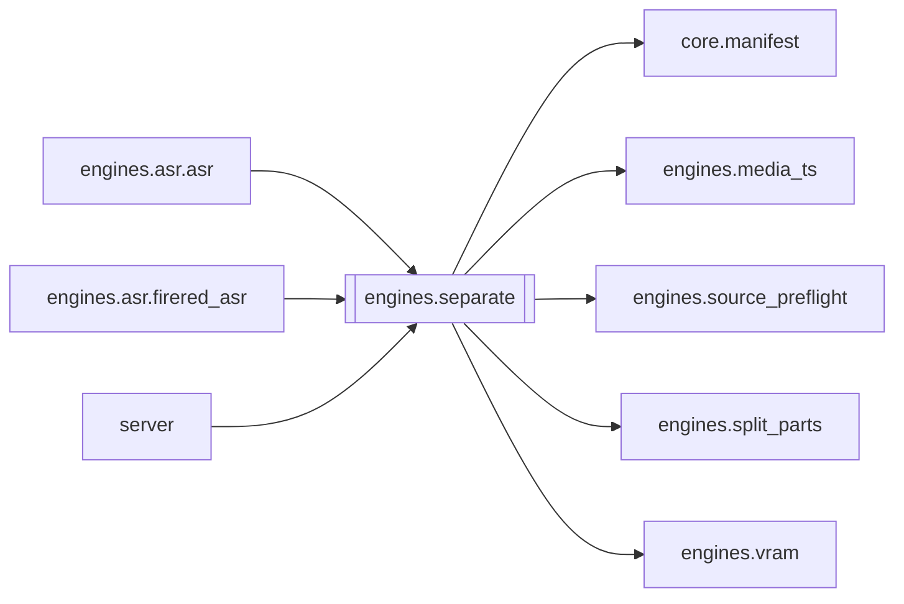

# `engines.separate`

[← Index](../generated/module-index.md) · [Brain home](../README.md)

<!-- AUTO:START — sinh bởi scripts/brain_build.py 2026-11-17 19:05. Đừng sửa tay khối này. -->
**File:** `engines/separate.py` · **Lớp:** `asr` · **575 dòng** (496 code) · **18 hàm**, **1 class** · sha1 `15d03bccb4`

> separate.py — Tách giọng/nền bằng Demucs (htdemucs --two-stems=vocals). Đầu vào : work/<job>/source.* (video) Đầu ra  : work/<job>/vocals.wav     (giọng Trung sạch — nguồn cho ASR, mặc định từ 2026-11-12)

### Phụ thuộc

- **Gọi tới (import nội bộ):** [core.manifest](./core.manifest.md), [engines.media_ts](./engines.media_ts.md), [engines.source_preflight](./engines.source_preflight.md), [engines.split_parts](./engines.split_parts.md), [engines.vram](./engines.vram.md)
- **Được dùng bởi:** [engines.asr.asr](./engines.asr.asr.md), [engines.asr.firered_asr](./engines.asr.firered_asr.md), [server](./server.md)
- **Được nhắc tên file `.py` (subprocess/script) bởi:** [engines.asr.asr](./engines.asr.asr.md), [restart_server](./restart_server.md), [server](./server.md)
- **Test:** `tests/test_firered_slice_silence.py`, `tests/test_layout_paths.py`, `tests/test_separate_demucs_chunks.py`, `tests/test_simple_junk_park.py`, `tests/test_video_preflight.py`

### Hàm & class top-level

| Tên | Dòng | Dài | Tham số | Docstring |
|---|---:|---:|---|---|
| **class `WavInfo`** | 83 | 2 method | |  |
| `_env_float` | 58 | 5 | `name, default` |  |
| `_cfg` | 66 | 7 | `` |  |
| `wav_info` | 100 | 39 | `path` | Đọc header WAV/RF64 (PCM/float/extensible). Không giải mã — chỉ vị trí data + số mẫu. |
| `_write_header` | 141 | 14 | `f, fmt_raw, data_bytes` | Header RIFF chuẩn; data ≥ ~4GB -> RF64 (ffmpeg/soundfile đọc được). |
| `_copy_frames` | 157 | 18 | `src, fsrc, start, count, fdst` | Chép `count` frame từ vị trí `start` của src; thiếu (vượt cuối file) -> đệm 0. |
| `write_wav_slice` | 177 | 13 | `src_path, out_path, start, count` | Ghi out = frames [start, start+count) của src (đệm 0 nếu src ngắn). Atomic (.partial). |
| `concat_wavs` | 192 | 24 | `parts, out_path, expect_frames` | Ghép WAV cùng định dạng theo mẫu (không re-encode). Kiểm tổng frame nếu có expect_frames. |
| `_frames_or_none` | 218 | 5 | `p` |  |
| `_find_video` | 227 | 4 | `work_dir` |  |
| `_probe_duration` | 233 | 11 | `path` | Lấy thời lượng file media (giây) qua ffprobe. |
| `_update_sep_progress` | 246 | 21 | `m, pct, cur_text` | Tiến độ stage 'separate' + đồng bộ sang 'asr' nếu ASR đang chờ tách giọng. |
| `_extract_orig_wav` | 269 | 8 | `video, out_wav` | Audio GỐC 44.1k stereo PCM s16 (RF64 khi >4GB) — chính xác theo mẫu để cắt/ghép. |
| `plan_chunks` | 279 | 32 | `n_frames, rate, cfg, cut_finder` | [(start, end)] theo mẫu, phủ kín [0, n_frames). Audio ≤ ngưỡng -> 1 khúc. |
| `_run_demucs_on_file` | 313 | 68 | `src_audio, tmp_out, device, work_dir, m, chunk_idx, n_chunks` | Chạy Demucs trên 1 file audio (ngắn hoặc 1 khúc) và trả về (no_vocals_wav, vocals_wav). |
| `outputs_valid` | 383 | 27 | `work_dir, video, st` | vocals.wav + no_vocals.wav đủ dùng lại? (kích thước + độ dài khớp gốc/video). |
| `_mark_done` | 412 | 8 | `m, work_dir, device, **extra` |  |
| `run_separate` | 422 | 141 ⚠️ | `work_dir, device, force` |  |
| `main` | 565 | 7 | `argv` |  |

**Hàm dài ≥120 dòng:** `run_separate` (141, L422)

### Config / env keys (4)

`DEMUCS_CHUNK_PAD_SEC`, `DEMUCS_CHUNK_SEC`, `DEMUCS_CUT_SEARCH_SEC`, `DEMUCS_LONG_THRESHOLD_SEC`

**File/artifact nhắc tới:** `no_vocals.wav`, `orig.wav`, `orig_audio.wav`, `plan.json`, `vocals.wav`

**Tín hiệu rủi ro (đếm tĩnh):** broad_except=7 · file_writes=1 · subprocess=2 · swallow_except=2

### Lịch sử (từ docs/)

- **Fix logs (2):**
  - [Port V2→V5: preflight/chuẩn hoá video nguồn + extract_pcm bền + FireRed slice khoảng lặng + câu rác «None.» / ](../../fixes/2026-11-13-port-preflight-slice-junk.md)
  - [Port V2→V5: luồng dịch `translate_simple` (mặc định) + Demucs trước ASR](../../fixes/2026-11-12-port-simple-demucs.md)
- **Reviews:** [_atoms_engines](../../reviews/_atoms_engines.md), [2026-11-06-v5-part-atoms](../../reviews/2026-11-06-v5-part-atoms.md), [2026-11-06-v5-func-catalog](../../reviews/2026-11-06-v5-func-catalog.md), [2026-11-02-v4-structure-and-v2-port](../../reviews/2026-11-02-v4-structure-and-v2-port.md), [2026-10-06-code-review](../../reviews/2026-10-06-code-review.md)
- Nhắc trong CHANGELOG: **4** lần · DECISIONS: **0** lần

<!-- AUTO:END -->

<!-- MANUAL:START -->
## Vai trò (viết tay)

_Chưa viết. 2–4 câu: module này chịu trách nhiệm gì trong pipeline, ai gọi nó, nó KHÔNG làm gì._

## Luồng chính

_Các hàm vào (entry) → bước chính → output/side effect. Ghi tên hàm thật._

## Bất biến & hợp đồng

_Điều luôn phải đúng (vd: chỉ ghi manifest qua `Manifest.update`; 1 job / ghế). Vi phạm = bug._

## Bẫy đã biết

_Lỗi từng gặp + link `docs/fixes/...`. Những chỗ dễ sửa sai._

## Ghi chú vận hành

_Config key quan trọng, cần restart gì khi sửa (:8801 / :8802 / hot-reload), cách test._
<!-- MANUAL:END -->
