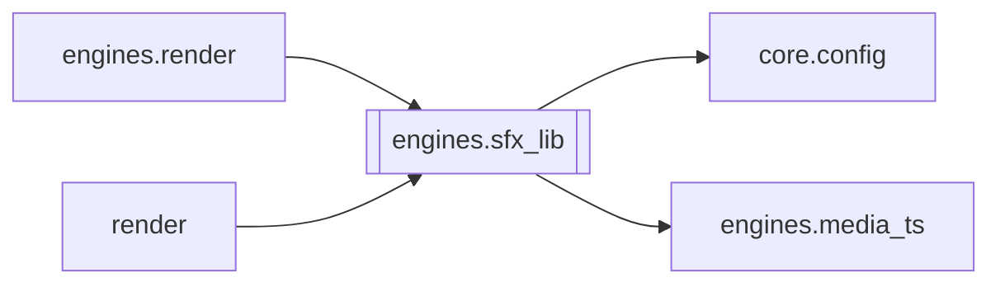

# `engines.sfx_lib`

[← Index](../generated/module-index.md) · [Brain home](../README.md)

<!-- AUTO:START — sinh bởi scripts/brain_build.py 2026-11-11 02:38. Đừng sửa tay khối này. -->
**File:** `engines/sfx_lib.py` · **Lớp:** `render` · **438 dòng** (372 code) · **21 hàm**, **0 class** · sha1 `676ff4a046`

> sfx_lib.py — chế độ audio `sfx_lib`: giọng Việt + TIẾNG ĐỘNG gốc + NHẠC KHO SẠCH theo mức. Bỏ toàn bộ nhạc nền gốc (nguồn claim Content ID) nhưng giữ tiếng động (nổ, va đập, xe...). Chuẩn bị trong work/<job>/ (cache theo

### Phụ thuộc

- **Gọi tới (import nội bộ):** [core.config](./core.config.md), [engines.media_ts](./engines.media_ts.md)
- **Được dùng bởi:** [engines.render](./engines.render.md), [render](./render.md)
- **Được nhắc tên file `.py` (subprocess/script) bởi:** [restart_server](./restart_server.md)
- **Test:** `tests/test_layout_paths.py`, `tests/test_sfx_lib.py`
- **Thư viện ngoài:** `demucs`, `numpy`, `soundfile`, `torch`

### Hàm & class top-level

| Tên | Dòng | Dài | Tham số | Docstring |
|---|---:|---:|---|---|
| `effect_volume` | 46 | 5 | `` |  |
| `music_volume` | 53 | 5 | `` |  |
| `voice_boost` | 60 | 7 | `` | Hệ số nhân thêm lên RENDER_DUB_VOL, chỉ cho sfx_lib. |
| `model_dir` | 69 | 2 | `` |  |
| `lib_dir` | 73 | 2 | `` |  |
| `model_files` | 77 | 5 | `` |  |
| `_fstat` | 84 | 6 | `p` |  |
| `separate_stream` | 94 | 30 | `read_block, write_block, fn, sr, chunk_s, overlap_s` | Tách theo khúc, nối crossfade tuyến tính ở vùng chồng. |
| `_cdx_fn` | 126 | 23 | `device` |  |
| `separate` | 151 | 41 | `src, work_dir, total, log` | Âm gốc (video/audio bất kỳ) → sfx_effect.flac + sfx_music.flac. |
| `window_features` | 196 | 16 | `music_path, win_s` | (rms_db, flux) mỗi cửa sổ win_s của stem nhạc (mono; flux tính ở ~11 kHz). |
| `_median` | 214 | 6 | `x, k` |  |
| `classify` | 222 | 45 | `rms_db, flux, win_s, none_db, smooth_s, min_seg_s` | Cửa sổ → đoạn {start, end, level}. Mức calm/mid/intense chia theo tam phân vị của chính phim. |
| `library` | 271 | 9 | `lib` | {mức: [(đường dẫn, giây)]} từ assets/bgm_yt/manifest.json (+ file lạ trong thư mục mức). |
| `_probe` | 282 | 7 | `f` |  |
| `plan_bgm` | 291 | 28 | `segments, total, lib, job_key, xfade` | Xếp bài cho từng đoạn → [{file, at, off, dur, fin, fout}] (giây). Đoạn 'none' để trống. |
| `_decode` | 321 | 8 | `f` |  |
| `render_bgm` | 331 | 37 | `plan, total, out, block_s` | Ghi dải nhạc dài `total` giây theo plan (từng khối, không giữ cả dải trong RAM). |
| `prepare` | 372 | 35 | `work_dir, video, total, force, log` |  |
| `run_subprocess` | 409 | 15 | `work_dir, video, total, on_line` | Gọi prepare ở tiến trình con (nhả VRAM/RAM khi xong); on_line(dòng log) để cập nhật tiến độ. |
| `main` | 426 | 9 | `argv` |  |

### Config / env keys (6)

`RENDER_LIB_BGM_VOL`, `RENDER_SFX_VOICE_BOOST`, `RENDER_SFX_VOL`, `SFX_CDX_HQ`, `SFX_CDX_MODEL_DIR`, `SFX_LIB_DIR`

**File/artifact nhắc tới:** `sfx_levels.json`, `sfx_lib.json`

**Tín hiệu rủi ro (đếm tĩnh):** file_writes=3 · subprocess=4

### Lịch sử (từ docs/)

- **Fix logs (1):**
  - [sfx_lib: audio trộn có lúc hụt đuôi (sidechaincompress kết thúc sớm)](../../fixes/2026-10-07-sfxlib-sidechain-short.md)
- **Reviews:** [_atoms_engines](../../reviews/_atoms_engines.md), [2026-11-06-v5-part-atoms](../../reviews/2026-11-06-v5-part-atoms.md), [2026-11-06-v5-func-catalog](../../reviews/2026-11-06-v5-func-catalog.md)
- Nhắc trong CHANGELOG: **8** lần · DECISIONS: **3** lần

<!-- AUTO:END -->

<!-- MANUAL:START -->
## Vai trò (viết tay)

_Chưa viết. 2–4 câu: module này chịu trách nhiệm gì trong pipeline, ai gọi nó, nó KHÔNG làm gì._

## Luồng chính

_Các hàm vào (entry) → bước chính → output/side effect. Ghi tên hàm thật._

## Bất biến & hợp đồng

_Điều luôn phải đúng (vd: chỉ ghi manifest qua `Manifest.update`; 1 job / ghế). Vi phạm = bug._

## Bẫy đã biết

_Lỗi từng gặp + link `docs/fixes/...`. Những chỗ dễ sửa sai._

## Ghi chú vận hành

_Config key quan trọng, cần restart gì khi sửa (:8801 / :8802 / hot-reload), cách test._
<!-- MANUAL:END -->
