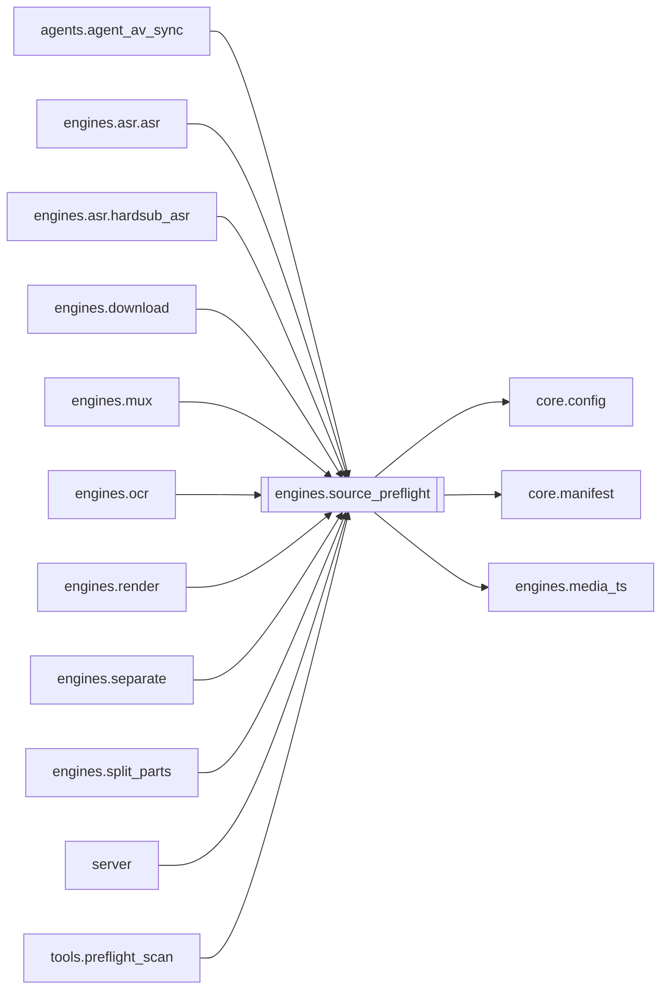

# `engines.source_preflight`

[← Index](../generated/module-index.md) · [Brain home](../README.md)

<!-- AUTO:START — sinh bởi scripts/brain_build.py 2026-11-17 19:05. Đừng sửa tay khối này. -->
**File:** `engines/source_preflight.py` · **Lớp:** `misc` · **556 dòng** (478 code) · **22 hàm**, **2 class** · sha1 `25e6a9d58c`

> Preflight + chuẩn hoá video nguồn TRƯỚC asr/separate/ocr/render (2026-11-12, agentK). Vì sao: nguồn AAC hỏng giữa file (Hongguo merge → rematrix -22) làm ASR fail mã 1 khó hiểu, và mỗi stage tự trích audio theo cách riên

### Phụ thuộc

- **Gọi tới (import nội bộ):** [core.config](./core.config.md), [core.manifest](./core.manifest.md), [engines.media_ts](./engines.media_ts.md)
- **Được dùng bởi:** [agents.agent_av_sync](./agents.agent_av_sync.md), [engines.asr.asr](./engines.asr.asr.md), [engines.asr.hardsub_asr](./engines.asr.hardsub_asr.md), [engines.download](./engines.download.md), [engines.mux](./engines.mux.md), [engines.ocr](./engines.ocr.md), [engines.render](./engines.render.md), [engines.separate](./engines.separate.md), [engines.split_parts](./engines.split_parts.md), [server](./server.md), [tools.preflight_scan](./tools.preflight_scan.md)
- **Được nhắc tên file `.py` (subprocess/script) bởi:** [tools.preflight_scan](./tools.preflight_scan.md)
- **Test:** `tests/test_video_preflight.py`

### Hàm & class top-level

| Tên | Dòng | Dài | Tham số | Docstring |
|---|---:|---:|---|---|
| **class `PreflightError`** | 57 | 0 method | | Nguồn video không dùng được — fail sớm với lý do rõ. |
| **class `_Lock`** | 455 | 3 method | | Khoá file trong work dir (asr + separate có thể cùng gọi ensure). |
| `_flag` | 63 | 9 | `name, default` |  |
| `preflight_enabled` | 74 | 2 | `` |  |
| `normalize_enabled` | 78 | 2 | `` |  |
| `normalize_on_drift` | 82 | 2 | `` |  |
| `pending_payload` | 86 | 3 | `` | Trường gắn vào stage download khi import (preflight chạy lười ở stage đầu tiên). |
| `_read_download_stage` | 93 | 7 | `work_dir` |  |
| `original_source_video` | 102 | 11 | `work_dir, dl` | Video gốc của job (download.video_path → source.*), bỏ qua bản chuẩn hoá. |
| `resolve_source_video` | 115 | 11 | `work_dir, dl` | HÀM DUY NHẤT chọn video nguồn cho mọi stage. Chỉ đọc, không side effect. |
| `stage_source_video` | 128 | 4 | `work_dir` | Đầu stage xử lý (asr/separate/ocr/render/mux/split): preflight nếu đang chờ, rồi resolve. |
| `_f` | 136 | 5 | `x` |  |
| `_ratio` | 143 | 6 | `s` |  |
| `probe` | 151 | 44 | `video` | ffprobe tóm tắt: format + luồng hình/tiếng đầu tiên. |
| `decode_audio_check` | 197 | 29 | `video, timeout, dur_hint` | Giải mã TOÀN BỘ audio như ASR (AUDIO_TS_FIX, mono 16k) ra null — bắt lỗi AAC/rematrix/mốc. |
| `decode_video_check` | 228 | 17 | `video, dur` | Giải mã thử 3 khung đầu + 3 khung giữa (rẻ). ok=False nếu cả hai đều không ra khung. |
| `check_source` | 247 | 76 | `video, quick` | Kiểm chỉ-đọc. Trả {ok, fatal?, issues[], warnings[], probe, decode, drift, …}. |
| `normalize_source` | 327 | 53 | `work_dir, video, chk` | Hình -c:v copy + audio dựng lại (extract_pcm_from_video) → work_dir/source_norm.<mp4/mkv>. |
| `_write_download` | 384 | 10 | `work_dir, fields, drop` |  |
| `run_preflight` | 396 | 57 | `work_dir, video, normalize, write` | Kiểm nguồn gốc của job; lỗi audio → chuẩn hoá (nếu bật). Ghi download.preflight. |
| `ensure_preflight` | 491 | 20 | `work_dir` | Gọi ở đầu stage xử lý. Rẻ khi không có gì phải làm (đọc manifest). |
| `inherit_payload` | 513 | 11 | `parent_dl, parent_job_id` | Trường preflight cho sub-job (split_parts) cắt từ nguồn của job cha. |
| `after_download` | 526 | 8 | `work_dir, video` | download.py gọi ngay sau mark_done (đang ở hàng tải → chạy luôn). Fatal → raise. |
| `main` | 536 | 17 | `argv` |  |

**File/artifact nhắc tới:** `.preflight.lock`, `manifest.json`, `norm_audio.wav`

**Tín hiệu rủi ro (đếm tĩnh):** broad_except=3 · sleep=1 · subprocess=4

### Lịch sử (từ docs/)

- **Fix logs (1):**
  - [Port V2→V5: preflight/chuẩn hoá video nguồn + extract_pcm bền + FireRed slice khoảng lặng + câu rác «None.» / ](../../fixes/2026-11-13-port-preflight-slice-junk.md)
- Nhắc trong CHANGELOG: **1** lần · DECISIONS: **0** lần

<!-- AUTO:END -->

<!-- MANUAL:START -->
## Vai trò (viết tay)

_Chưa viết. 2–4 câu: module này chịu trách nhiệm gì trong pipeline, ai gọi nó, nó KHÔNG làm gì._

## Luồng chính

_Các hàm vào (entry) → bước chính → output/side effect. Ghi tên hàm thật._

## Bất biến & hợp đồng

_Điều luôn phải đúng (vd: chỉ ghi manifest qua `Manifest.update`; 1 job / ghế). Vi phạm = bug._

## Bẫy đã biết

_Lỗi từng gặp + link `docs/fixes/...`. Những chỗ dễ sửa sai._

## Ghi chú vận hành

_Config key quan trọng, cần restart gì khi sửa (:8801 / :8802 / hot-reload), cách test._
<!-- MANUAL:END -->
