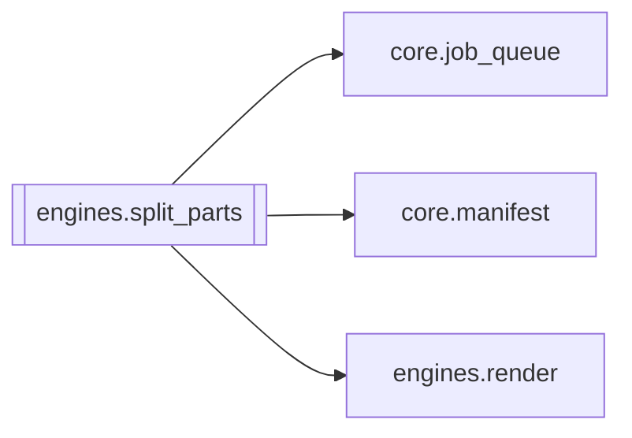

# `engines.split_parts`

[← Index](../generated/module-index.md) · [Brain home](../README.md)

<!-- AUTO:START — sinh bởi scripts/brain_build.py 2026-11-11 02:38. Đừng sửa tay khối này. -->
**File:** `engines/split_parts.py` · **Lớp:** `render` · **845 dòng** (721 code) · **19 hàm**, **1 class** · sha1 `9a96e41455`

> split_parts.py — Tự động tính toán và chia video dài (3h-12h+) thành các Part 2-2.5h để chạy ASR/TTS/Render độc lập chống lệch time, sau đó ghép concat lại thành bản Full.

### Phụ thuộc

- **Gọi tới (import nội bộ):** [core.job_queue](./core.job_queue.md), [core.manifest](./core.manifest.md), [engines.render](./engines.render.md)
- **Được dùng bởi:** —
- **Được nhắc tên file `.py` (subprocess/script) bởi:** [restart_server](./restart_server.md), [split_parts](./split_parts.md)
- **Test:** `tests/test_split_enospc_guard.py`

### Hàm & class top-level

| Tên | Dòng | Dài | Tham số | Docstring |
|---|---:|---:|---|---|
| **class `DiskFullError`** | 32 | 0 method | | Ổ đầy — dừng split, không fallback re-encode. |
| `_is_disk_full_text` | 36 | 3 | `*chunks` |  |
| `free_bytes` | 41 | 7 | `path` | Dung lượng trống trên volume chứa `path` (tạo parent nếu chưa có). |
| `estimate_split_need_bytes` | 50 | 4 | `video_path` | Ước lượng chỗ cần cho split copy-mode (= gần bằng size nguồn + margin). |
| `assert_enough_space_for_split` | 56 | 8 | `video_path, out_dir` |  |
| `_unlink_quiet` | 66 | 6 | `path` |  |
| `probe_duration` | 74 | 14 | `video_path` | Lấy thời lượng video tính bằng giây. |
| `calculate_part_plan` | 90 | 19 | `total_sec, target_hours` | Tính toán danh sách (start_sec, end_sec) cho từng part. |
| `find_best_cut_point` | 111 | 39 | `video_path, target_cut_sec, search_radius_sec` | Tìm điểm khoảng lặng (silence) gần nhất với target_cut_sec trong phạm vi ±search_radius_sec. |
| `compute_smart_plan` | 152 | 40 | `video_path, target_hours` | Tính plan hoàn chỉnh có điểm cắt thông minh (tránh đứt câu thoại). |
| `split_video_to_parts` | 194 | 135 ⚠️ | `video_path, out_dir, target_hours, prefix` | Cắt video thành các part theo smart plan (lossless copy). |
| `_hardlink_alias` | 331 | 28 | `primary, alias` | Tạo alias cùng inode với primary. Không bao giờ copy2 (tránh nhân đôi GB). |
| `cleanup_split_parts_dir` | 361 | 10 | `parts_dir` | Xoá thư mục `_split_parts` dở (orphan GB sau fail / ENOSPC). |
| `merge_parts_to_full` | 373 | 37 | `part_videos, out_full_mp4` | Nối danh sách các part đã render hoàn chỉnh thành 1 file full (lossless copy 30s). |
| `split_job_to_subjobs` | 412 | 162 ⚠️ | `job_id, target_hours, work_root` | Tự động chia một job video dài thành các sub-jobs (Part 1, Part 2...). |
| `merge_job_parts` | 576 | 97 | `job_id, work_root` | Kiểm tra các sub-job của job_id, nếu tất cả đã render xong thì ghép thành output_full.mp4. |
| `is_split_subjob` | 675 | 11 | `work_dir` | Part đã tách (…_p01) — không auto-split lần nữa. |
| `maybe_auto_split_job` | 688 | 102 | `job_id, work_root, enabled, target_hours, min_hours` | Tự detect thời lượng video sau khi có source: |
| `try_auto_merge_parent` | 792 | 24 | `job_id, work_root, enabled` | Sau khi một part mux xong: nếu mọi part done → merge output_full trên job cha. |
| `main` | 818 | 24 | `` |  |

**Hàm dài ≥120 dòng:** `split_job_to_subjobs` (162, L412), `split_video_to_parts` (135, L194)

**File/artifact nhắc tới:** `output.mp4`, `output_full.mp4`, `split_manifest.json`, `tts_config.json`

**Tín hiệu rủi ro (đếm tĩnh):** broad_except=8 · file_writes=2 · subprocess=5 · swallow_except=1

### Lịch sử (từ docs/)

- **Fix logs (6):**
  - [`/api/hg/poster` 502 với job_id / `downloads`](../../fixes/2026-11-09-hg-poster-502-junk-name.md)
  - [Auto-split part (Phần N/N) bị đưa vào upload](../../fixes/2026-11-08-skip-split-part-upload.md)
  - [Films UI thiếu nút gộp job đã làm (combine)](../../fixes/2026-11-07-films-combine-ui.md)
  - [V5 split hết ổ vẫn re-encode / thiếu ENOSPC guard](../../fixes/2026-11-06-v5-enospc-port.md)
  - [Merge split tạo output + output_full nhân đôi dung lượng](../../fixes/2026-11-06-merge-no-dup-output.md)
  - [Phim dài ~12h lệch khung sub — nguyên nhân + split_parts](../../fixes/2026-11-02-longfilm-sub-drift-split.md)
- **Reviews:** [_atoms_engines](../../reviews/_atoms_engines.md), [2026-11-06-v5-part-atoms](../../reviews/2026-11-06-v5-part-atoms.md), [2026-11-06-v5-func-catalog](../../reviews/2026-11-06-v5-func-catalog.md), [2026-11-06-v5-eng-swarm](../../reviews/2026-11-06-v5-eng-swarm.md)
- Nhắc trong CHANGELOG: **2** lần · DECISIONS: **0** lần

<!-- AUTO:END -->

<!-- MANUAL:START -->
## Vai trò (viết tay)

_Chưa viết. 2–4 câu: module này chịu trách nhiệm gì trong pipeline, ai gọi nó, nó KHÔNG làm gì._

## Luồng chính

_Các hàm vào (entry) → bước chính → output/side effect. Ghi tên hàm thật._

## Bất biến & hợp đồng

_Điều luôn phải đúng (vd: chỉ ghi manifest qua `Manifest.update`; 1 job / ghế). Vi phạm = bug._

## Bẫy đã biết

_Lỗi từng gặp + link `docs/fixes/...`. Những chỗ dễ sửa sai._

## Ghi chú vận hành

_Config key quan trọng, cần restart gì khi sửa (:8801 / :8802 / hot-reload), cách test._
<!-- MANUAL:END -->
