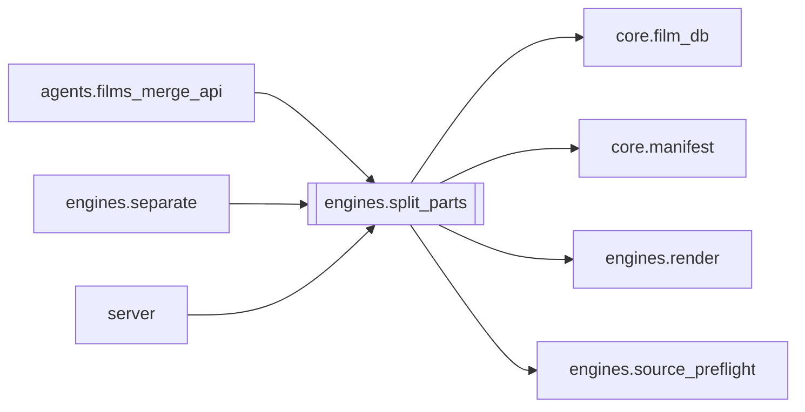

# `engines.split_parts`

[← Index](../generated/module-index.md) · [Brain home](../README.md)

<!-- AUTO:START — sinh bởi scripts/brain_build.py 2026-11-17 19:05. Đừng sửa tay khối này. -->
**File:** `engines/split_parts.py` · **Lớp:** `render` · **1105 dòng** (937 code) · **27 hàm**, **1 class** · sha1 `1c94246acb`

> split_parts.py — Tự động tính toán và chia video dài (3h-12h+) thành các Part 2-2.5h để chạy ASR/TTS/Render độc lập chống lệch time, sau đó ghép concat lại thành bản Full.

### Phụ thuộc

- **Gọi tới (import nội bộ):** [core.film_db](./core.film_db.md), [core.manifest](./core.manifest.md), [engines.render](./engines.render.md), [engines.source_preflight](./engines.source_preflight.md)
- **Được dùng bởi:** [agents.films_merge_api](./agents.films_merge_api.md), [engines.separate](./engines.separate.md), [server](./server.md)
- **Được nhắc tên file `.py` (subprocess/script) bởi:** [restart_server](./restart_server.md)
- **Test:** `tests/test_parent_rerun_after_done.py`, `tests/test_separate_demucs_chunks.py`, `tests/test_simple_junk_park.py`, `tests/test_split_enospc_guard.py`

### Hàm & class top-level

| Tên | Dòng | Dài | Tham số | Docstring |
|---|---:|---:|---|---|
| **class `DiskFullError`** | 37 | 0 method | | Ổ đầy — dừng split, không fallback re-encode. |
| `_is_disk_full_text` | 41 | 3 | `*chunks` |  |
| `free_bytes` | 46 | 7 | `path` | Dung lượng trống trên volume chứa `path` (tạo parent nếu chưa có). |
| `estimate_split_need_bytes` | 55 | 4 | `video_path` | Ước lượng chỗ cần cho split copy-mode (= gần bằng size nguồn + margin). |
| `assert_enough_space_for_split` | 61 | 8 | `video_path, out_dir` |  |
| `cleanup_split_parts_dir` | 71 | 10 | `parts_dir` | Xoá thư mục `_split_parts` dở (orphan GB sau fail / ENOSPC). |
| `_unlink_quiet` | 83 | 6 | `path` |  |
| `probe_duration` | 91 | 14 | `video_path` | Lấy thời lượng video tính bằng giây. |
| `calculate_part_plan` | 107 | 19 | `total_sec, target_hours` | Tính toán danh sách (start_sec, end_sec) cho từng part. |
| `find_best_cut_point` | 128 | 39 | `video_path, target_cut_sec, search_radius_sec` | Tìm điểm khoảng lặng (silence) gần nhất với target_cut_sec trong phạm vi ±search_radius_sec. |
| `compute_smart_plan` | 169 | 40 | `video_path, target_hours` | Tính plan hoàn chỉnh có điểm cắt thông minh (tránh đứt câu thoại). |
| `split_video_to_parts` | 211 | 135 ⚠️ | `video_path, out_dir, target_hours, prefix` | Cắt video thành các part theo smart plan (lossless copy). |
| `_hardlink_alias` | 348 | 28 | `primary, alias` | Tạo alias cùng inode với primary. Không bao giờ copy2 (tránh nhân đôi GB). |
| `_concat_run` | 391 | 27 | `valid_parts, out_full_mp4, mode` | mode=copy: concat demuxer -c copy (cũ). mode=regen: +genpts, SPS/PPS trong luồng, make_zero. |
| `_probe_vcodec` | 420 | 11 | `path` |  |
| `_decode_window` | 433 | 9 | `full_mp4, t0, dur` |  |
| `check_merge_joints` | 444 | 20 | `full_mp4, joints, window` | Giải mã thử [t-window, t+window] quanh mỗi mối nối. ok=False nếu có lỗi giải mã (DTS chỉ cảnh báo). |
| `merge_parts_checked` | 466 | 44 | `part_videos, out_full_mp4, verify, window` | Ghép + kiểm mối nối. Trả {"ok", "mode", "joints", "attempts", "message"}; ok=False → đã xoá out. |
| `merge_parts_to_full` | 512 | 9 | `part_videos, out_full_mp4` | Nối danh sách các part đã render hoàn chỉnh thành 1 file full (concat copy) + kiểm mối nối. |
| `_merge_check_summary` | 523 | 9 | `rep` |  |
| `_source_sig` | 534 | 6 | `video, dur` |  |
| `_sig_match` | 542 | 6 | `a, b` |  |
| `_part_dur_tol` | 550 | 3 | `d` |  |
| `find_reusable_parts` | 555 | 47 | `job_id, work_root, video, dur, target_hours` | agentS 2026-11-13: part đã cắt đúng kế hoạch (cùng nguồn/độ dài) → trả parts_info để DÙNG LẠI. |
| `split_job_to_subjobs` | 604 | 224 ⚠️ | `job_id, target_hours, work_root, reset_parts` | Tự động chia một job video dài thành các sub-jobs (Part 1, Part 2...). |
| `merge_job_parts` | 830 | 141 ⚠️ | `job_id, work_root, force` | Kiểm tra các sub-job của job_id, nếu tất cả đã render xong thì ghép thành output_full.mp4. |
| `merge_subjob_asr_to_parent` | 973 | 103 | `job_id, work_root` | Gộp kết quả ASR (asr.json và sub.zh.srt) của các sub-job về job cha. |
| `main` | 1078 | 24 | `` |  |

**Hàm dài ≥120 dòng:** `split_job_to_subjobs` (224, L604), `merge_job_parts` (141, L830), `split_video_to_parts` (135, L211)

**File/artifact nhắc tới:** `asr.json`, `manifest.json`, `output.merging.mp4`, `output.mp4`, `output_full.mp4`, `split_manifest.json`, `sub.zh.srt`, `tts_config.json`

**Tín hiệu rủi ro (đếm tĩnh):** broad_except=14 · file_writes=5 · subprocess=7 · swallow_except=2

### Lịch sử (từ docs/)

- **Fix logs (7):**
  - [Port V2→V5: preflight/chuẩn hoá video nguồn + extract_pcm bền + FireRed slice khoảng lặng + câu rác «None.» / ](../../fixes/2026-11-13-port-preflight-slice-junk.md)
  - [`/api/hg/poster` 502 với job_id / `downloads`](../../fixes/2026-11-09-hg-poster-502-junk-name.md)
  - [Auto-split part (Phần N/N) bị đưa vào upload](../../fixes/2026-11-08-skip-split-part-upload.md)
  - [Films UI thiếu nút gộp job đã làm (combine)](../../fixes/2026-11-07-films-combine-ui.md)
  - [V5 split hết ổ vẫn re-encode / thiếu ENOSPC guard](../../fixes/2026-11-06-v5-enospc-port.md)
  - [Merge split tạo output + output_full nhân đôi dung lượng](../../fixes/2026-11-06-merge-no-dup-output.md)
  - [Phim dài ~12h lệch khung sub — nguyên nhân + split_parts](../../fixes/2026-11-02-longfilm-sub-drift-split.md)
- **Reviews:** [_atoms_engines](../../reviews/_atoms_engines.md), [2026-11-06-v5-part-atoms](../../reviews/2026-11-06-v5-part-atoms.md), [2026-11-06-v5-func-catalog](../../reviews/2026-11-06-v5-func-catalog.md), [2026-11-06-v5-eng-swarm](../../reviews/2026-11-06-v5-eng-swarm.md)
- Nhắc trong CHANGELOG: **3** lần · DECISIONS: **0** lần

<!-- AUTO:END -->

<!-- MANUAL:START -->
## Vai trò (viết tay)

_Chưa viết. 2–4 câu: module này chịu trách nhiệm gì trong pipeline, ai gọi nó, nó KHÔNG làm gì._

## Luồng chính

_Các hàm vào (entry) → bước chính → output/side effect. Ghi tên hàm thật._

## Bất biến & hợp đồng

_Điều luôn phải đúng (vd: chỉ ghi manifest qua `Manifest.update`; 1 job / ghế). Vi phạm = bug._

## Bẫy đã biết

_Lỗi từng gặp + link `docs/fixes/...`. Những chỗ dễ sửa sai._

## Ghi chú vận hành

_Config key quan trọng, cần restart gì khi sửa (:8801 / :8802 / hot-reload), cách test._
<!-- MANUAL:END -->
