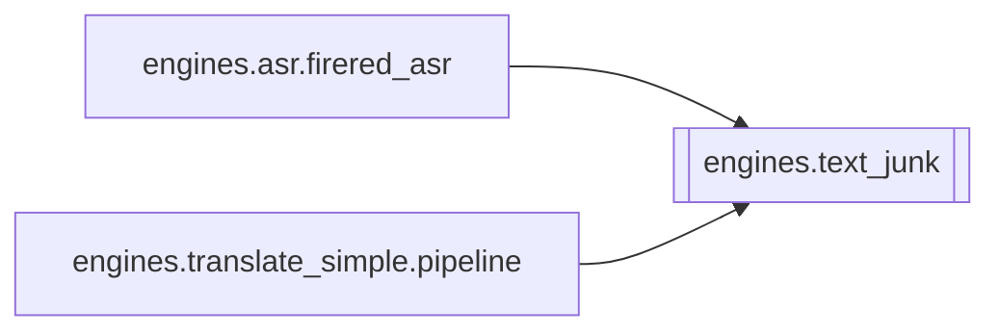

# `engines.text_junk`

[← Index](../generated/module-index.md) · [Brain home](../README.md)

<!-- AUTO:START — sinh bởi scripts/brain_build.py 2026-11-17 19:05. Đừng sửa tay khối này. -->
**File:** `engines/text_junk.py` · **Lớp:** `misc` · **26 dòng** (20 code) · **1 hàm**, **0 class** · sha1 `734532e7b1`

> Nhận diện câu ASR «rác» (fix 2026-11-13 agentM, sự cố 60892cc63cb7_p01 i=1039 zh="None."). Rác = KHÔNG có nội dung để dịch / lồng tiếng: - rỗng / chỉ khoảng trắng / chỉ dấu câu, ký hiệu (không có ký tự CJK, chữ cái hay c

### Phụ thuộc

- **Gọi tới (import nội bộ):** —
- **Được dùng bởi:** [engines.asr.firered_asr](./engines.asr.firered_asr.md), [engines.translate_simple.pipeline](./engines.translate_simple.pipeline.md)
- **Test:** `tests/test_simple_junk_park.py`

### Hàm & class top-level

| Tên | Dòng | Dài | Tham số | Docstring |
|---|---:|---:|---|---|
| `is_junk_text` | 19 | 8 | `s` | True khi s không có gì để dịch/đọc (xem docstring module). Chữ Hán/chữ/số thật → False. |

### Lịch sử (từ docs/)

- **Fix logs (1):**
  - [Port V2→V5: preflight/chuẩn hoá video nguồn + extract_pcm bền + FireRed slice khoảng lặng + câu rác «None.» / ](../../fixes/2026-11-13-port-preflight-slice-junk.md)
- Nhắc trong CHANGELOG: **1** lần · DECISIONS: **0** lần

<!-- AUTO:END -->

<!-- MANUAL:START -->
## Vai trò (viết tay)

_Chưa viết. 2–4 câu: module này chịu trách nhiệm gì trong pipeline, ai gọi nó, nó KHÔNG làm gì._

## Luồng chính

_Các hàm vào (entry) → bước chính → output/side effect. Ghi tên hàm thật._

## Bất biến & hợp đồng

_Điều luôn phải đúng (vd: chỉ ghi manifest qua `Manifest.update`; 1 job / ghế). Vi phạm = bug._

## Bẫy đã biết

_Lỗi từng gặp + link `docs/fixes/...`. Những chỗ dễ sửa sai._

## Ghi chú vận hành

_Config key quan trọng, cần restart gì khi sửa (:8801 / :8802 / hot-reload), cách test._
<!-- MANUAL:END -->
